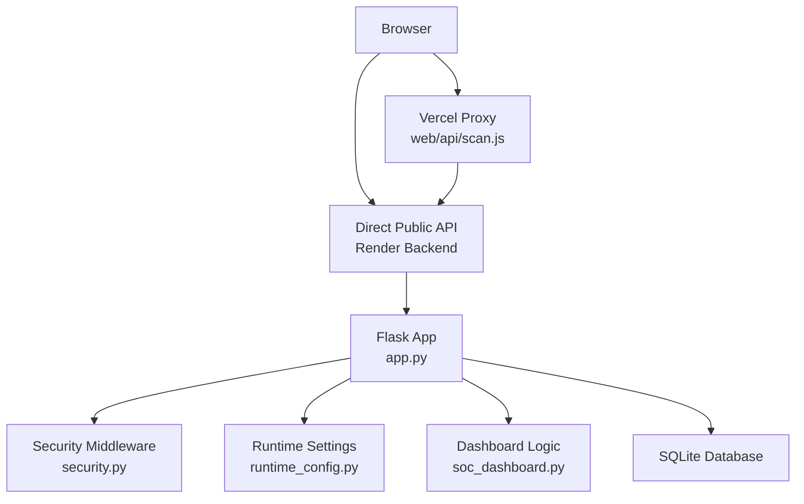
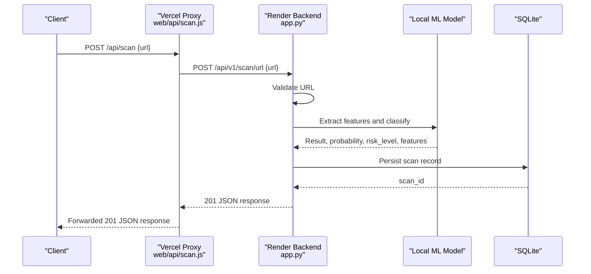
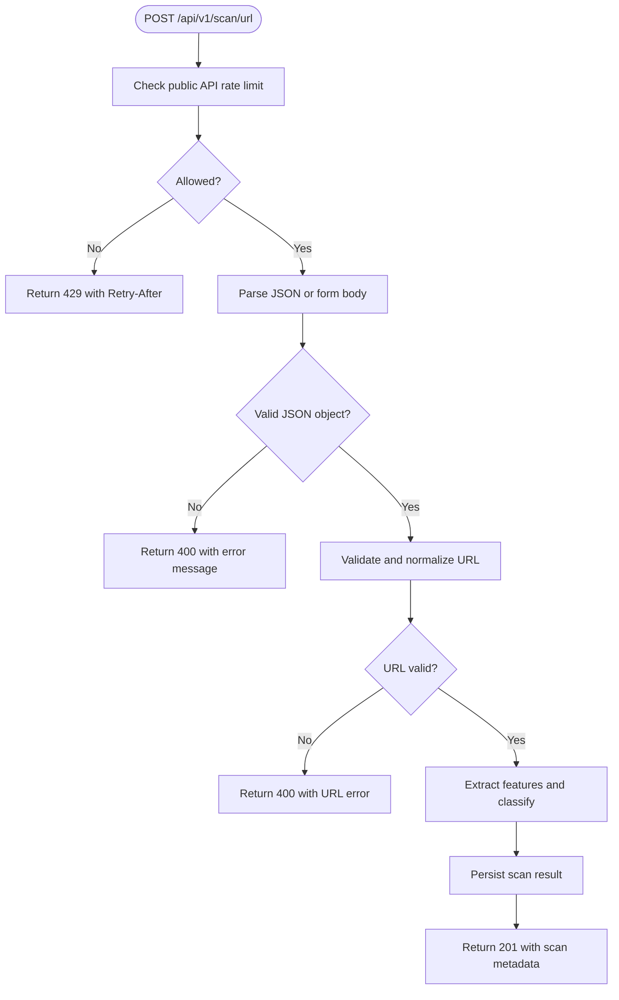
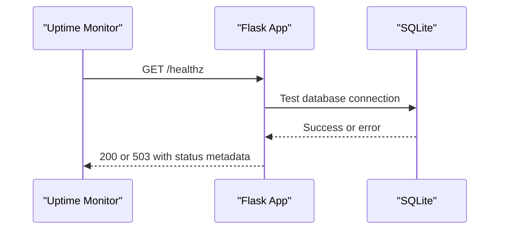
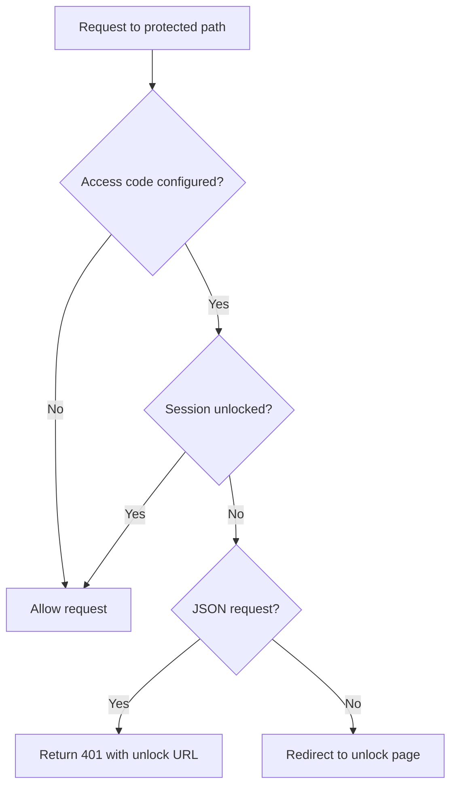
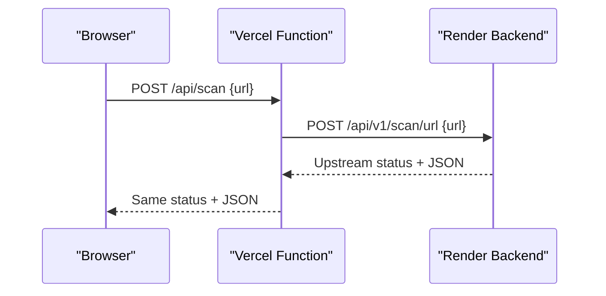
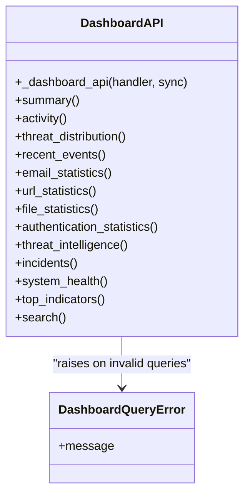
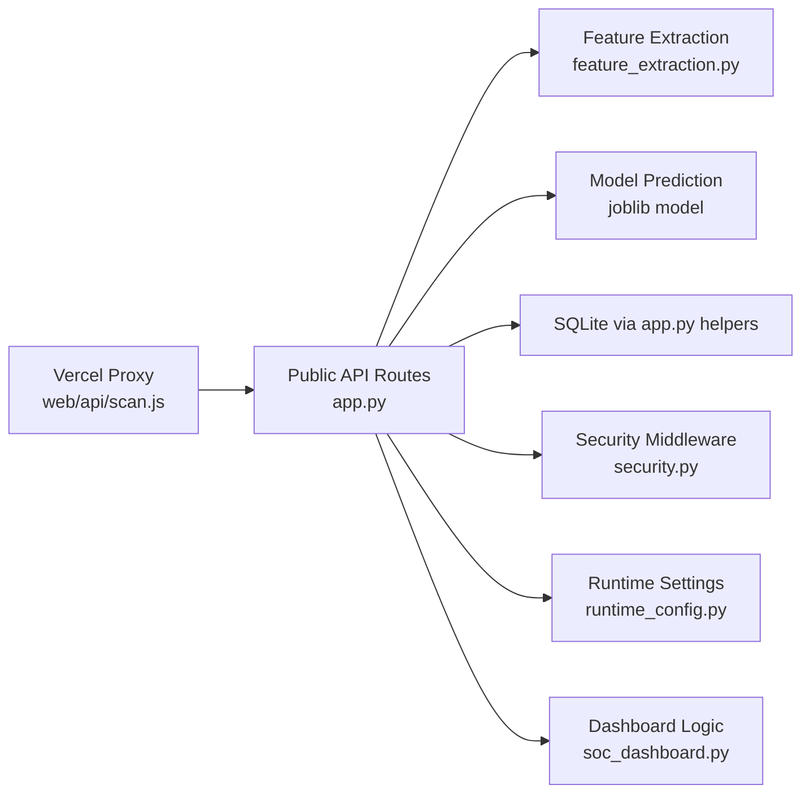
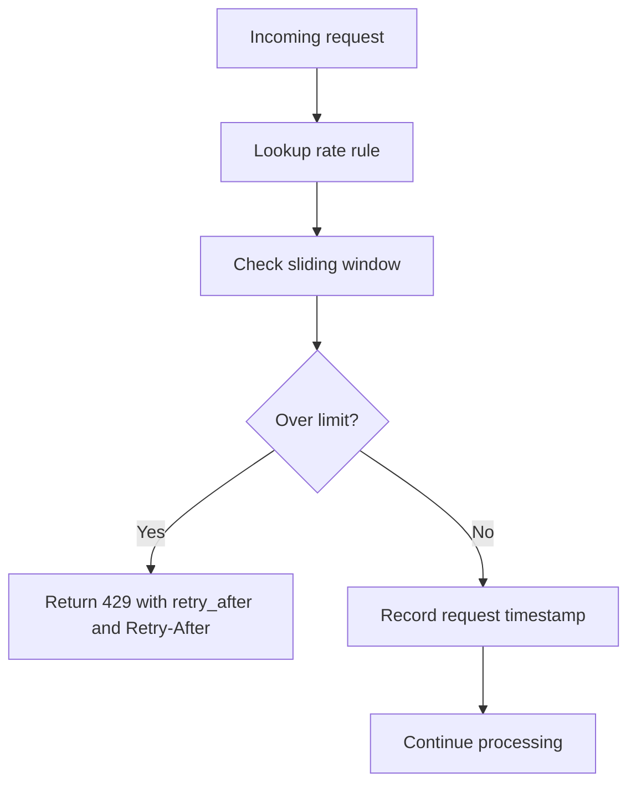

# API Reference

<cite>
**Referenced Files in This Document**   
- [app.py](file://app.py)
- [security.py](file://security.py)
- [runtime_config.py](file://runtime_config.py)
- [web/api/scan.js](file://web/api/scan.js)
- [web/api/health.js](file://web/api/health.js)
- [soc_dashboard.py](file://soc_dashboard.py)
- [README.md](file://README.md)
</cite>

## Table of Contents
1. [Introduction](#introduction)
2. [Project Structure](#project-structure)
3. [Core Components](#core-components)
4. [Architecture Overview](#architecture-overview)
5. [Detailed Component Analysis](#detailed-component-analysis)
6. [Dependency Analysis](#dependency-analysis)
7. [Performance Considerations](#performance-considerations)
8. [Troubleshooting Guide](#troubleshooting-guide)
9. [Conclusion](#conclusion)
10. [Appendices](#appendices)

## Introduction
This document describes PhishGuard’s public JSON API for URL phishing analysis, health monitoring, and the read-only dashboard data layer. It focuses on:

- Primary endpoint: `POST /api/v1/scan/url`
- Health endpoints: `GET /api/v1/health` and `GET /healthz`
- Read-only dashboard endpoints under `/api/dashboard/`
- Authentication model, CORS behavior, rate limiting, error responses, and client implementation guidance
- The Vercel proxy that forwards browser requests to the hosted Render backend

PhishGuard performs structural URL analysis using a local machine-learning model. It does not open or fetch submitted URLs, and it does not query external reputation services by default.

## Project Structure
The API is implemented as a Flask application with shared security middleware, runtime configuration, and a small Vercel frontend proxy.



**Diagram sources**
- [web/api/scan.js:1-60](file://web/api/scan.js#L1-L60)
- [app.py:470-508](file://app.py#L470-L508)
- [security.py:245-253](file://security.py#L245-L253)
- [runtime_config.py:140-188](file://runtime_config.py#L140-L188)
- [soc_dashboard.py:1-57](file://soc_dashboard.py#L1-L57)

**Section sources**
- [README.md:58-67](file://README.md#L58-L67)
- [app.py:74-96](file://app.py#L74-L96)

## Core Components
- **Public URL scan API**: Accepts a JSON body containing a URL, validates it, runs feature extraction and classification, persists the result, and returns structured metadata.
- **Health endpoints**: Provide lightweight service status and capability information.
- **CORS and security middleware**: Adds response headers, optional access gating, and per-route rate limiting.
- **Vercel proxy**: A server-side proxy that hides the backend hostname from the browser and avoids CORS issues in the hosted demo.
- **Dashboard API**: Read-only endpoints exposing summary, activity, events, statistics, incidents, intelligence, indicators, search, and system health.

**Section sources**
- [app.py:470-508](file://app.py#L470-L508)
- [app.py:511-554](file://app.py#L511-L554)
- [security.py:58-100](file://security.py#L58-L100)
- [security.py:201-242](file://security.py#L201-L242)
- [web/api/scan.js:1-60](file://web/api/scan.js#L1-L60)

## Architecture Overview
The recommended production flow uses a Vercel-hosted static front end that proxies only the URL scan request to the Render-hosted Flask backend. This keeps the backend URL out of browser code and avoids cross-origin restrictions.



**Diagram sources**
- [web/api/scan.js:17-48](file://web/api/scan.js#L17-L48)
- [app.py:470-508](file://app.py#L470-L508)
- [app.py:295-337](file://app.py#L295-L337)
- [app.py:340-353](file://app.py#L340-L353)

## Detailed Component Analysis

### Public URL Scan Endpoint
**Endpoint:** `POST /api/v1/scan/url`  
**Purpose:** Submit a URL for phishing classification and receive a structured result.

#### Request
- **Method:** `POST`
- **Content-Type:** `application/json`
- **Body schema:**
  - `url` (string, required): HTTP or HTTPS URL without spaces. Maximum length is defined by the server.

#### Response
- **Success:** `201 Created`
- **Response fields:**
  - `scan_id` (integer): Database-assigned identifier for the saved scan.
  - `scanned_at` (string): Server timestamp when the scan was recorded.
  - `engine` (string): Detection engine name.
  - `disclaimer` (string): Explanation that this is structural model output only.
  - `url` (string): Normalized input URL.
  - `result` (string): Classification result.
  - `risk_level` (string): Risk category.
  - `probability` (number): Phishing probability percentage.
  - `features` (object): Structural features used by the classifier.

#### Example curl request
```bash
curl -X POST https://your-render-hostname/api/v1/scan/url \
  -H "Content-Type: application/json" \
  -d '{"url": "https://example.com"}'
```

#### Expected example response
```json
{
  "scan_id": 1,
  "scanned_at": "2025-01-01 12:00:00",
  "engine": "phishguard-url-random-forest",
  "disclaimer": "Structural model output only. The URL was never opened and no reputation service was queried.",
  "url": "https://example.com",
  "result": "LEGITIMATE",
  "risk_level": "Low",
  "probability": 3.45,
  "features": {}
}
```

#### Error handling
| Status | Meaning | Typical cause |
|--------|---------|---------------|
| `201` | Success | Valid URL scanned and persisted. |
| `400` | Bad request | Missing or invalid JSON body, missing `url`, malformed URL, or URL validation failure. |
| `429` | Too many requests | Rate limit exceeded; includes `Retry-After`. |
| `500` | Internal server error | Unexpected server-side failure. |

#### Validation rules
- The URL must be non-empty.
- The URL must not contain spaces.
- The URL must use `http://` or `https://`.
- The URL must have a hostname.
- The URL length is capped by the server configuration.



**Diagram sources**
- [app.py:470-508](file://app.py#L470-L508)
- [app.py:295-337](file://app.py#L295-L337)
- [app.py:340-353](file://app.py#L340-L353)

**Section sources**
- [app.py:470-508](file://app.py#L470-L508)
- [app.py:295-337](file://app.py#L295-L337)
- [app.py:340-353](file://app.py#L340-L353)

### Health Endpoints

#### GET /api/v1/health
Returns service capabilities, limits, and environment metadata.

- **Status codes:** `200`
- **Response fields:**
  - `status`: Service status string.
  - `service`: Service name.
  - `environment`: Deployment environment.
  - `capabilities`: Available API capabilities, including the URL scan endpoint and feature names.
  - `limits`: Upload size limits, maximum URL length, and public API rate limit window.
  - `history_gate`: Whether saved history requires an access code.

#### GET /healthz
Used by uptime monitors and deployment platforms.

- **Status codes:**
  - `200` when database and model are healthy.
  - `503` when the service is degraded.
- **Response fields:**
  - `status`: `ok` or `degraded`.
  - `environment`: Deployment environment.
  - `database`: Database connectivity state.
  - `model`: Model availability state.
  - `uptime_seconds`: Process uptime.



**Diagram sources**
- [app.py:511-531](file://app.py#L511-L531)

**Section sources**
- [app.py:511-554](file://app.py#L511-L554)

### Authentication and Access Control
- The public URL scan API does not require authentication tokens.
- Protected dashboard and history routes may require an access code depending on deployment configuration.
- When protected routes are accessed without authorization, JSON responses return `401` with an unlock URL.



**Diagram sources**
- [security.py:178-198](file://security.py#L178-L198)

**Section sources**
- [security.py:114-198](file://security.py#L114-L198)

### CORS Configuration
CORS is applied automatically to requests under `/api/v1`.

- **Configuration variable:** `PHISHGUARD_ALLOWED_ORIGINS`
- **Behavior:**
  - If the list contains `*`, the response allows any origin.
  - Otherwise, only origins explicitly listed in the configuration are allowed.
  - Preflight `OPTIONS` requests for `/api/v1` return `204`.
  - Responses include `Access-Control-Allow-Origin`, `Access-Control-Allow-Methods`, `Access-Control-Allow-Headers`, `Access-Control-Max-Age`, and `Vary: Origin`.

**Section sources**
- [security.py:201-242](file://security.py#L201-L242)
- [runtime_config.py:59-66](file://runtime_config.py#L59-L66)
- [runtime_config.py:180](file://runtime_config.py#L180)

### Vercel Frontend Proxy
The Vercel proxy exists so the browser only talks to the same origin. It forwards the URL scan request to the Render backend and forwards the upstream status and body back to the client.

- **Proxy endpoint:** `POST /api/scan`
- **Required environment variable:** `PHISHGUARD_APP_URL`
- **Timeout:** 8 seconds
- **Error mapping:**
  - Timeout: `504`
  - Upstream unreachable: `502`
  - Missing backend URL: `503`
  - Invalid method: `405`
  - Missing URL field: `400`



**Diagram sources**
- [web/api/scan.js:1-60](file://web/api/scan.js#L1-L60)

**Section sources**
- [web/api/scan.js:1-60](file://web/api/scan.js#L1-L60)
- [web/api/health.js:1-38](file://web/api/health.js#L1-L38)
- [README.md:58-67](file://README.md#L58-L67)

### Read-Only Dashboard API
All dashboard endpoints are read-only and share common behavior:

- **Authentication:** May be protected by an access code depending on deployment configuration.
- **Rate limiting:** Separate dashboard rate rule applies.
- **Date range:** Many endpoints accept a `range` query parameter.
- **Errors:**
  - `400` for invalid date ranges or query parameters.
  - `503` for database read failures.
  - `404` for missing incident records where applicable.

#### Common Query Parameters
| Parameter | Type | Default | Description |
|-----------|------|---------|-------------|
| `range` | string | Server-defined default | Date range selector such as short-term, hourly, daily, weekly, monthly, or all-time. |
| `page` | integer | `1` | Page number for paginated endpoints. |
| `page_size` | integer | Endpoint-specific default | Number of items per page. |
| `q` | string | Empty | Free-text search filter. |
| `bucket` | string | `1h` | Activity aggregation bucket. |
| `severity` | string | `all` | Filter recent events by severity. |
| `event_type` | string | `all` | Filter recent events by event type. |
| `source` | string | `all` | Filter recent events by source type. |
| `sort` | string | `desc` | Sort order for recent events. |
| `status` | string | `all` | Filter security incidents by status. |

#### Endpoint Summary

| Endpoint | Method | Purpose | Key Query Parameters | Notes |
|----------|--------|---------|----------------------|-------|
| `/api/dashboard/summary` | GET | High-level KPIs and overview | `range` | Syncs incidents before returning. |
| `/api/dashboard/activity` | GET | Time-based activity counts | `range`, `bucket` | Validates bucket values. |
| `/api/dashboard/threat-distribution` | GET | Threat distribution breakdown | `range` | Read-only. |
| `/api/dashboard/recent-events` | GET | Paginated recent events | `range`, `q`, `severity`, `event_type`, `source`, `page`, `page_size`, `sort` | Syncs incidents before returning. |
| `/api/dashboard/recent-events.csv` | GET | Export recent events as CSV | `range`, `q`, `severity`, `event_type`, `source`, `sort` | Returns CSV with headers and export metadata. |
| `/api/dashboard/email-statistics` | GET | Email analysis statistics | `range`, `page`, `page_size`, `q` | Read-only. |
| `/api/dashboard/url-statistics` | GET | URL analysis statistics | `range`, `page`, `page_size` | Read-only. |
| `/api/dashboard/file-statistics` | GET | File analysis statistics | `range`, `page`, `page_size` | Read-only. |
| `/api/dashboard/authentication-statistics` | GET | Authentication-related statistics | `range` | Read-only. |
| `/api/dashboard/threat-intelligence` | GET | Scanner provider intelligence | `range` | Uses scanner configuration. |
| `/api/dashboard/incidents` | GET | Security incidents list | `range`, `status`, `page`, `page_size` | Syncs incidents before returning. |
| `/api/dashboard/incidents/<incident_id>` | PATCH | Update incident status or analyst | Body: `status`, `assigned_analyst` | Requires CSRF token; validates status values. |
| `/api/dashboard/system-health` | GET | System and integration health | `range` | Reports services, last scan, failed/pending scans, uptime. |
| `/api/dashboard/top-indicators` | GET | Top threat indicators | `range` | Read-only. |
| `/api/dashboard/search` | GET | Search across scan data | `range`, `q`, `limit` | Syncs incidents before returning. |



**Diagram sources**
- [app.py:935-953](file://app.py#L935-L953)
- [app.py:956-1252](file://app.py#L956-L1252)
- [soc_dashboard.py:9-10](file://soc_dashboard.py#L9-L10)

**Section sources**
- [app.py:935-1252](file://app.py#L935-L1252)
- [soc_dashboard.py:1-57](file://soc_dashboard.py#L1-L57)

## Dependency Analysis
The public API depends on several internal modules and shared infrastructure.



**Diagram sources**
- [app.py:22-23](file://app.py#L22-L23)
- [app.py:1322](file://app.py#L1322)
- [security.py:245-253](file://security.py#L245-L253)
- [runtime_config.py:140-188](file://runtime_config.py#L140-L188)
- [web/api/scan.js:34-48](file://web/api/scan.js#L34-L48)

**Section sources**
- [app.py:22-65](file://app.py#L22-L65)
- [app.py:1322](file://app.py#L1322)
- [security.py:245-253](file://security.py#L245-L253)
- [runtime_config.py:140-188](file://runtime_config.py#L140-L188)
- [web/api/scan.js:34-48](file://web/api/scan.js#L34-L48)

## Performance Considerations
- The URL scan endpoint performs synchronous feature extraction and model prediction.
- File scanning uses a thread pool executor to avoid blocking the main request loop.
- Dashboard endpoints can perform database queries and incident synchronization; some endpoints force synchronization before returning results.
- Rate limiting is in-process and suitable for single-instance deployments. Multi-instance deployments should place a distributed limiter or CDN-level rate limiter in front of the backend.

[No sources needed since this section provides general guidance]

## Troubleshooting Guide

### Common HTTP Status Codes
| Code | Meaning | Guidance |
|------|---------|----------|
| `201` | URL scan created successfully | Use `scan_id` and `scanned_at` for auditability. |
| `400` | Bad request | Check JSON structure, required `url` field, and URL format. |
| `404` | Not found | Some dashboard endpoints return this for missing incident IDs. |
| `405` | Method not allowed | Vercel proxy rejects non-POST requests to its proxy endpoint. |
| `413` | Payload too large | Exceeds upload or email request limits. |
| `429` | Too many requests | Respect `Retry-After`; implement exponential backoff. |
| `500` | Internal server error | Retry after a delay; check server logs. |
| `502` | Bad gateway | Vercel proxy could not reach the backend. |
| `503` | Service unavailable | Backend temporarily unavailable or database/model unhealthy. |
| `504` | Gateway timeout | Vercel proxy timed out waiting for the backend. |

### Rate Limiting Behavior
- Public API rate limit: 60 requests per 5 minutes by default.
- Rate limiting uses a sliding window keyed by client address and rule scope.
- When limited, responses include:
  - `error`: Human-readable message.
  - `retry_after`: Seconds until the client should retry.
  - `Retry-After` header.



**Diagram sources**
- [security.py:58-100](file://security.py#L58-L100)
- [security.py:256-262](file://security.py#L256-L262)
- [app.py:98-105](file://app.py#L98-L105)

**Section sources**
- [security.py:58-100](file://security.py#L58-L100)
- [security.py:256-262](file://security.py#L256-L262)
- [app.py:98-105](file://app.py#L98-L105)
- [app.py:267-288](file://app.py#L267-L288)

### Client Implementation Guidelines
- Prefer using the Vercel proxy endpoint when integrating with the hosted demo.
- Send `Content-Type: application/json` and a JSON body with a `url` field.
- Handle `201` success responses and extract `scan_id`, `scanned_at`, `engine`, `disclaimer`, `url`, `result`, `risk_level`, `probability`, and `features`.
- Implement retries for `429` using the `Retry-After` header.
- Implement timeouts for proxy calls; the Vercel proxy uses an 8-second timeout.
- For dashboard endpoints, handle pagination, date ranges, and possible access-code protection.
- Do not assume authentication is required for the public URL scan endpoint unless your deployment adds additional gateware.

**Section sources**
- [web/api/scan.js:17-58](file://web/api/scan.js#L17-L58)
- [app.py:470-508](file://app.py#L470-L508)
- [security.py:178-198](file://security.py#L178-L198)

## Conclusion
PhishGuard’s public API provides a simple, structured interface for URL phishing classification. The primary endpoint returns deterministic metadata about each scan, while health endpoints support operational monitoring. The Vercel proxy simplifies browser integration, and the dashboard API exposes rich read-only analytics. Clients should validate inputs, respect rate limits, handle documented error codes, and follow the security and CORS configuration described here.

[No sources needed since this section summarizes without analyzing specific files]

## Appendices

### Complete Request and Response Examples

#### Successful URL Scan
```bash
curl -X POST https://your-render-hostname/api/v1/scan/url \
  -H "Content-Type: application/json" \
  -d '{"url": "https://example.com"}'
```

Expected response:
```json
{
  "scan_id": 1,
  "scanned_at": "2025-01-01 12:00:00",
  "engine": "phishguard-url-random-forest",
  "disclaimer": "Structural model output only. The URL was never opened and no reputation service was queried.",
  "url": "https://example.com",
  "result": "LEGITIMATE",
  "risk_level": "Low",
  "probability": 3.45,
  "features": {}
}
```

#### Validation Error
```bash
curl -X POST https://your-render-hostname/api/v1/scan/url \
  -H "Content-Type: application/json" \
  -d '{}'
```

Expected response:
```json
{
  "error": "Send a JSON body such as {\"url\": \"https://example.com\"}."
}
```

#### Rate Limited
```bash
curl -X POST https://your-render-hostname/api/v1/scan/url \
  -H "Content-Type: application/json" \
  -d '{"url": "https://example.com"}'
```

Expected response:
```json
{
  "error": "Too many API scans from this address. Wait a moment and try again.",
  "retry_after": 120
}
```

Headers:
```
Retry-After: 120
```

**Section sources**
- [app.py:470-508](file://app.py#L470-L508)
- [security.py:256-262](file://security.py#L256-L262)