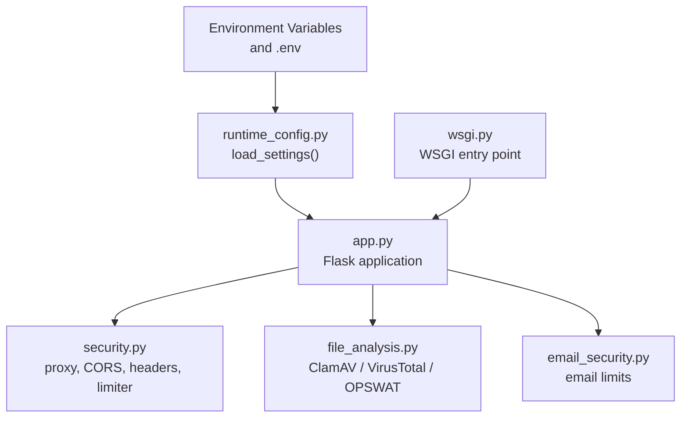
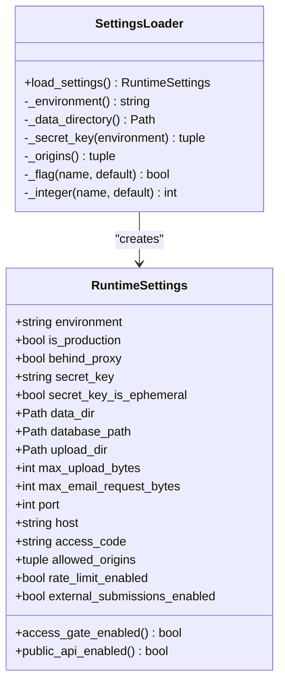
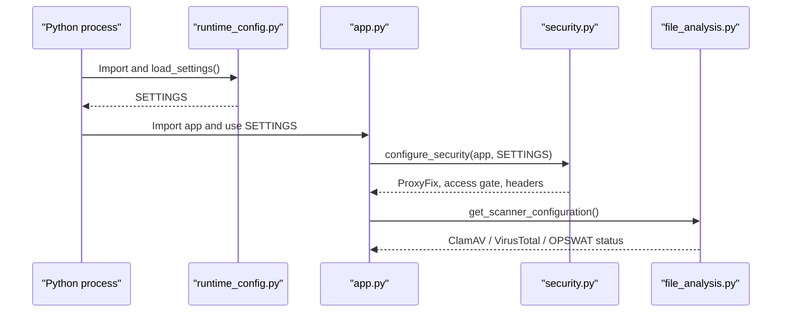
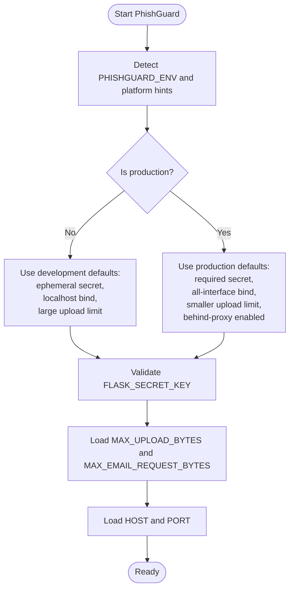
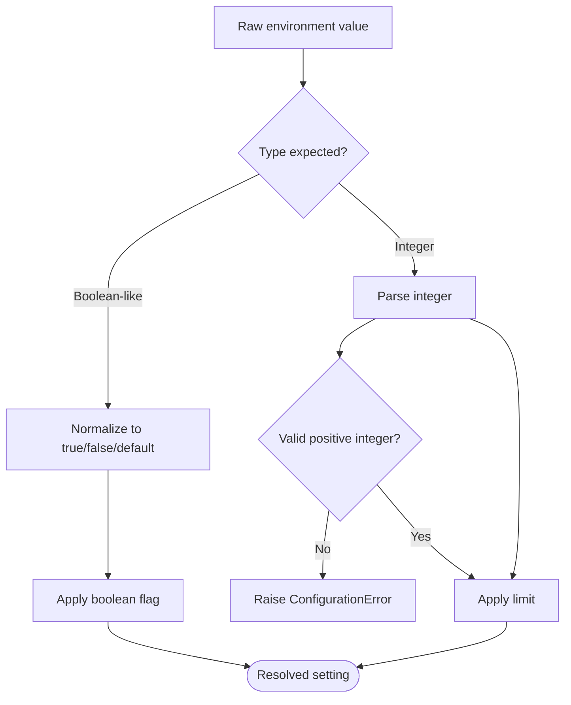
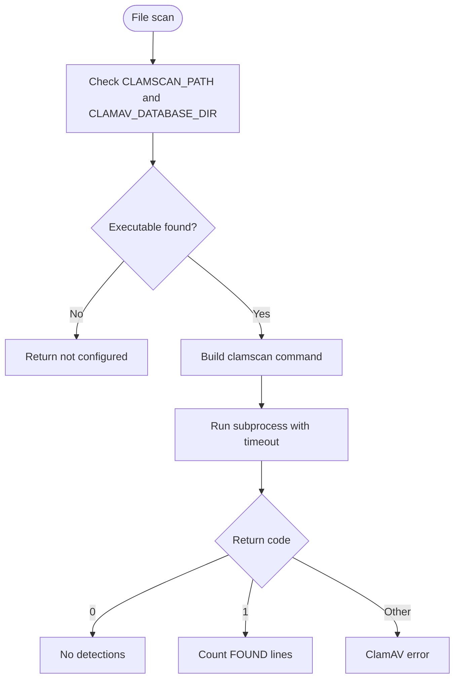
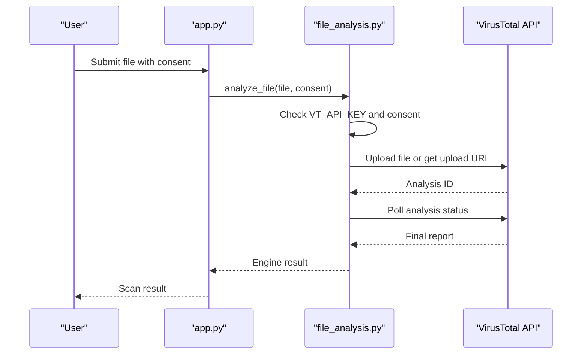
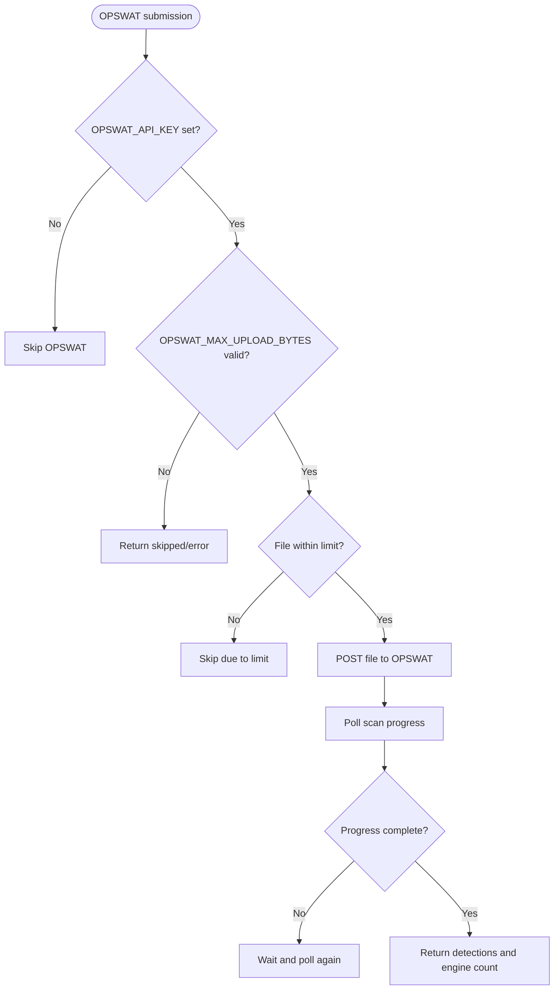
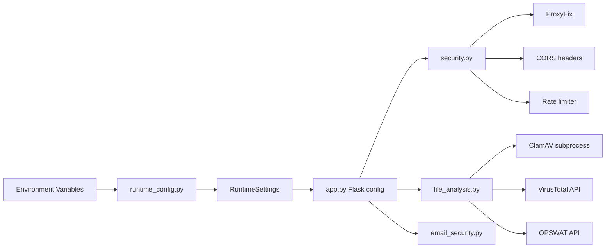

# Configuration

<cite>
**Referenced Files in This Document**
- [runtime_config.py](file://runtime_config.py)
- [app.py](file://app.py)
- [security.py](file://security.py)
- [wsgi.py](file://wsgi.py)
- [file_analysis.py](file://file_analysis.py)
- [email_security.py](file://email_security.py)
- [README.md](file://README.md)
</cite>

## Table of Contents
1. [Introduction](#introduction)
2. [Project Structure](#project-structure)
3. [Core Components](#core-components)
4. [Architecture Overview](#architecture-overview)
5. [Detailed Component Analysis](#detailed-component-analysis)
6. [Dependency Analysis](#dependency-analysis)
7. [Performance Considerations](#performance-considerations)
8. [Troubleshooting Guide](#troubleshooting-guide)
9. [Conclusion](#conclusion)
10. [Appendices](#appendices)

## Introduction
This document explains how PhishGuard reads its runtime configuration from environment variables and a local `.env` file. It covers every core setting requested, including development versus production defaults, security implications, validation rules, optional integrations for ClamAV, VirusTotal, and OPSWAT MetaDefender, practical `.env` examples, Windows path escaping, and common troubleshooting steps.

PhishGuard loads environment variables once at startup through `runtime_config.py`. The resolved settings are then exposed to Flask routes, security middleware, and scanner modules.

## Project Structure
The configuration surface is concentrated in one module:

| File | Responsibility |
|---|---|
| `runtime_config.py` | Loads `.env`, resolves environment-driven settings, validates values, and exposes `SETTINGS`. |
| `app.py` | Reads `SETTINGS`, configures Flask, applies upload/email limits, and wires rate limiting and access controls. |
| `security.py` | Applies proxy trust, CORS, response headers, shared passcode gate, and per-endpoint rate limiting. |
| `wsgi.py` | Stable WSGI target for production servers; does not change configuration behavior. |
| `file_analysis.py` | Reads ClamAV, VirusTotal, and OPSWAT integration variables and reports scanner readiness. |
| `email_security.py` | Defines email-specific size/character limits used by the email analysis flow. |
| `README.md` | Provides user-facing configuration defaults and deployment guidance. |

**Diagram sources**
- [runtime_config.py:140-188](file://runtime_config.py#L140-L188)
- [app.py:68-96](file://app.py#L68-L96)
- [security.py:245-253](file://security.py#L245-L253)
- [file_analysis.py:44-99](file://file_analysis.py#L44-L99)
- [email_security.py:16-18](file://email_security.py#L16-L18)
- [wsgi.py:1-12](file://wsgi.py#L1-L12)

**Section sources**
- [runtime_config.py:1-21](file://runtime_config.py#L1-L21)
- [app.py:68-96](file://app.py#L68-L96)
- [security.py:1-12](file://security.py#L1-L12)
- [wsgi.py:1-12](file://wsgi.py#L1-L12)

## Core Components
PhishGuard’s runtime configuration is represented by an immutable snapshot called `RuntimeSettings`. It contains the environment, secret key, data directory, database path, upload directory, upload limits, host/port, access code, allowed origins, rate-limiting state, and external-submission state.

Key behaviors:
- A local `.env` file in the project root is loaded automatically.
- Boolean-like flags accept truthy/falsy strings such as `1`, `true`, `yes`, `on`, `0`, `false`, `no`, `off`, or empty.
- Integer settings are validated and raise a startup error when invalid.
- Production detection changes defaults for secret keys, bind address, behind-proxy trust, and upload ceilings.

**Diagram sources**
- [runtime_config.py:33-35](file://runtime_config.py#L33-L35)
- [runtime_config.py:37-66](file://runtime_config.py#L37-L66)
- [runtime_config.py:69-107](file://runtime_config.py#L69-L107)
- [runtime_config.py:110-138](file://runtime_config.py#L110-L138)
- [runtime_config.py:140-188](file://runtime_config.py#L140-L188)

**Section sources**
- [runtime_config.py:1-35](file://runtime_config.py#L1-L35)
- [runtime_config.py:110-188](file://runtime_config.py#L110-L188)

## Architecture Overview
The configuration lifecycle is intentionally simple:

1. `runtime_config.py` loads `.env`.
2. `load_settings()` determines the environment, secret key, data directory, limits, host/port, and feature flags.
3. `app.py` imports `SETTINGS` and configures Flask with those values.
4. `security.py` attaches proxy handling, CORS, security headers, and the access-code gate.
5. Scanner modules read their own optional integration variables.

**Diagram sources**
- [runtime_config.py:140-188](file://runtime_config.py#L140-L188)
- [app.py:68-96](file://app.py#L68-L96)
- [security.py:245-253](file://security.py#L245-L253)
- [file_analysis.py:44-99](file://file_analysis.py#L44-L99)

## Detailed Component Analysis

### Environment Variables Reference

| Variable | Type | Default (development) | Default (production) | Validation Rules | Security Implications |
|---|---|---|---|---|---|
| `FLASK_SECRET_KEY` | String | Ephemeral random token generated at startup | **Required**; must be at least 16 characters | Must be present and ≥ 16 characters outside development environments | Controls session signing and CSRF protection. Without a stable key, sessions break across workers/dynos. |
| `PHISHGUARD_ENV` | String | `development` unless platform hints indicate otherwise | `production` if `RENDER`, `RENDER_EXTERNAL_HOSTNAME`, or `VERCEL` is set; also influenced by `FLASK_DEBUG=1` | Lowercased; any non-empty value overrides auto-detection | Selects safe defaults and enables secure cookies in production. |
| `HOST` | String | `127.0.0.1` | `0.0.0.0` | No explicit numeric validation here; used directly as bind address | Binding to `0.0.0.0` exposes the process to all interfaces. Use a reverse proxy and firewall. |
| `PORT` | Integer | `5000` | `5000` unless overridden by platform variables | Must be between 1 and 65535 | Choosing a privileged port may require elevated permissions. |
| `PHISHGUARD_DATA_DIR` | Path | Project directory | Project directory (resolved via code logic) | Expanded using user home resolution; no absolute-path-only enforcement | Holds SQLite database and uploads. Point it at a persistent, permission-controlled volume. |
| `MAX_UPLOAD_BYTES` | Integer | `5 GiB` | `100 MiB` | Must be positive | Limits uploaded file processing. Too large increases memory/disk risk. |
| `MAX_EMAIL_REQUEST_BYTES` | Integer | `64 MiB` | `64 MiB` | Must be positive | Limits pasted-email request size. |
| `PHISHGUARD_ACCESS_CODE` | String | Empty | Empty | Trimmed; presence enables the history/dashboard gate | Protects sensitive dashboard/history endpoints with a shared passcode. |
| `PHISHGUARD_ALLOWED_ORIGINS` | Comma-separated list | `*` | `*` | Trims whitespace and trailing slashes; deduplicates | Controls CORS for `/api/v1`. Avoid `*` in production; restrict to trusted front-end domains. |
| `PHISHGUARD_RATE_LIMIT` | Flag | Enabled (`1`) | Enabled (`1`) | Truthy/falsy flag | Enables in-process rate limiting. Disabling it is discouraged on hosted deployments. |
| `PHISHGUARD_EXTERNAL_SUBMISSIONS` | Flag | Enabled (`1`) | Enabled (`1`) | Truthy/falsy flag | Allows consented submissions to VirusTotal and OPSWAT. Disable to prevent external sharing. |
| `PHISHGUARD_BEHIND_PROXY` | Flag | Auto-detected based on production state | Enabled (`1`) | Truthy/falsy flag | Trusts `X-Forwarded-*` headers. Only enable when a trusted reverse proxy is in front. |

**Section sources**
- [runtime_config.py:23-30](file://runtime_config.py#L23-L30)
- [runtime_config.py:37-66](file://runtime_config.py#L37-L66)
- [runtime_config.py:69-107](file://runtime_config.py#L69-L107)
- [runtime_config.py:140-188](file://runtime_config.py#L140-L188)
- [README.md:98-118](file://README.md#L98-L118)

### Development vs Production Defaults

| Aspect | Development | Production |
|---|---|---|
| Environment detection | `development`, `dev`, `local`, `test`, `testing` | Anything else, including Render/Vercel hints |
| Secret key | Generated randomly at startup | Required and validated |
| Bind address | `127.0.0.1` | `0.0.0.0` |
| Upload ceiling | `5 GiB` | `100 MiB` |
| Behind-proxy trust | Disabled unless production | Enabled by default |
| Session cookie security | Not forced secure | Secure cookies enabled |

**Diagram sources**
- [runtime_config.py:23-30](file://runtime_config.py#L23-L30)
- [runtime_config.py:69-107](file://runtime_config.py#L69-L107)
- [runtime_config.py:140-188](file://runtime_config.py#L140-L188)

**Section sources**
- [runtime_config.py:23-30](file://runtime_config.py#L23-L30)
- [runtime_config.py:69-107](file://runtime_config.py#L69-L107)
- [runtime_config.py:140-188](file://runtime_config.py#L140-L188)

### Validation Rules

| Setting | Validation Behavior |
|---|---|
| Boolean-like flags | Accept truthy values (`1`, `true`, `yes`, `on`) or falsy values (`0`, `false`, `no`, `off`, empty). Unknown values fall back to the default. |
| Integers | Parsed strictly; invalid values raise `ConfigurationError`. |
| `FLASK_SECRET_KEY` | Must be ≥ 16 characters outside development. Missing or too short raises `ConfigurationError`. |
| `MAX_UPLOAD_BYTES` | Must be positive. |
| `MAX_EMAIL_REQUEST_BYTES` | Must be positive. |
| `PORT` | Must be between 1 and 65535. |
| `PHISHGUARD_ALLOWED_ORIGINS` | Split by comma, trimmed, trailing slash removed, duplicates removed. If empty, defaults to `("*",)` for public API CORS. |
| `PHISHGUARD_DATA_DIR` | Expanded with user-home resolution; no explicit existence check at load time. |

**Diagram sources**
- [runtime_config.py:37-57](file://runtime_config.py#L37-L57)
- [runtime_config.py:59-66](file://runtime_config.py#L59-L66)
- [runtime_config.py:89-107](file://runtime_config.py#L89-L107)
- [runtime_config.py:140-188](file://runtime_config.py#L140-L188)

**Section sources**
- [runtime_config.py:33-57](file://runtime_config.py#L33-L57)
- [runtime_config.py:59-66](file://runtime_config.py#L59-L66)
- [runtime_config.py:89-107](file://runtime_config.py#L89-L107)
- [runtime_config.py:140-188](file://runtime_config.py#L140-L188)

### Optional Integrations

#### ClamAV

| Variable | Purpose | Behavior |
|---|---|---|
| `CLAMSCAN_PATH` | Override the ClamAV executable location | If unset, the resolver tries `clamscan` on PATH. |
| `CLAMAV_DATABASE_DIR` | Point to the ClamAV signature database directory | If unset but executable exists, the resolver guesses a sibling `database` directory. |

Scanner readiness requires both an executable and signature files matching `*.cvd` or `*.cld`. When configured, scans invoke the external `clamscan` process with a timeout.

**Diagram sources**
- [file_analysis.py:44-99](file://file_analysis.py#L44-L99)
- [file_analysis.py:146-203](file://file_analysis.py#L146-L203)

**Section sources**
- [file_analysis.py:44-99](file://file_analysis.py#L44-L99)
- [file_analysis.py:146-203](file://file_analysis.py#L146-L203)

#### VirusTotal

| Variable | Purpose | Behavior |
|---|---|---|
| `VT_API_KEY` | Enable VirusTotal file submission | Required header for VirusTotal API calls. |

VirusTotal submission is consent-gated. External submissions are only sent when the user explicitly consents and `PHISHGUARD_EXTERNAL_SUBMISSIONS` is enabled. The module enforces VirusTotal’s internal upload limits and polls results asynchronously.

**Diagram sources**
- [file_analysis.py:347-402](file://file_analysis.py#L347-L402)
- [file_analysis.py:547-580](file://file_analysis.py#L547-L580)
- [app.py:374-400](file://app.py#L374-L400)

**Section sources**
- [file_analysis.py:347-402](file://file_analysis.py#L347-L402)
- [file_analysis.py:547-580](file://file_analysis.py#L547-L580)

#### OPSWAT MetaDefender

| Variable | Purpose | Behavior |
|---|---|---|
| `OPSWAT_API_KEY` | Enable OPSWAT MetaDefender file submission | Required header for OPSWAT API calls. |
| `OPSWAT_MAX_UPLOAD_BYTES` | Account-level upload limit for OPSWAT | Must be a positive integer byte count. |

OPSWAT submission is also consent-gated. The module checks the configured account limit before uploading and polls the scan result until completion or timeout.

**Diagram sources**
- [file_analysis.py:405-461](file://file_analysis.py#L405-L461)
- [file_analysis.py:464-544](file://file_analysis.py#L464-L544)

**Section sources**
- [file_analysis.py:405-461](file://file_analysis.py#L405-L461)
- [file_analysis.py:464-544](file://file_analysis.py#L464-L544)

### Practical `.env` Examples

#### Minimal Local Development
A minimal local `.env` can leave most values unset so defaults apply. For example:

- Leave `FLASK_SECRET_KEY` unset locally; PhishGuard generates an ephemeral key.
- Keep `PHISHGUARD_ENV` unset or set to `development`.
- Set `PORT` only if you need a different local port.
- Do not set `PHISHGUARD_BEHIND_PROXY` unless you are running behind a local proxy.

#### Production-Style Local Testing
For testing production behavior locally without deploying:

- Set `PHISHGUARD_ENV=production`.
- Generate a stable `FLASK_SECRET_KEY` with at least 16 characters.
- Set `HOST=0.0.0.0` only if you intend to expose the process directly.
- Reduce `MAX_UPLOAD_BYTES` to a realistic value.
- Set `PHISHGUARD_ALLOWED_ORIGINS` to your frontend domain instead of `*`.
- Keep `PHISHGUARD_RATE_LIMIT` enabled.
- Disable `PHISHGUARD_EXTERNAL_SUBMISSIONS` unless you want cloud scanner submissions.

#### Full Optional Integrations
When enabling ClamAV, VirusTotal, and OPSWAT:

- Set `CLAMSCAN_PATH` to the installed `clamscan` executable.
- Set `CLAMAV_DATABASE_DIR` to the directory containing `.cvd` or `.cld` files.
- Set `VT_API_KEY` to your VirusTotal API key.
- Set `OPSWAT_API_KEY` to your OPSWAT API key.
- Set `OPSWAT_MAX_UPLOAD_BYTES` to your account’s maximum upload size in bytes.

**Section sources**
- [runtime_config.py:17-21](file://runtime_config.py#L17-L21)
- [file_analysis.py:44-99](file://file_analysis.py#L44-L99)
- [README.md:98-118](file://README.md#L98-L118)

### Windows Path Escaping
Windows paths often contain backslashes, which can cause problems when passed to subprocesses or interpreted incorrectly by shells. Recommended practices:

- Use forward slashes where possible, for example `C:/Users/username/clamav/database`.
- Escape backslashes in `.env`, for example `C:\\Program Files\\ClamAV\\bin\\clamscan.exe`.
- Prefer raw-style quoting in shell commands when exporting variables.
- Verify that the resolved path exists and has read/execute permissions for the PhishGuard process.
- Test `CLAMSCAN_PATH` and `CLAMAV_DATABASE_DIR` independently before enabling full scanning.

The resolver expands user paths and uses the configured directory directly when provided. On Windows, ensure the operating system and Python process can access the path.

**Section sources**
- [runtime_config.py:82-86](file://runtime_config.py#L82-L86)
- [file_analysis.py:146-159](file://file_analysis.py#L146-L159)

### Security Implications Summary

| Setting | Main Risk | Recommended Action |
|---|---|---|
| `FLASK_SECRET_KEY` | Weak or missing secrets break session security and multi-worker deployments | Always set a strong, stable secret in production. |
| `PHISHGUARD_ENV` | Misconfigured environment can expose debug-friendly defaults | Explicitly set to `production` in hosted environments. |
| `HOST` | Binding to all interfaces exposes the app unintentionally | Use a reverse proxy and restrict binding. |
| `PHISHGUARD_ALLOWED_ORIGINS` | Overly broad CORS allows cross-origin requests | Restrict to known frontend domains. |
| `PHISHGUARD_BEHIND_PROXY` | Trusting untrusted proxies can spoof client IPs | Enable only behind a trusted proxy. |
| `PHISHGUARD_RATE_LIMIT` | Disabling rate limits invites abuse | Keep enabled in production. |
| `PHISHGUARD_EXTERNAL_SUBMISSIONS` | External scanners receive uploaded samples | Disable unless consent and policy allow sharing. |
| `PHISHGUARD_ACCESS_CODE` | Unprotected dashboard/history leaks scan data | Set a strong access code in production. |
| `MAX_UPLOAD_BYTES` | Large uploads consume disk/memory | Tune according to storage capacity and threat model. |
| `MAX_EMAIL_REQUEST_BYTES` | Large email payloads can exhaust resources | Keep reasonable limits. |

**Section sources**
- [runtime_config.py:89-107](file://runtime_config.py#L89-L107)
- [runtime_config.py:140-188](file://runtime_config.py#L140-L188)
- [security.py:28-55](file://security.py#L28-L55)
- [security.py:225-234](file://security.py#L225-L234)
- [security.py:245-253](file://security.py#L245-L253)

## Dependency Analysis
The following diagram shows how configuration flows into runtime behavior:

**Diagram sources**
- [runtime_config.py:140-188](file://runtime_config.py#L140-L188)
- [app.py:68-96](file://app.py#L68-L96)
- [security.py:245-253](file://security.py#L245-L253)
- [file_analysis.py:44-99](file://file_analysis.py#L44-L99)
- [email_security.py:16-18](file://email_security.py#L16-L18)

**Section sources**
- [runtime_config.py:140-188](file://runtime_config.py#L140-L188)
- [app.py:68-96](file://app.py#L68-L96)
- [security.py:245-253](file://security.py#L245-L253)
- [file_analysis.py:44-99](file://file_analysis.py#L44-L99)

## Performance Considerations
- `MAX_UPLOAD_BYTES` controls the file upload ceiling. Larger values increase disk usage and potential memory pressure during streaming.
- `MAX_EMAIL_REQUEST_BYTES` controls pasted-email request size. Email parsing and attachment inspection add CPU and memory overhead.
- Rate limiting is in-process. It protects single instances but should be complemented by a reverse proxy or platform limiter for multi-instance deployments.
- External provider polling introduces network latency. VirusTotal and OPSWAT results are polled until completion or timeout.
- ClamAV runs as an external process with a long timeout; slow or large scans can block worker threads temporarily.

[No sources needed since this section provides general guidance]

## Troubleshooting Guide

| Symptom | Likely Cause | Resolution |
|---|---|---|
| Startup fails with a secret-key error | `FLASK_SECRET_KEY` is missing or shorter than 16 characters in production | Generate a stable secret and set it as an environment variable. |
| Dashboard/history returns unauthorized | `PHISHGUARD_ACCESS_CODE` is set but not entered | Enter the correct access code on the unlock page. |
| CORS errors from frontend | `PHISHGUARD_ALLOWED_ORIGINS` does not include the frontend origin | Set the exact frontend origin or use `*` only for development. |
| Client IP appears as proxy address | `PHISHGUARD_BEHIND_PROXY` is disabled while traffic comes through a proxy | Enable behind-proxy mode or configure the proxy correctly. |
| Upload rejected immediately | `MAX_UPLOAD_BYTES` is too small for the file | Increase the limit or split/compress the file. |
| Email paste rejected | Request exceeds `MAX_EMAIL_REQUEST_BYTES` | Reduce email size or adjust the limit carefully. |
| ClamAV shows not configured | `CLAMSCAN_PATH` missing or signatures absent | Install ClamAV, set the executable path, and populate signature files. |
| VirusTotal shows not configured | `VT_API_KEY` missing | Add your VirusTotal API key. |
| OPSWAT shows skipped or invalid limit | `OPSWAT_API_KEY` or `OPSWAT_MAX_UPLOAD_BYTES` missing/invalid | Set both variables; make the upload limit a positive integer. |
| Port already in use | Another process owns the port | Change `PORT` or stop the conflicting service. |
| Host binding issue | `HOST` is misconfigured or privileges insufficient | Use a valid address and appropriate permissions. |

**Section sources**
- [runtime_config.py:89-107](file://runtime_config.py#L89-L107)
- [runtime_config.py:140-188](file://runtime_config.py#L140-L188)
- [security.py:103-111](file://security.py#L103-L111)
- [security.py:178-198](file://security.py#L178-L198)
- [file_analysis.py:44-99](file://file_analysis.py#L44-L99)
- [file_analysis.py:146-203](file://file_analysis.py#L146-L203)
- [file_analysis.py:405-461](file://file_analysis.py#L405-L461)

## Conclusion
PhishGuard’s configuration is intentionally environment-driven. Most deployment differences come from `PHISHGUARD_ENV`, `FLASK_SECRET_KEY`, `HOST`/`PORT`, `PHISHGUARD_DATA_DIR`, upload limits, access controls, CORS, rate limiting, and proxy trust. Optional integrations are opt-in and clearly reported through scanner readiness. For secure deployments, always set a stable secret key, restrict allowed origins, keep rate limiting enabled, avoid exposing the app directly, and tune upload limits to your infrastructure.

[No sources needed since this section summarizes without analyzing specific files]

## Appendices

### Appendix A: How `app.py` Uses Configuration
- Imports `SETTINGS` from `runtime_config.py`.
- Sets Flask configuration values such as secret key, database path, upload directory, upload limit, port, environment, access code, allowed origins, rate-limit state, and external-submission state.
- Computes `MAX_CONTENT_LENGTH` from the larger of file upload and email request limits.
- Applies security configuration and rate-limit rules.

**Section sources**
- [app.py:22-33](file://app.py#L22-L33)
- [app.py:68-96](file://app.py#L68-L96)

### Appendix B: WSGI Entry Point
`wsgi.py` exposes the Flask app for production servers. It does not modify configuration behavior; it simply provides a stable import target.

**Section sources**
- [wsgi.py:1-12](file://wsgi.py#L1-L12)