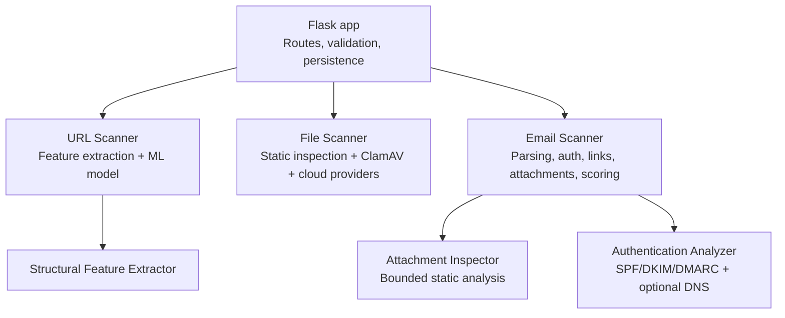
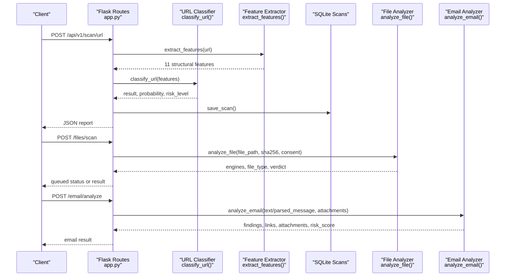
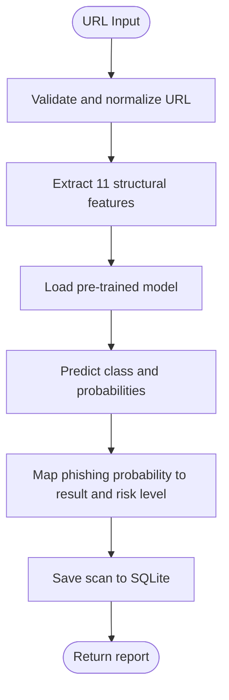
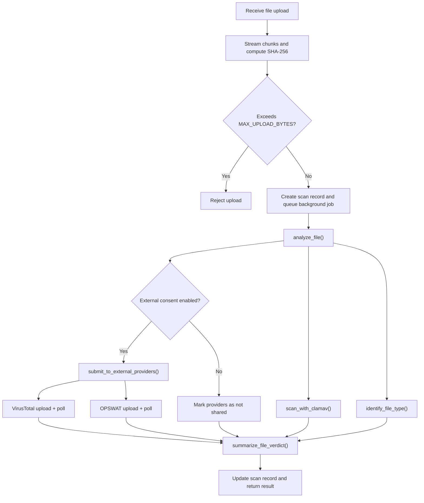
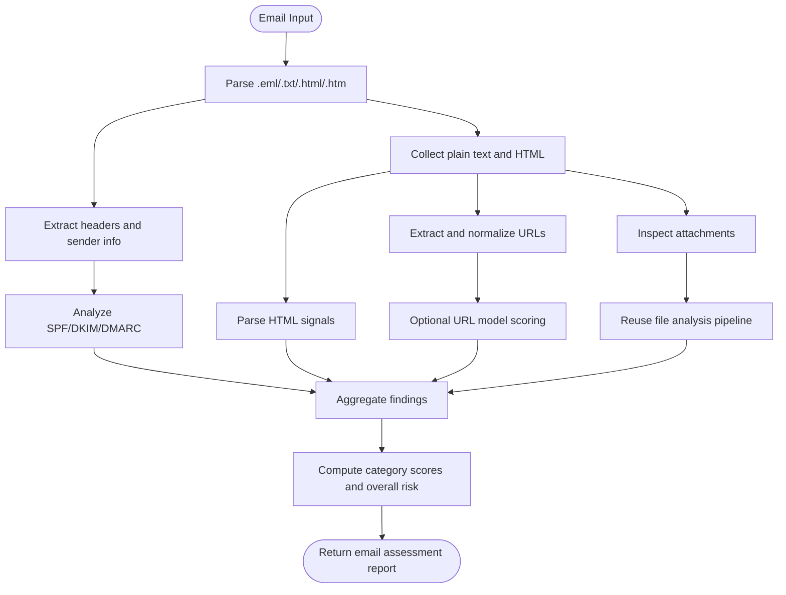
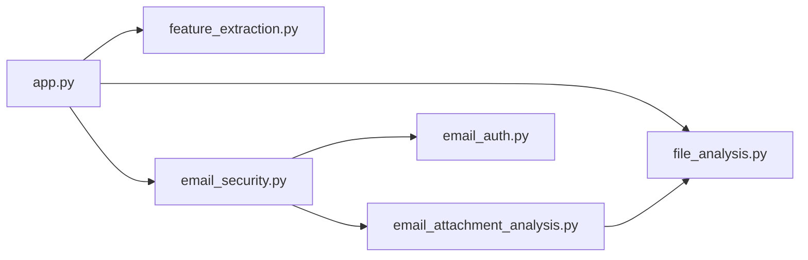

# Core Features

<cite>
**Referenced Files in This Document**   
- [README.md](file://README.md)
- [app.py](file://app.py)
- [feature_extraction.py](file://feature_extraction.py)
- [file_analysis.py](file://file_analysis.py)
- [email_security.py](file://email_security.py)
- [email_attachment_analysis.py](file://email_attachment_analysis.py)
- [email_auth.py](file://email_auth.py)
</cite>

## Table of Contents
1. [Introduction](#introduction)
2. [Project Structure](#project-structure)
3. [Core Components](#core-components)
4. [Architecture Overview](#architecture-overview)
5. [Detailed Component Analysis](#detailed-component-analysis)
6. [Dependency Analysis](#dependency-analysis)
7. [Performance Considerations](#performance-considerations)
8. [Troubleshooting Guide](#troubleshooting-guide)
9. [Conclusion](#conclusion)

## Introduction
PhishGuard is an educational phishing triage console that combines three analysis engines:
- URL scanning with a pre-trained machine-learning model and structural feature extraction.
- File analysis with static inspection, ClamAV integration, SHA-256 hashing, and optional cloud scanner submissions.
- Email security assessment covering multi-format parsing, authentication header analysis, attachment inspection, link extraction, and risk scoring.

The project explicitly states that it is not a production-grade security product. Model output, signature checks, and heuristic findings can be wrong, and results should never be treated as proof of safety.

**Section sources**
- [README.md:1-15](file://README.md#L1-L15)
- [README.md:34-48](file://README.md#L34-L48)

## Project Structure
The core features are implemented across a small set of focused modules:
- `app.py` exposes Flask routes, request validation, rate limiting, database persistence, and orchestration for all three scanners.
- `feature_extraction.py` computes the 11 structural features used by the URL model.
- `file_analysis.py` performs file type identification, local ClamAV scanning, and optional VirusTotal/OPSWAT submissions.
- `email_security.py` parses emails, extracts links and HTML signals, scores content, inspects attachments, and computes a composite risk score.
- `email_attachment_analysis.py` performs bounded static inspection of email attachments and reuses the file analysis pipeline.
- `email_auth.py` analyzes SPF/DKIM/DMARC headers and optionally performs DNS lookups.

**Diagram sources**
- [app.py:22-46](file://app.py#L22-L46)
- [feature_extraction.py:5-60](file://feature_extraction.py#L5-L60)
- [file_analysis.py:20-41](file://file_analysis.py#L20-L41)
- [email_security.py:11-13](file://email_security.py#L11-L13)
- [email_attachment_analysis.py:17-17](file://email_attachment_analysis.py#L17-L17)
- [email_auth.py:185-319](file://email_auth.py#L185-L319)

**Section sources**
- [README.md:202-219](file://README.md#L202-L219)
- [app.py:1-46](file://app.py#L1-L46)

## Core Components
PhishGuard’s three main analysis engines share common operational principles:
- Inputs are validated before processing.
- Results are deterministic and offline by default.
- External network access is limited to public DNS lookups and opt-in cloud submissions.
- Findings are scored and summarized rather than producing absolute verdicts.

| Engine | Primary responsibilities | Key outputs |
|---|---|---|
| URL scanner | Structural feature extraction, model prediction, probability scoring | Result, risk level, probability, feature breakdown |
| File scanner | Static type detection, ClamAV scan, SHA-256 hashing, optional provider submission | File type, engine results, summary verdict |
| Email scanner | Multi-format parsing, authentication analysis, link extraction, attachment inspection, rule-based scoring | Subject, sender, links, attachments, findings, risk score, recommendation |

**Section sources**
- [README.md:34-48](file://README.md#L34-L48)
- [app.py:315-337](file://app.py#L315-L337)
- [file_analysis.py:583-607](file://file_analysis.py#L583-L607)
- [email_security.py:284-309](file://email_security.py#L284-L309)

## Architecture Overview
At runtime, user input enters through Flask routes in `app.py`. The application validates inputs, persists scans, and delegates work to specialized modules.

**Diagram sources**
- [app.py:470-508](file://app.py#L470-L508)
- [app.py:636-720](file://app.py#L636-L720)
- [app.py:764-800](file://app.py#L764-L800)
- [feature_extraction.py:5-60](file://feature_extraction.py#L5-L60)
- [file_analysis.py:583-607](file://file_analysis.py#L583-L607)
- [email_security.py:284-309](file://email_security.py#L284-L309)

## Detailed Component Analysis

### URL Scanning Engine
The URL engine uses a pre-trained random forest model and a fixed set of structural features. It does not open URLs, resolve domains beyond what Python’s URL parser requires, or query reputation services.

#### How it works
1. A submitted URL is normalized and validated without fetching it.
2. `extract_features()` computes 11 structural properties such as URL length, hostname length, dot/hyphen/slash counts, digit count, special character count, presence of `@`, IP-like hostnames, HTTPS usage, subdomain count, and login-related keywords.
3. The features are converted into a pandas DataFrame and passed to the loaded model.
4. The model returns a class prediction and probabilities; the phishing class probability is extracted and rounded.
5. The result is mapped to a human-readable classification and risk level.
6. The scan is persisted to SQLite and returned via the web form or public API.

**Diagram sources**
- [app.py:295-337](file://app.py#L295-L337)
- [feature_extraction.py:5-60](file://feature_extraction.py#L5-L60)

#### Input and output formats
- **Public API input**: JSON object containing a `url` field.
- **Public API output**: JSON object including `scan_id`, `scanned_at`, `url`, `result`, `risk_level`, `probability`, `features`, `engine`, and a disclaimer stating that the URL was never opened and no reputation service was queried.
- **Web form input**: Form field `url` with CSRF token.
- **Web form output**: Rendered result page showing classification, confidence, and feature breakdown.

**Section sources**
- [README.md:137-166](file://README.md#L137-L166)
- [app.py:295-337](file://app.py#L295-L337)
- [app.py:470-508](file://app.py#L470-L508)
- [feature_extraction.py:5-60](file://feature_extraction.py#L5-L60)

#### Practical code reference paths
- URL normalization and validation: [app.py:295-312](file://app.py#L295-L312)
- Feature extraction: [feature_extraction.py:5-60](file://feature_extraction.py#L5-L60)
- Model prediction and scoring: [app.py:315-337](file://app.py#L315-L337)
- Public API response shape: [app.py:499-508](file://app.py#L499-L508)

### File Analysis Pipeline
The file pipeline performs local static inspection, integrates ClamAV, computes SHA-256 hashes, and optionally submits files to VirusTotal and OPSWAT MetaDefender when the user consents and external submissions are enabled.

#### Processing stages
1. **Upload handling**: The uploaded file is streamed in chunks, size-checked against `MAX_UPLOAD_BYTES`, and hashed with SHA-256 while being written to a temporary upload path.
2. **Scan record creation**: A scan ID, filename, size, SHA-256, initial status, and timestamps are inserted into SQLite.
3. **Background processing**: A thread pool executes `_process_file`, which calls `analyze_file`.
4. **Static inspection**: `identify_file_type()` reads the first bytes and matches known signatures to label the file.
5. **ClamAV scan**: `scan_with_clamav()` runs the configured ClamAV executable with optional signature database directory.
6. **Optional cloud submissions**: If consent is given, `submit_to_external_providers()` sends the file to VirusTotal and/or OPSWAT, polling for completion.
7. **Result summarization**: `summarize_file_verdict()` aggregates completed engine results into a final verdict.

**Diagram sources**
- [app.py:636-720](file://app.py#L636-L720)
- [file_analysis.py:20-41](file://file_analysis.py#L20-L41)
- [file_analysis.py:146-203](file://file_analysis.py#L146-L203)
- [file_analysis.py:547-580](file://file_analysis.py#L547-L580)
- [file_analysis.py:583-607](file://file_analysis.py#L583-L607)

#### Integration points
- **ClamAV**: Configured via `CLAMSCAN_PATH` and `CLAMAV_DATABASE_DIR`. The scanner configuration endpoint reports whether the executable and signature database are ready.
- **VirusTotal**: Uses `VT_API_KEY`; supports standard and large-file upload flows and polls for analysis completion.
- **OPSWAT MetaDefender**: Requires `OPSWAT_API_KEY` and `OPSWAT_MAX_UPLOAD_BYTES`; uploads and polls until completion or timeout.
- **Consent gate**: External submissions only occur when the per-scan consent checkbox is checked and `PHISHGUARD_EXTERNAL_SUBMISSIONS` is enabled.

**Section sources**
- [README.md:174-183](file://README.md#L174-L183)
- [file_analysis.py:44-99](file://file_analysis.py#L44-L99)
- [file_analysis.py:146-203](file://file_analysis.py#L146-L203)
- [file_analysis.py:347-402](file://file_analysis.py#L347-L402)
- [file_analysis.py:405-461](file://file_analysis.py#L405-L461)
- [file_analysis.py:547-607](file://file_analysis.py#L547-L607)

#### Practical code reference paths
- Streaming upload and SHA-256 computation: [app.py:662-686](file://app.py#L662-L686)
- Background job submission: [app.py:703-712](file://app.py#L703-L712)
- File type identification: [file_analysis.py:20-41](file://file_analysis.py#L20-L41)
- ClamAV execution: [file_analysis.py:146-203](file://file_analysis.py#L146-L203)
- VirusTotal polling: [file_analysis.py:252-344](file://file_analysis.py#L252-L344)
- OPSWAT polling: [file_analysis.py:464-544](file://file_analysis.py#L464-L544)
- Verdict summarization: [file_analysis.py:102-143](file://file_analysis.py#L102-L143)

### Email Security Assessment
The email engine parses pasted or uploaded email content, extracts links and HTML signals, inspects attachments, analyzes authentication headers, and produces a composite risk score.

#### Supported inputs
- Pasted email text, headers, subject, body, or links.
- Uploaded `.eml`, `.txt`, `.html`, and `.htm` files.
- Optional embedded attachments from parsed MIME parts.

#### Processing stages
1. **Input validation**: Enforces maximum character and byte limits and rejects unsupported formats like Outlook `.msg`.
2. **Message parsing**: Uses Python’s email parser to handle multipart MIME structures, plain text, and HTML bodies.
3. **Header extraction**: Reads `From`, `Reply-To`, `Return-Path`, `Subject`, `Date`, `Message-ID`, and `Received` headers.
4. **Authentication analysis**: Calls `analyze_authentication()` to parse `Authentication-Results`, `Received-SPF`, and `DKIM-Signature` headers and optionally perform DNS lookups for SPF, DMARC, MX, A, and NS records.
5. **HTML signal detection**: Parses HTML with BeautifulSoup to detect unsafe schemes, hidden links, anchor mismatches, forms, password fields, scripts, iframes, and external resources.
6. **Link extraction and enrichment**: Normalizes URLs, detects IP hosts, punycode domains, HTTP links, credential-bearing URLs, shorteners, and sensitive action words. Each link can be scored by the same URL model used by the URL scanner.
7. **Attachment inspection**: Runs bounded static analysis on each attachment, extracting text, URLs, metadata, and suspicious indicators, then reusing the file analysis pipeline for antivirus scanning.
8. **Risk scoring**: Aggregates weighted findings by category, caps category scores, sums them to a maximum of 100, and maps the total to a risk level and recommendation.

**Diagram sources**
- [email_security.py:258-281](file://email_security.py#L258-L281)
- [email_security.py:284-309](file://email_security.py#L284-L309)
- [email_security.py:383-449](file://email_security.py#L383-L449)
- [email_security.py:450-584](file://email_security.py#L450-L584)
- [email_security.py:586-646](file://email_security.py#L586-L646)
- [email_attachment_analysis.py:283-378](file://email_attachment_analysis.py#L283-L378)
- [email_auth.py:185-319](file://email_auth.py#L185-L319)

#### Authentication header analysis
The authentication analyzer:
- Parses multiple `Authentication-Results` headers.
- Extracts SPF, DKIM, and DMARC statuses, associated domains, and selectors.
- Checks alignment between the `From` domain and authenticated domains using registrable-domain comparison.
- Optionally queries public DNS for SPF TXT records, DMARC policy, MX, A, and NS records.
- Reports whether DMARC pass aligns with an aligned SPF or DKIM mechanism.

**Section sources**
- [email_auth.py:8-23](file://email_auth.py#L8-L23)
- [email_auth.py:33-38](file://email_auth.py#L33-L38)
- [email_auth.py:101-182](file://email_auth.py#L101-L182)
- [email_auth.py:185-319](file://email_auth.py#L185-L319)
- [email_security.py:391-416](file://email_security.py#L391-L416)

#### Risk scoring methodology
- Each finding has a category, title, detail, severity, and numeric score.
- Scores are grouped by category: authentication, sender, content, HTML, URLs, attachments, and reputation.
- Category scores are capped at 35.
- The overall score is the sum of category scores, capped at 100.
- Thresholds map to risk levels:
  - 75+: Critical, Likely Phishing
  - 50-74: High, Suspicious
  - 25-49: Medium, Suspicious
  - Below 25: Low, Inconclusive
- The report includes a recommendation and a confidence note indicating that this is rule-based, not a calibrated probability.

**Section sources**
- [email_security.py:245-255](file://email_security.py#L245-L255)
- [email_security.py:586-605](file://email_security.py#L586-L605)
- [email_security.py:614-646](file://email_security.py#L614-L646)

#### Practical code reference paths
- Email upload parsing: [email_security.py:258-281](file://email_security.py#L258-L281)
- Main analysis function: [email_security.py:284-309](file://email_security.py#L284-L309)
- Header and sender analysis: [email_security.py:383-449](file://email_security.py#L383-L449)
- HTML signal detection: [email_security.py:169-242](file://email_security.py#L169-L242)
- Link extraction and model scoring: [email_security.py:450-584](file://email_security.py#L450-L584)
- Attachment inspection: [email_attachment_analysis.py:283-378](file://email_attachment_analysis.py#L283-L378)
- Authentication analysis: [email_auth.py:185-319](file://email_auth.py#L185-L319)

## Dependency Analysis
The following diagram shows how the core modules depend on each other.

**Diagram sources**
- [app.py:22-46](file://app.py#L22-L46)
- [email_security.py:11-13](file://email_security.py#L11-L13)
- [email_attachment_analysis.py:17-17](file://email_attachment_analysis.py#L17-L17)

Key dependency observations:
- `app.py` orchestrates all three engines and depends on feature extraction, file analysis, and email security modules.
- `email_security.py` depends on both attachment analysis and authentication analysis.
- `email_attachment_analysis.py` reuses `file_analysis.py` to run the same static inspection and optional cloud scanning logic on attachments.
- There is no circular import among these core modules; the dependency graph is acyclic.

**Section sources**
- [app.py:22-46](file://app.py#L22-L46)
- [email_security.py:11-13](file://email_security.py#L11-L13)
- [email_attachment_analysis.py:17-17](file://email_attachment_analysis.py#L17-L17)

## Performance Considerations
- **URL scanning** is lightweight: string parsing, regex checks, and a single model inference over one-row data.
- **File scanning** can be I/O-bound due to streaming uploads, ClamAV subprocess execution, and optional cloud provider uploads and polling. The application uses a thread pool for background file analysis.
- **Email scanning** may involve HTML parsing, MIME traversal, optional DNS queries, and attachment inspection. Limits are enforced for characters, upload size, attachment count, archive expansion, PDF pages, and extracted text.
- **Cloud integrations** introduce latency and rate-limit sensitivity; VirusTotal and OPSWAT polling use timeouts and retry intervals.

[No sources needed since this section provides general guidance]

## Troubleshooting Guide
Common issues and their likely causes:
- **URL validation errors**: Spaces, missing scheme, invalid hostname, or excessive URL length.
- **Rate limiting**: Too many requests within the configured window; responses include retry information.
- **ClamAV not configured**: Missing executable or signature database; check environment variables and installation.
- **Cloud provider skipped**: Missing API keys, disabled external submissions, exceeded upload limits, or provider rate limiting.
- **Email parsing failures**: Unsupported format, oversized input, malformed MIME structure, or encoding issues.
- **DNS lookup errors**: Network restrictions, missing DNS records, or resolver exceptions.

Operational safeguards:
- CSRF validation protects state-changing forms.
- Content-length and upload-size limits prevent resource exhaustion.
- Temporary files are cleaned up after analysis.
- Scan records track status, messages, and timestamps for recovery and auditing.

**Section sources**
- [app.py:267-288](file://app.py#L267-L288)
- [app.py:295-312](file://app.py#L295-L312)
- [app.py:636-720](file://app.py#L636-L720)
- [file_analysis.py:44-99](file://file_analysis.py#L44-L99)
- [file_analysis.py:146-203](file://file_analysis.py#L146-L203)
- [email_security.py:258-281](file://email_security.py#L258-L281)
- [email_security.py:284-309](file://email_security.py#L284-L309)

## Conclusion
PhishGuard’s core features provide a practical, educational triage workflow:
- The URL scanner demonstrates structural feature extraction and machine-learning classification without opening or reputating URLs.
- The file scanner demonstrates safe static inspection, signature-based detection, hashing, and optional cloud verification with explicit consent.
- The email scanner demonstrates realistic email triage: parsing, authentication header analysis, HTML and link inspection, attachment analysis, and rule-based risk scoring.

These tools are valuable for learning phishing indicators, understanding security headers, and practicing triage workflows. They are not substitutes for production-grade security products, and their outputs should always be interpreted as heuristic evidence rather than definitive verdicts.

[No sources needed since this section summarizes without analyzing specific files]