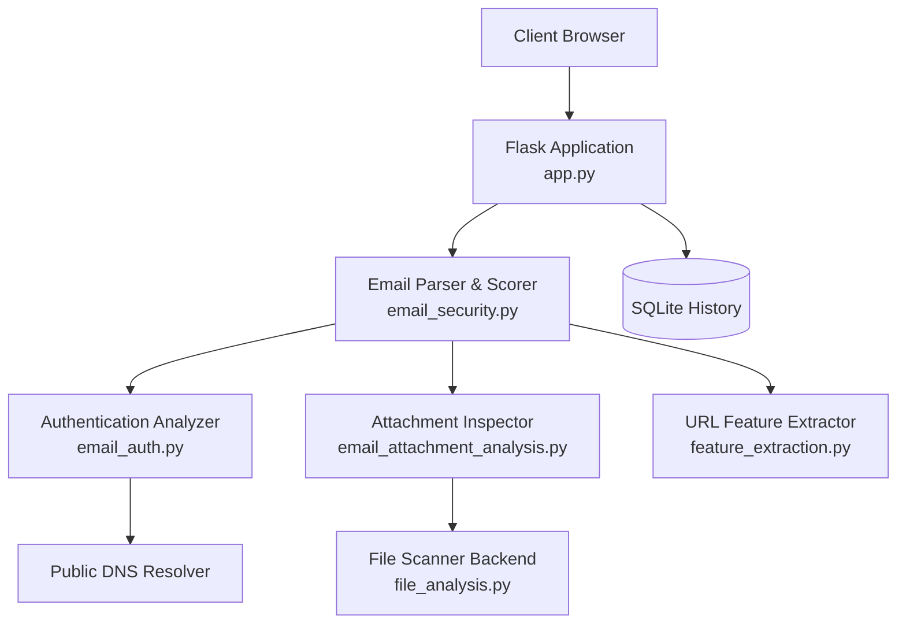
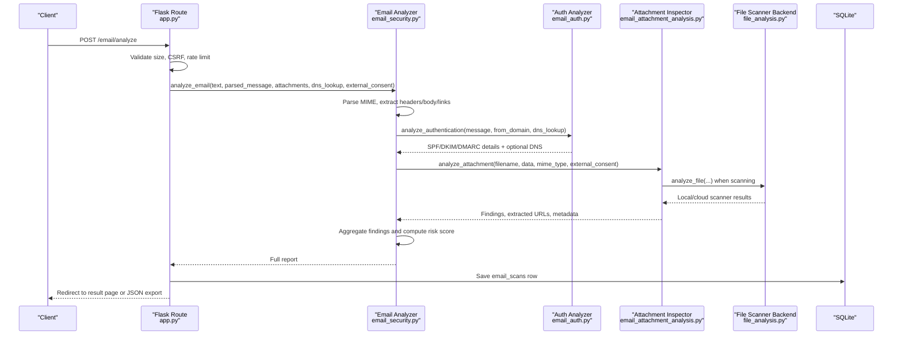
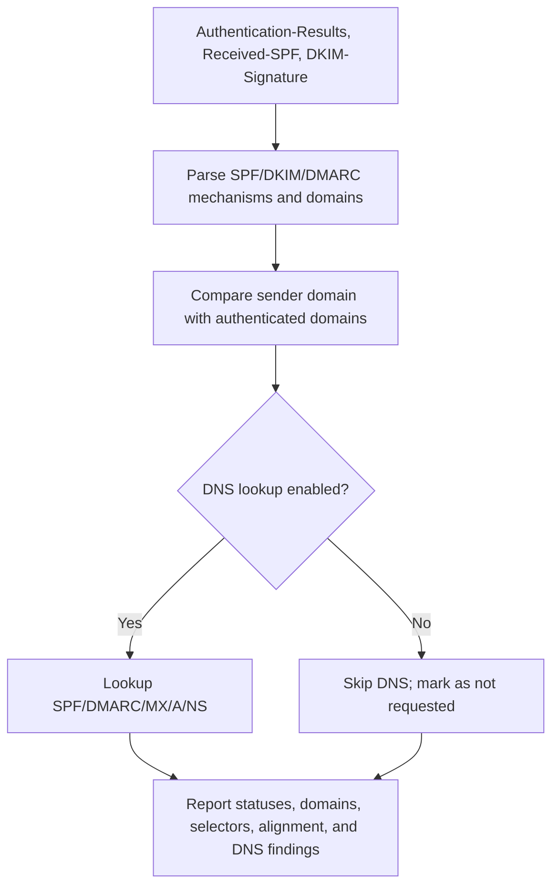
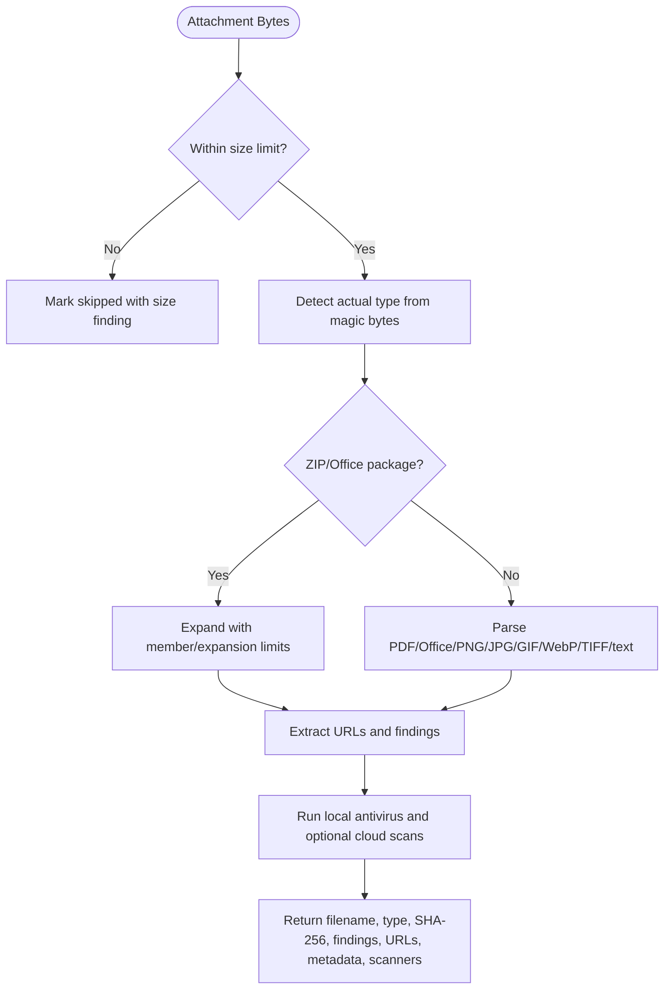
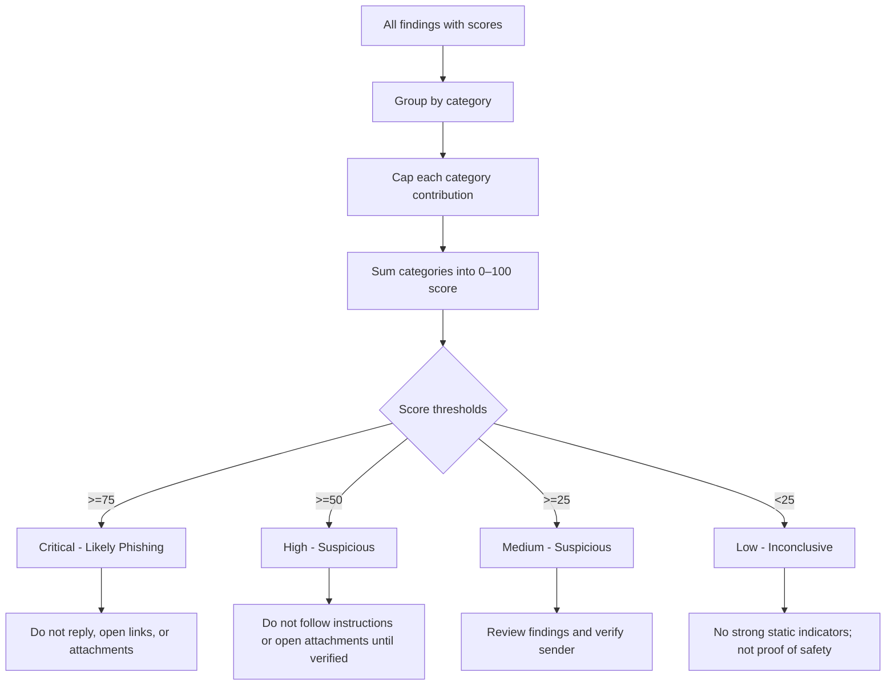
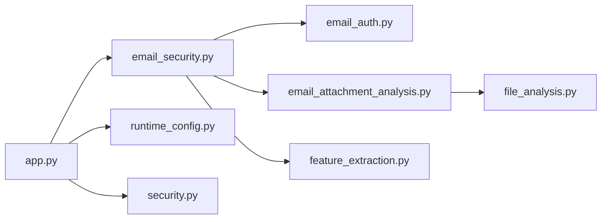

# Email Security Assessment

<cite>
**Referenced Files in This Document**   
- [README.md](file://README.md)
- [app.py](file://app.py)
- [email_security.py](file://email_security.py)
- [email_auth.py](file://email_auth.py)
- [email_attachment_analysis.py](file://email_attachment_analysis.py)
- [feature_extraction.py](file://feature_extraction.py)
- [file_analysis.py](file://file_analysis.py)
- [runtime_config.py](file://runtime_config.py)
- [security.py](file://security.py)
</cite>

## Table of Contents
1. [Introduction](#introduction)
2. [Project Structure](#project-structure)
3. [Core Components](#core-components)
4. [Architecture Overview](#architecture-overview)
5. [Detailed Component Analysis](#detailed-component-analysis)
6. [Dependency Analysis](#dependency-analysis)
7. [Performance Considerations](#performance-considerations)
8. [Troubleshooting Guide](#troubleshooting-guide)
9. [Conclusion](#conclusion)

## Introduction
This document explains the email security assessment system with a focus on multi-format email parsing, authentication verification, attachment inspection, and unified risk scoring. The system accepts pasted email text or uploaded `.eml`, `.txt`, `.html`, and `.htm` files. It extracts headers, body content, links, and attachments; analyzes SPF/DKIM/DMARC claims; optionally performs DNS record lookups; inspects attachments for executable content, embedded URLs, and suspicious patterns; and combines all indicators into a single threat score and recommendation.

The project is an educational phishing triage console that records scans in SQLite and exposes both web pages and JSON APIs. Network activity is limited to optional public DNS lookups and opt-in cloud file submissions.

**Section sources**
- [README.md:3-48](file://README.md#L3-L48)
- [README.md:120-135](file://README.md#L120-L135)

## Project Structure
The email analysis pipeline spans several modules:

| Area | Primary File | Responsibility |
|---|---|---|
| Web entry points | `app.py` | Routes for `/email`, `/authentication`, history storage, result export, rate limiting, CSRF protection, and request size enforcement |
| Email parsing and scoring | `email_security.py` | MIME parsing, header/body extraction, link detection, HTML signal analysis, attachment orchestration, and risk scoring |
| Authentication analysis | `email_auth.py` | SPF/DKIM/DMARC header parsing, domain alignment, and optional DNS TXT/MX/A/NS lookups |
| Attachment inspection | `email_attachment_analysis.py` | Static attachment type detection, archive expansion limits, PDF/Office/image handling, URL extraction, and local scanner integration |
| File scanning backend | `file_analysis.py` | Signature-based file type identification, ClamAV execution, VirusTotal and OPSWAT submission/polling |
| URL feature extraction | `feature_extraction.py` | Structural features used by the local URL phishing model |
| Runtime configuration | `runtime_config.py` | Environment-driven settings for upload sizes, data directory, secret key, host/port, and feature flags |
| Request hardening | `security.py` | CSP/security headers, CORS, passcode gate, and in-process rate limiter |



**Diagram sources**
- [app.py:752-876](file://app.py#L752-L876)
- [email_security.py:284-646](file://email_security.py#L284-L646)
- [email_auth.py:185-319](file://email_auth.py#L185-L319)
- [email_attachment_analysis.py:283-378](file://email_attachment_analysis.py#L283-L378)
- [file_analysis.py:583-607](file://file_analysis.py#L583-L607)
- [feature_extraction.py:5-59](file://feature_extraction.py#L5-L59)

**Section sources**
- [README.md:202-219](file://README.md#L202-L219)
- [app.py:752-876](file://app.py#L752-L876)

## Core Components
- **Email input handling**: Accepts pasted text or uploaded `.eml`, `.txt`, `.html`, `.htm`. Enforces per-request and per-file size limits and validates supported formats.
- **MIME parsing**: Uses Python’s `email` parser with default policy to walk message parts, extract plain text and HTML bodies, collect attachments, and detect malformed structure.
- **Header and sender analysis**: Extracts `From`, `Reply-To`, `Return-Path`, subject, date, message ID, and `Received` header count. Normalizes mailbox display names and domains.
- **Authentication verification**: Parses `Authentication-Results`, `Received-SPF`, and `DKIM-Signature` headers; reports statuses, domains, selectors, and alignment relative to the sender domain. Optional DNS lookup retrieves SPF, DMARC, MX, A, and NS records.
- **Link extraction and analysis**: Finds URLs in plain text, visible HTML text, and HTML attributes; detects IP hosts, punycode domains, HTTP links, credential-bearing URLs, shorteners, sensitive path words, and hidden/mismatched anchor links.
- **Attachment inspection**: Detects actual file types from magic bytes, enforces size and archive expansion limits, expands ZIP archives safely, parses PDFs and Office packages, reads image metadata, extracts embedded URLs, and integrates local antivirus and optional cloud providers.
- **Risk scoring**: Aggregates weighted findings across categories, caps category contributions, sums them into a 0–100 score, and maps the score to a risk level, verdict, and recommendation.

**Section sources**
- [email_security.py:16-22](file://email_security.py#L16-L22)
- [email_security.py:258-281](file://email_security.py#L258-L281)
- [email_security.py:284-390](file://email_security.py#L284-L390)
- [email_security.py:391-449](file://email_security.py#L391-L449)
- [email_security.py:450-584](file://email_security.py#L450-L584)
- [email_security.py:586-646](file://email_security.py#L586-L646)

## Architecture Overview
The email analysis workflow begins at the Flask route, validates inputs, parses the email, runs authentication checks, inspects attachments, scores findings, stores the scan, and renders or exports the result.



**Diagram sources**
- [app.py:764-876](file://app.py#L764-L876)
- [email_security.py:284-646](file://email_security.py#L284-L646)
- [email_auth.py:185-319](file://email_auth.py#L185-L319)
- [email_attachment_analysis.py:283-378](file://email_attachment_analysis.py#L283-L378)
- [file_analysis.py:583-607](file://file_analysis.py#L583-L607)

## Detailed Component Analysis

### Multi-Format Email Parsing
The system supports:
- `.eml`: Parsed directly as raw MIME using `BytesParser` with default policy.
- `.txt`: Decoded as UTF-8 with BOM support; parsed as a message; if no headers are found, the payload is treated as raw text.
- `.html` and `.htm`: Same handling as `.txt`; HTML content is later analyzed for forms, scripts, iframes, hidden links, and anchor mismatches.

Unsupported Outlook `.msg` files are rejected with a clear error directing users to export as `.eml` or `.txt`.

Key behaviors:
- Maximum pasted email characters and maximum uploaded email bytes are enforced before parsing.
- MIME parts are walked; multipart containers are skipped while leaf parts are decoded.
- Unsupported MIME types are recorded as informational findings rather than fatal errors.
- Plain text and HTML parts are combined for content rule matching and link extraction.

```mermaid
flowchart TD
Start(["Email Input"]) --> CheckType{"File extension?"}
CheckType --> |.eml| ParseEML["Parse as MIME with BytesParser"]
CheckType --> |.txt|.html|.htm| ParseText["Decode UTF-8-sig and parse as message"]
ParseText --> HasHeaders{"Has headers?"}
HasHeaders --> |No| SetPayload["Set payload to raw text"]
HasHeaders --> |Yes| WalkParts["Walk MIME parts"]
ParseEML --> WalkParts
WalkParts --> ExtractBody["Extract text/plain and text/html"]
ExtractBody --> Combine["Combine subject, plain, and visible HTML"]
Combine --> NextStage["Content rules, links, attachments"]
```

**Diagram sources**
- [email_security.py:258-281](file://email_security.py#L258-L281)
- [email_security.py:309-372](file://email_security.py#L309-L372)

**Section sources**
- [email_security.py:258-281](file://email_security.py#L258-L281)
- [email_security.py:309-372](file://email_security.py#L309-L372)

### Header Extraction and Body Content Analysis
The analyzer extracts:
- Sender information: display name, address, and normalized ASCII domain.
- Routing fields: `Reply-To`, `Return-Path`, `To`, `Cc`, `Bcc`, `Date`, `Message-ID`.
- Received header count as a structural indicator.
- Subject and combined body text for pattern matching.

HTML-specific signals include:
- Unsafe schemes such as `javascript:`, `data:`, and `file:`.
- Forms and password inputs.
- Active content like `<script>` or `<iframe>`.
- External resources referenced via HTTP(S).
- Hidden links and mismatched visible label versus destination host.

Plain-text and HTML content are scanned against predefined rules covering account suspension threats, credential verification requests, one-time code mentions, unusual payment requests, urgency language, and invoice/delivery lures.

**Section sources**
- [email_security.py:383-449](file://email_security.py#L383-L449)
- [email_security.py:169-242](file://email_security.py#L169-L242)
- [email_security.py:23-66](file://email_security.py#L23-L66)

### Authentication Verification System
The authentication module parses:
- `Authentication-Results` headers for SPF, DKIM, and DMARC mechanisms and their reported statuses.
- `Received-SPF` headers for envelope-from SPF results.
- `DKIM-Signature` headers for signature domains and selectors.

It computes:
- Unique reported statuses per mechanism.
- Domains associated with each mechanism.
- Alignment between the sender domain and authenticated domains using registrable-domain comparison.
- Strict alignment based on DMARC `aspf` and `adkim` policies when DNS data is available.
- Whether DMARC pass is backed by an aligned passing SPF or DKIM mechanism in the same `Authentication-Results` header.

Optional DNS lookups retrieve:
- SPF TXT records.
- DMARC TXT records and policy (`none`, `quarantine`, `reject`).
- MX, A, and NS records.

DNS operations use a resolver with short timeouts and return structured status values such as `found`, `no_record`, `not_found`, or `lookup_error`.



**Diagram sources**
- [email_auth.py:8-23](file://email_auth.py#L8-L23)
- [email_auth.py:33-38](file://email_auth.py#L33-L38)
- [email_auth.py:101-182](file://email_auth.py#L101-L182)
- [email_auth.py:185-319](file://email_auth.py#L185-L319)

**Section sources**
- [email_auth.py:185-319](file://email_auth.py#L185-L319)
- [email_auth.py:101-182](file://email_auth.py#L101-L182)
- [email_security.py:391-416](file://email_security.py#L391-L416)

### Attachment Inspection Capabilities
Attachment inspection is bounded and defensive:
- Maximum attachment size is enforced; oversized attachments are marked as skipped with an explanatory finding.
- Actual file type is detected from magic bytes, including PDF, ZIP, Windows executable, ELF, OLE compound documents, images, and text-like content.
- Filename extensions are checked for double extensions and executable/script suffixes.
- Claimed MIME type vs filename mapping is compared; mismatches are recorded.
- ZIP archives are expanded with member count, expanded size, per-entry size, compression ratio, encryption, nested archives, and executable/script entries checked.
- Office packages are inspected for VBA projects, macro-enabled formats, external relationships, and readable XML content.
- PDFs are parsed up to a page limit; encrypted PDFs cannot be text-extracted.
- Images are opened safely with bounds and decompression protections; metadata fields are collected.
- Embedded URLs are extracted from HTML, text, and archive contents.
- Social-engineering and credential-collection language is searched in extracted text.
- Local antivirus scanning and optional cloud provider submissions are integrated through the shared file analysis backend.



**Diagram sources**
- [email_attachment_analysis.py:283-378](file://email_attachment_analysis.py#L283-L378)
- [email_attachment_analysis.py:55-138](file://email_attachment_analysis.py#L55-L138)
- [email_attachment_analysis.py:141-194](file://email_attachment_analysis.py#L141-L194)
- [email_attachment_analysis.py:197-258](file://email_attachment_analysis.py#L197-L258)
- [file_analysis.py:583-607](file://file_analysis.py#L583-L607)

**Section sources**
- [email_attachment_analysis.py:283-378](file://email_attachment_analysis.py#L283-L378)
- [email_attachment_analysis.py:55-138](file://email_attachment_analysis.py#L55-L138)
- [email_attachment_analysis.py:197-258](file://email_attachment_analysis.py#L197-L258)

### Risk Scoring Methodology
The scoring engine aggregates weighted findings across categories:
- Authentication
- Sender
- Content
- HTML
- URLs
- Attachments
- Reputation

Each finding has a severity and numeric score. Category totals are capped to prevent any single area from dominating the overall score. The final score is capped at 100 and mapped to:
- Critical: Likely Phishing
- High: Suspicious
- Medium: Suspicious
- Low: Inconclusive

Recommendations guide analysts to avoid clicking links or opening attachments and to verify senders through trusted channels. If no obvious static warning is found, an informational finding is added to clarify that absence of indicators is not proof of safety.



**Diagram sources**
- [email_security.py:586-646](file://email_security.py#L586-L646)

**Section sources**
- [email_security.py:586-646](file://email_security.py#L586-L646)

### Practical Email Analysis Workflow
A typical user workflow is:
1. Open the email scanner page.
2. Paste email headers/body or upload an `.eml`, `.txt`, `.html`, or `.htm` file.
3. Optionally enable DNS lookup and external file submissions with consent.
4. Submit the analysis.
5. Review the result page showing headers, links, attachments, authentication claims, findings, risk score, and recommendation.
6. Export the full JSON report for downstream processing.

The route enforces CSRF validation, rate limits, and request size limits. Errors are rendered back to the form with context so users can correct input issues.

**Section sources**
- [app.py:752-876](file://app.py#L752-L876)
- [app.py:895-908](file://app.py#L895-L908)

### Authentication Report Generation
The authentication review page is exposed at `/authentication`. The email analysis result includes:
- Per-mechanism statuses from supplied headers.
- Associated domains and selectors.
- Alignment results relative to the sender domain.
- Optional DNS TXT/MX/A/NS records and DMARC policy.
- A note that header results are reported claims unless independently verified.

Dashboard endpoints also expose authentication statistics, allowing historical trends and cross-source summaries.

**Section sources**
- [app.py:928-932](file://app.py#L928-L932)
- [email_security.py:391-416](file://email_security.py#L391-L416)
- [email_auth.py:185-319](file://email_auth.py#L185-L319)
- [app.py:1084-1086](file://app.py#L1084-L1086)

### Finding Interpretation
Findings are grouped by category and include:
- Title and detail explaining what was observed.
- Severity classification: info, low, medium, high.
- Numeric score contributing to the overall risk.
- Source attribution where relevant, such as “Attachment: filename”.

Analysts should treat findings as indicators, not definitive verdicts. For example:
- Authentication failures are high-severity but represent header claims.
- HTML forms and password fields are high-severity because they suggest credential collection.
- Shortened URLs and punycode domains are medium-severity due to obfuscation potential.
- Antivirus detections in attachments are high-severity and carry a large score contribution.

**Section sources**
- [email_security.py:245-255](file://email_security.py#L245-L255)
- [email_security.py:402-416](file://email_security.py#L402-L416)
- [email_security.py:527-584](file://email_security.py#L527-L584)

## Dependency Analysis
The email analysis depends on several modules:



**Diagram sources**
- [app.py:22-46](file://app.py#L22-L46)
- [email_security.py:11-13](file://email_security.py#L11-L13)
- [email_attachment_analysis.py:17-17](file://email_attachment_analysis.py#L17-L17)

Key coupling notes:
- `app.py` orchestrates routes and persists results but delegates core logic to `email_security.py`.
- `email_security.py` composes authentication, attachment inspection, and URL feature extraction.
- `email_attachment_analysis.py` reuses `file_analysis.py` for consistent file-type detection and antivirus scanning.
- `email_auth.py` uses a DNS resolver and TLD extractor for registrable-domain alignment and DNS record retrieval.
- `runtime_config.py` centralizes environment-driven limits and flags consumed by `app.py` and other modules.
- `security.py` provides shared request hardening, rate limiting, and access gating used by all routes.

**Section sources**
- [app.py:22-46](file://app.py#L22-L46)
- [email_security.py:11-13](file://email_security.py#L11-L13)
- [email_attachment_analysis.py:17-17](file://email_attachment_analysis.py#L17-L17)
- [email_auth.py:3-5](file://email_auth.py#L3-L5)
- [runtime_config.py:140-188](file://runtime_config.py#L140-L188)
- [security.py:245-253](file://security.py#L245-L253)

## Performance Considerations
- **Large emails**: Pasted email text is limited to a configured character ceiling; uploaded email files have a separate byte limit. Both are enforced before parsing to avoid excessive memory use.
- **Attachment limits**: Each attachment is limited in size; ZIP archives are constrained by member count, total expanded size, per-entry size, and compression-ratio heuristics. PDF parsing is limited to a page count, and extracted text is truncated.
- **Network-dependent operations**: DNS lookups are optional and controlled per analysis. They use short resolver timeouts and return structured statuses instead of raising unhandled exceptions. Cloud file submissions are opt-in and require explicit consent.
- **Concurrency**: File scanning is queued and executed by a thread pool so repeated uploads do not block the main request handler.
- **Rate limiting**: In-process sliding-window rate limits protect expensive endpoints such as email analysis, dashboard queries, and API calls.
- **Model inference**: URL model predictions run locally and are guarded by feature compatibility checks; unavailable models return safe fallbacks rather than failing the entire analysis.

Operational recommendations:
- Keep DNS resolution disabled unless needed for a specific investigation.
- Avoid enabling external file submissions in untrusted environments.
- Tune `MAX_EMAIL_REQUEST_BYTES`, `MAX_UPLOAD_BYTES`, and worker counts according to deployment capacity.
- Monitor DNS connectivity and provider API availability through the health and dashboard endpoints.

**Section sources**
- [email_security.py:16-18](file://email_security.py#L16-L18)
- [email_security.py:294-297](file://email_security.py#L294-L297)
- [email_attachment_analysis.py:20-24](file://email_attachment_analysis.py#L20-L24)
- [email_attachment_analysis.py:55-138](file://email_attachment_analysis.py#L55-L138)
- [email_attachment_analysis.py:222-237](file://email_attachment_analysis.py#L222-L237)
- [email_auth.py:41-66](file://email_auth.py#L41-L66)
- [app.py:107-110](file://app.py#L107-L110)
- [app.py:98-105](file://app.py#L98-L105)
- [security.py:71-93](file://security.py#L71-L93)

## Troubleshooting Guide
Common issues and resolutions:

| Symptom | Likely Cause | Resolution |
|---|---|---|
| Upload rejected as unsupported format | Only `.eml`, `.txt`, `.html`, `.htm` are accepted for email parsing | Export Outlook `.msg` as `.eml` or paste headers/body as text |
| Email request too large | Exceeds `MAX_EMAIL_REQUEST_BYTES` or per-file limits | Reduce pasted content or split attachments |
| Attachment skipped | Exceeds `MAX_ATTACHMENT_BYTES` | Inspect smaller copies or analyze externally |
| DNS lookup shows `lookup_error` or `not_found` | Domain does not exist, DNS is blocked, or resolver timed out | Verify network access and domain spelling; disable DNS lookup if unnecessary |
| Authentication says “reported pass without aligned mechanism” | DMARC pass exists but no aligned SPF/DKIM pass was present in the same header | Treat as a concern; investigate sender infrastructure |
| HTML form or password field flagged | Message contains interactive elements | Do not submit; verify sender through another channel |
| URL model prediction unavailable | Model features do not match extractor or model is missing | Ensure the trained model is present and compatible |
| External file scan not completed | Provider rate-limited or still processing | Check provider report URL and retry later |

Error handling paths:
- Large request errors are caught and returned as friendly messages for both file and email routes.
- Validation errors during email analysis render the form again with recent scans and error context.
- Database or query failures return standardized error responses for dashboard and API endpoints.

**Section sources**
- [email_security.py:258-281](file://email_security.py#L258-L281)
- [email_security.py:294-297](file://email_security.py#L294-L297)
- [email_attachment_analysis.py:283-308](file://email_attachment_analysis.py#L283-L308)
- [email_auth.py:41-66](file://email_auth.py#L41-L66)
- [email_auth.py:265-268](file://email_auth.py#L265-L268)
- [email_security.py:138-166](file://email_security.py#L138-L166)
- [file_analysis.py:252-344](file://file_analysis.py#L252-L344)
- [app.py:1260-1288](file://app.py#L1260-L1288)
- [app.py:843-858](file://app.py#L843-L858)

## Conclusion
The email security assessment system provides a layered, bounded analysis of email content, authentication claims, links, and attachments. It balances usability with safety by enforcing strict input limits, avoiding execution or fetching of potentially malicious content, and clearly labeling heuristic findings. The unified risk score helps analysts prioritize investigations, while optional DNS lookups and consented cloud scans add depth when appropriate. For production use, operators should configure secure secrets, tune upload and request limits, monitor DNS and provider integrations, and treat all outputs as educational indicators rather than absolute guarantees of safety.