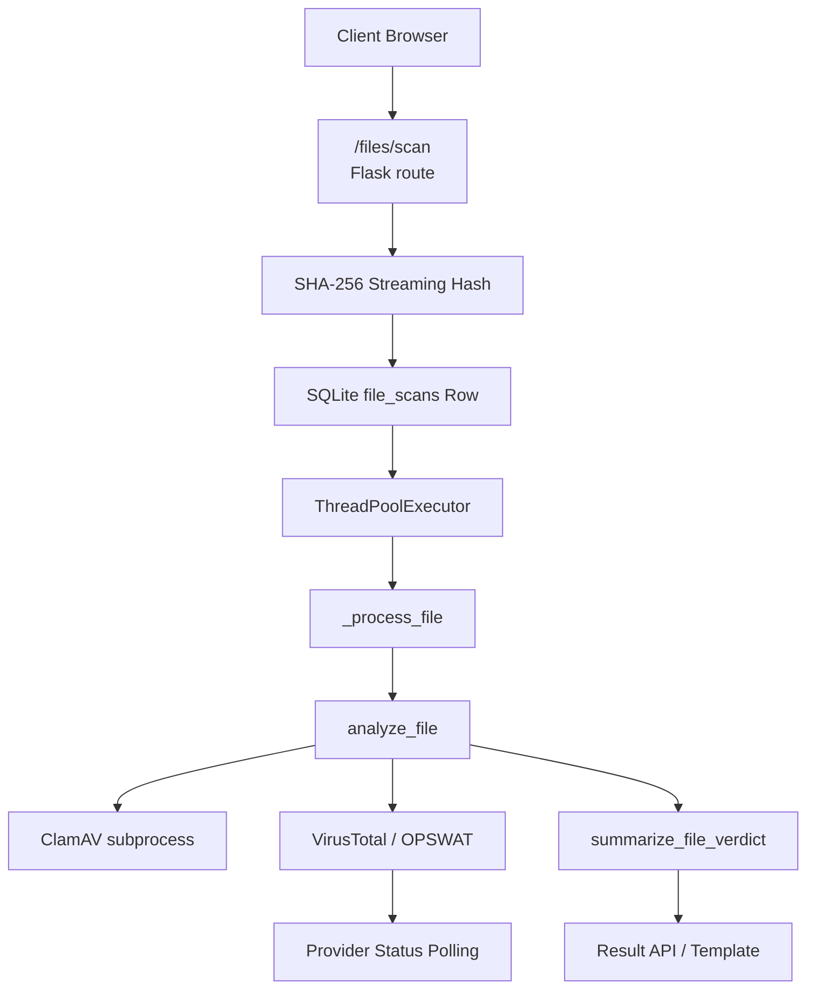
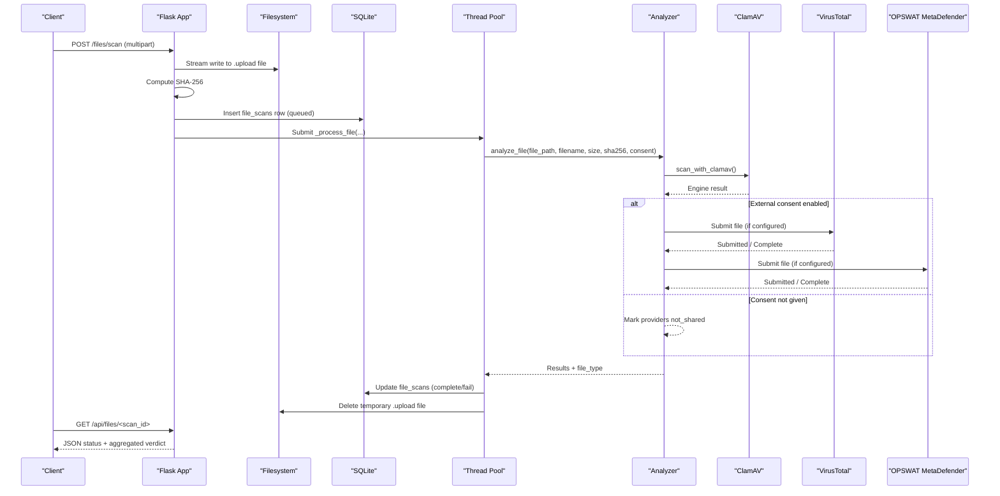
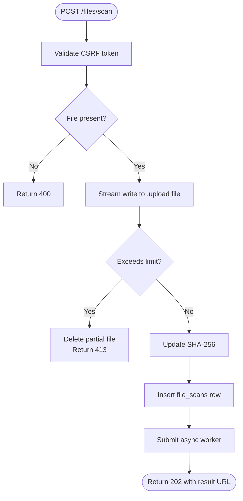
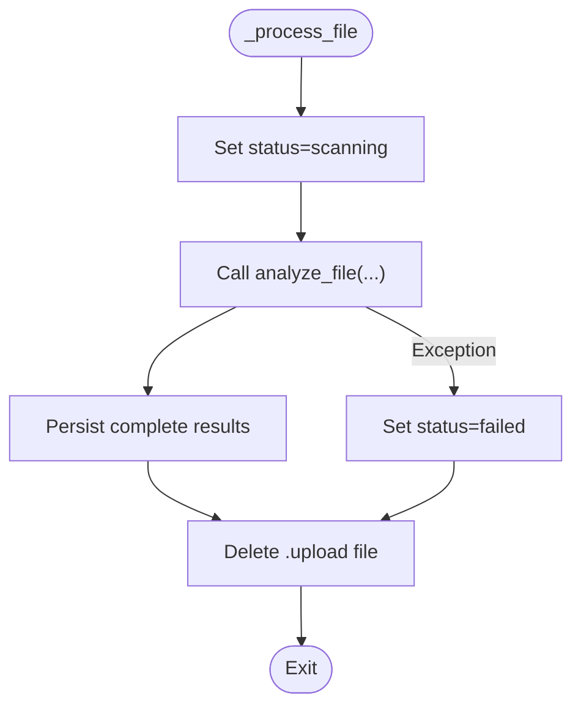
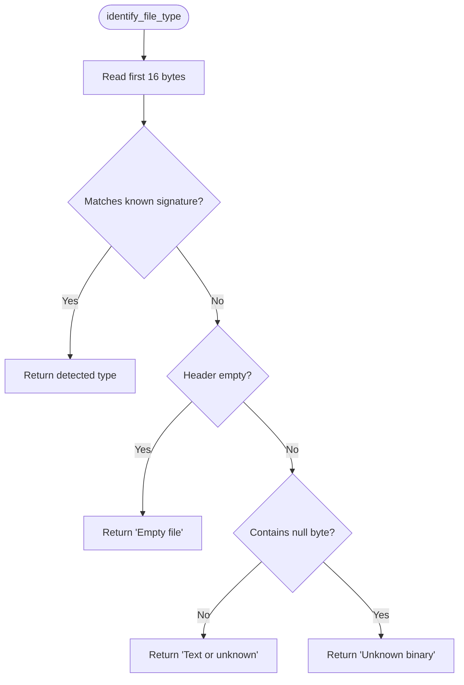
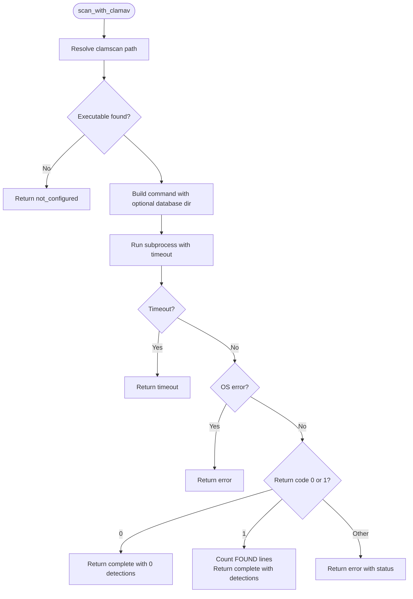
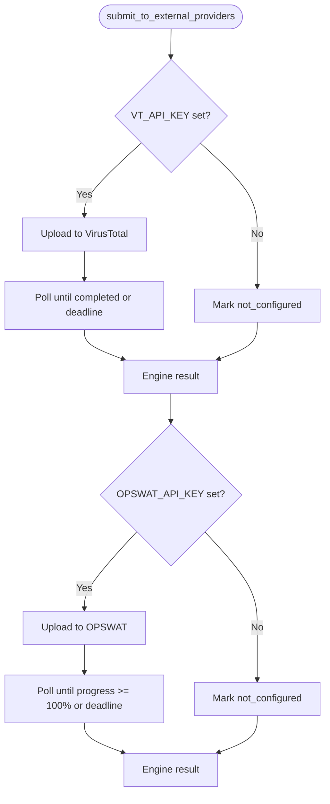
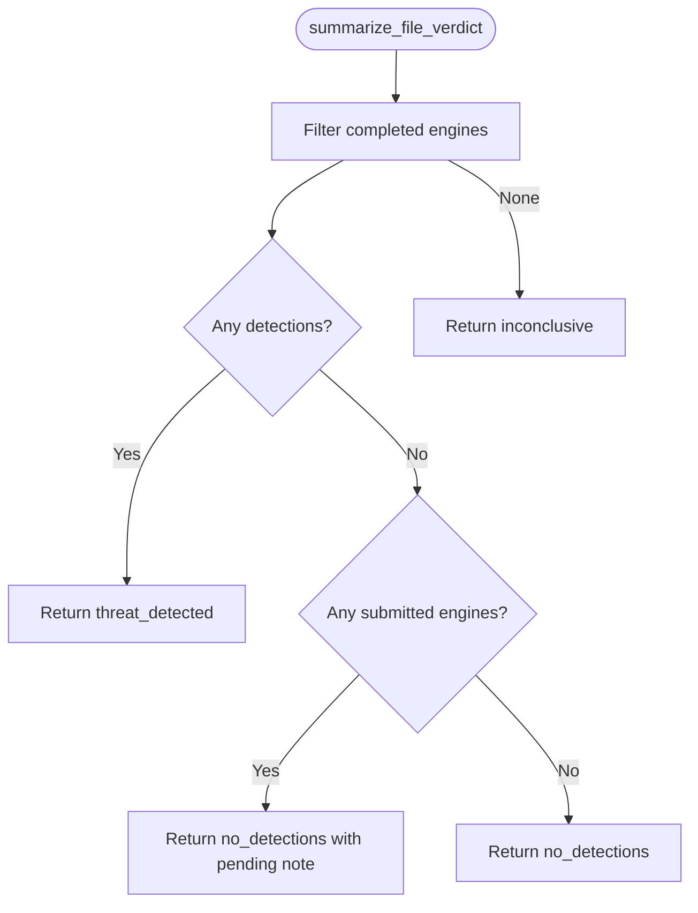
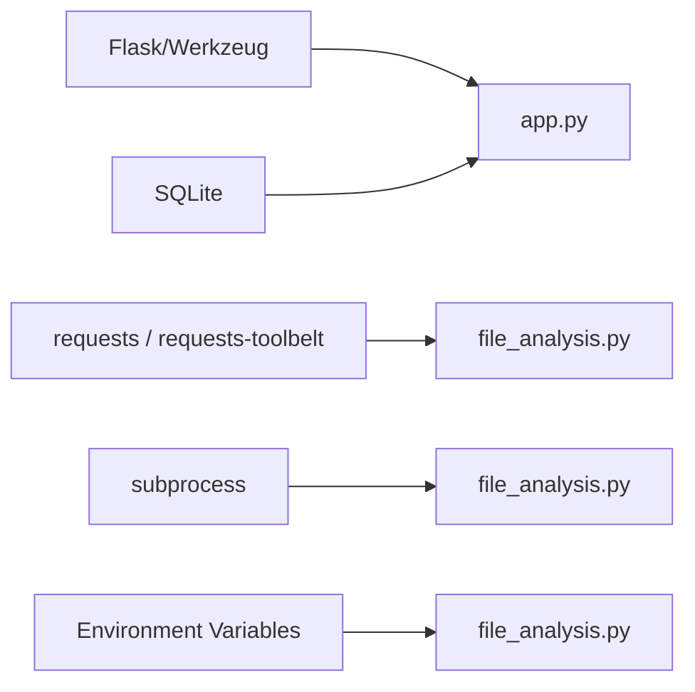

# File Analysis Pipeline

<cite>
**Referenced Files in This Document**   
- [file_analysis.py](file://file_analysis.py)
- [app.py](file://app.py)
- [requirements.txt](file://requirements.txt)
- [test_file_scanning.py](file://tests/test_file_scanning.py)
</cite>

## Table of Contents
1. [Introduction](#introduction)
2. [Project Structure](#project-structure)
3. [Core Components](#core-components)
4. [Architecture Overview](#architecture-overview)
5. [Detailed Component Analysis](#detailed-component-analysis)
6. [Dependency Analysis](#dependency-analysis)
7. [Performance Considerations](#performance-considerations)
8. [Troubleshooting Guide](#troubleshooting-guide)
9. [Conclusion](#conclusion)

## Introduction
This document explains the file analysis pipeline used by the application to inspect uploaded files, detect their type, compute a stable identifier, run local malware detection with ClamAV, and optionally submit samples to VirusTotal and OPSWAT MetaDefender. It covers the end-to-end workflow from upload through asynchronous processing to result aggregation, including supported file types, scan result formats, error handling, security considerations, temporary storage management, resource cleanup, performance tips, and troubleshooting guidance.

## Project Structure
The file analysis feature is implemented across two primary modules:
- The web layer handles uploads, validation, hashing, persistence, and asynchronous job dispatch.
- The analysis module performs static inspection, local scanning, provider submission, polling, and verdict aggregation.

**Diagram sources**
- [app.py:636-720](file://app.py#L636-L720)
- [app.py:374-400](file://app.py#L374-L400)
- [file_analysis.py:583-607](file://file_analysis.py#L583-L607)
- [file_analysis.py:146-203](file://file_analysis.py#L146-L203)
- [file_analysis.py:547-580](file://file_analysis.py#L547-L580)

**Section sources**
- [app.py:636-720](file://app.py#L636-L720)
- [file_analysis.py:583-607](file://file_analysis.py#L583-L607)

## Core Components
- Static file inspection and type detection: reads the first bytes of the file and matches known signatures to classify the sample.
- SHA-256 identification: computes a streaming hash during upload for deduplication and auditability.
- Local threat assessment: invokes ClamAV via subprocess with configurable executable path and signature database directory.
- Optional cloud scanning: submits files to VirusTotal and OPSWAT MetaDefender when configured and consented.
- Asynchronous processing: uses a thread pool to avoid blocking the web server while scanning large files or waiting on providers.
- Result aggregation: combines engine results into a unified verdict with status, label, and message.

**Section sources**
- [file_analysis.py:20-41](file://file_analysis.py#L20-L41)
- [app.py:662-686](file://app.py#L662-L686)
- [file_analysis.py:146-203](file://file_analysis.py#L146-L203)
- [file_analysis.py:547-580](file://file_analysis.py#L547-L580)
- [file_analysis.py:102-143](file://file_analysis.py#L102-L143)

## Architecture Overview
The pipeline separates concerns between request handling and long-running analysis:

**Diagram sources**
- [app.py:636-720](file://app.py#L636-L720)
- [app.py:374-400](file://app.py#L374-L400)
- [file_analysis.py:583-607](file://file_analysis.py#L583-L607)
- [file_analysis.py:146-203](file://file_analysis.py#L146-L203)
- [file_analysis.py:547-580](file://file_analysis.py#L547-L580)

## Detailed Component Analysis

### Upload, Validation, and Hashing
- CSRF protection is enforced for both form fields and headers.
- File uploads are streamed in 1 MiB chunks to avoid loading entire files into memory.
- A maximum upload size is enforced; exceeding it returns HTTP 413 and removes any partial upload.
- SHA-256 is computed incrementally over each chunk.
- The original filename is sanitized using a secure filename function and truncated to a safe length.
- A unique scan ID is generated and persisted along with filename, size, SHA-256, initial status, and timestamps.
- After successful insertion, the actual analysis is dispatched asynchronously.

**Diagram sources**
- [app.py:636-720](file://app.py#L636-L720)

**Section sources**
- [app.py:636-720](file://app.py#L636-L720)

### Asynchronous Processing Worker
- A `ThreadPoolExecutor` runs one or more workers based on an environment variable.
- `_process_file` updates the record to “scanning,” calls `analyze_file`, persists final results, and deletes the temporary file in a `finally` block.
- Any exception marks the scan as failed and logs details.

**Diagram sources**
- [app.py:374-400](file://app.py#L374-L400)

**Section sources**
- [app.py:107-110](file://app.py#L107-L110)
- [app.py:374-400](file://app.py#L374-L400)

### Static File Inspection and Type Detection
- Reads the first 16 bytes of the file to determine its type.
- Recognizes common signatures such as Windows PE, ELF, PDF, ZIP, OLE compound documents, GZIP, RAR, and 7-Zip archives.
- Returns descriptive labels like “Empty file,” “Text or unknown,” or “Unknown binary” when no signature matches.

Supported examples include:
- Executables: Windows PE, ELF
- Documents: PDF, OLE compound documents
- Archives: ZIP, GZIP, RAR, 7-Zip
- Text or generic binaries

**Diagram sources**
- [file_analysis.py:20-41](file://file_analysis.py#L20-L41)

**Section sources**
- [file_analysis.py:20-41](file://file_analysis.py#L20-L41)

### Local Malware Detection with ClamAV
- Locates the ClamAV executable via environment configuration or PATH.
- Optionally points to a custom signature database directory.
- Invokes ClamAV with flags that return only infected lines and suppress summaries.
- Handles timeouts, OS errors, and non-zero exit codes.
- Returns a structured engine result indicating completion, detections, timeout, or error.

**Diagram sources**
- [file_analysis.py:146-203](file://file_analysis.py#L146-L203)

**Section sources**
- [file_analysis.py:44-99](file://file_analysis.py#L44-L99)
- [file_analysis.py:146-203](file://file_analysis.py#L146-L203)

### Optional Cloud Scanners: VirusTotal and OPSWAT MetaDefender
- Submission is gated by explicit user consent and a global configuration flag.
- VirusTotal supports standard and large-file upload flows, with strict URL validation for redirect targets.
- OPSWAT requires an API key and a positive integer upload limit configured at runtime.
- Both providers use polling loops with rate-limit handling and deadlines.
- Each provider returns a standardized engine result with status, optional IDs, detection counts, and messages.

**Diagram sources**
- [file_analysis.py:547-580](file://file_analysis.py#L547-L580)
- [file_analysis.py:347-402](file://file_analysis.py#L347-L402)
- [file_analysis.py:405-544](file://file_analysis.py#L405-L544)

**Section sources**
- [file_analysis.py:547-580](file://file_analysis.py#L547-L580)
- [file_analysis.py:347-402](file://file_analysis.py#L347-L402)
- [file_analysis.py:405-544](file://file_analysis.py#L405-L544)

### Result Aggregation and Verdict
- The analyzer always includes the detected file type and a list of engine results.
- If external sharing is not approved, providers are marked as not shared rather than skipped.
- `summarize_file_verdict` aggregates completed engines:
  - Threat detected if any completed engine reports detections.
  - No detections if all completed engines report zero detections.
  - Inconclusive if no scanner completed successfully.

**Diagram sources**
- [file_analysis.py:102-143](file://file_analysis.py#L102-L143)

**Section sources**
- [file_analysis.py:102-143](file://file_analysis.py#L102-L143)
- [file_analysis.py:583-607](file://file_analysis.py#L583-L607)

## Dependency Analysis
The file analysis pipeline depends on:
- Flask and Werkzeug for request handling, CSRF, and secure filename utilities.
- SQLite for persistent scan records and history.
- Python’s subprocess for invoking ClamAV.
- requests and requests-toolbelt for multipart uploads to cloud scanners.
- Environment variables for scanner configuration and provider credentials.

**Diagram sources**
- [app.py:1-23](file://app.py#L1-L23)
- [file_analysis.py:1-18](file://file_analysis.py#L1-L18)
- [requirements.txt:1-35](file://requirements.txt#L1-L35)

**Section sources**
- [requirements.txt:1-35](file://requirements.txt#L1-L35)
- [app.py:1-23](file://app.py#L1-L23)
- [file_analysis.py:1-18](file://file_analysis.py#L1-L18)

## Performance Considerations
- Streaming uploads: Files are read and hashed in fixed-size chunks to minimize memory usage.
- Thread pool sizing: Adjust `FILE_SCAN_WORKERS` to match CPU cores and I/O characteristics.
- Provider polling intervals: Polling uses a fixed interval and deadline to avoid indefinite waits.
- Large file support: VirusTotal uses a separate upload URL flow for larger samples.
- Database indexing: Indices exist on frequently queried columns for faster dashboard queries.

Recommendations:
- Tune `FILE_SCAN_WORKERS` based on workload and hardware.
- Ensure ClamAV signature databases are up to date to reduce scan time.
- Configure appropriate provider upload limits to avoid unnecessary submissions.
- Monitor disk space for the upload directory and ensure timely cleanup.

[No sources needed since this section provides general guidance]

## Troubleshooting Guide

### Common Issues and Resolutions
- ClamAV not configured:
  - Symptom: Engine status is “not_configured.”
  - Resolution: Install ClamAV, ensure `clamscan` is discoverable, and provide `CLAMSCAN_PATH` and `CLAMAV_DATABASE_DIR` if necessary.
- ClamAV timeout:
  - Symptom: Engine status is “timeout.”
  - Resolution: Investigate slow scans due to large files or outdated signatures; consider increasing system resources or updating signatures.
- Provider not configured:
  - Symptom: Engine status is “not_configured.”
  - Resolution: Set `VT_API_KEY` and/or `OPSWAT_API_KEY`; for OPSWAT, also set `OPSWAT_MAX_UPLOAD_BYTES`.
- Provider rate limiting:
  - Symptom: Engine status remains “submitted” with a rate-limit message.
  - Resolution: Retry later or open the provider’s portal for the latest result.
- Upload too large:
  - Symptom: HTTP 413 response.
  - Resolution: Reduce file size or adjust server-side limits carefully.
- Missing CSRF token:
  - Symptom: HTTP 400 with expired form message.
  - Resolution: Reload the page and resubmit.

**Section sources**
- [file_analysis.py:44-99](file://file_analysis.py#L44-L99)
- [file_analysis.py:146-203](file://file_analysis.py#L146-L203)
- [file_analysis.py:547-580](file://file_analysis.py#L547-L580)
- [app.py:636-720](file://app.py#L636-L720)

### Security Considerations
- Input validation:
  - CSRF tokens validated for both form fields and headers.
  - Filenames sanitized and truncated.
  - URLs normalized without network resolution.
- File handling:
  - Temporary files written with exclusive creation mode.
  - Temporary files deleted after analysis, even on failure.
  - Interrupted scans cleaned up at startup.
- Provider safety:
  - VirusTotal redirect URLs validated to trusted hosts and schemes.
  - External submissions require explicit consent and global enablement.
- Secrets management:
  - Provider keys read from environment variables and never logged.

**Section sources**
- [app.py:636-720](file://app.py#L636-L720)
- [app.py:374-400](file://app.py#L374-L400)
- [file_analysis.py:234-249](file://file_analysis.py#L234-L249)
- [file_analysis.py:547-580](file://file_analysis.py#L547-L580)

### Scan Result Formats
- Top-level result object includes:
  - `file_type`: Detected type string.
  - `engines`: List of engine results.
  - `sha256`: Stable file identifier.
- Engine result structure:
  - `provider`: Scanner name.
  - `status`: One of “complete”, “submitted”, “not_configured”, “not_shared”, “skipped”, “timeout”, or “error”.
  - `detections`: Integer count when applicable.
  - `message`: Human-readable status explanation.
  - Optional fields: `analysis_id`, `report_url`, `stats`, `total_engines`.
- Aggregated verdict:
  - `status`: “threat_detected”, “no_detections”, or “inconclusive”.
  - `label`: Short human-readable label.
  - `message`: Explanation including pending provider scans when relevant.

**Section sources**
- [file_analysis.py:102-143](file://file_analysis.py#L102-L143)
- [file_analysis.py:583-607](file://file_analysis.py#L583-L607)

### Error Handling Patterns
- Local scanning:
  - Subprocess exceptions mapped to structured statuses.
  - Non-zero exit codes interpreted as detections or errors.
- Provider interactions:
  - Network and parsing errors wrapped into provider-specific error results.
  - HTTP status codes captured and reported.
  - Polling respects rate limits and deadlines.
- Application-level:
  - Failed analyses mark scans as failed and log details.
  - Temporary files are removed in finally blocks.
  - Startup cleanup removes stale uploads associated with interrupted jobs.

**Section sources**
- [file_analysis.py:206-231](file://file_analysis.py#L206-L231)
- [file_analysis.py:252-402](file://file_analysis.py#L252-L402)
- [file_analysis.py:464-544](file://file_analysis.py#L464-L544)
- [app.py:374-400](file://app.py#L374-L400)
- [app.py:230-249](file://app.py#L230-L249)

## Conclusion
The file analysis pipeline provides a robust, extensible framework for static inspection, local malware detection, and optional cloud-based multi-engine assessment. It emphasizes security through input validation, safe file handling, and controlled external submissions, while supporting asynchronous processing for scalability. Operators can tune performance via worker pools and provider configurations, and diagnose issues using structured statuses and messages. The design ensures clear separation between request handling and long-running analysis, making it suitable for environments ranging from local development to production deployments.