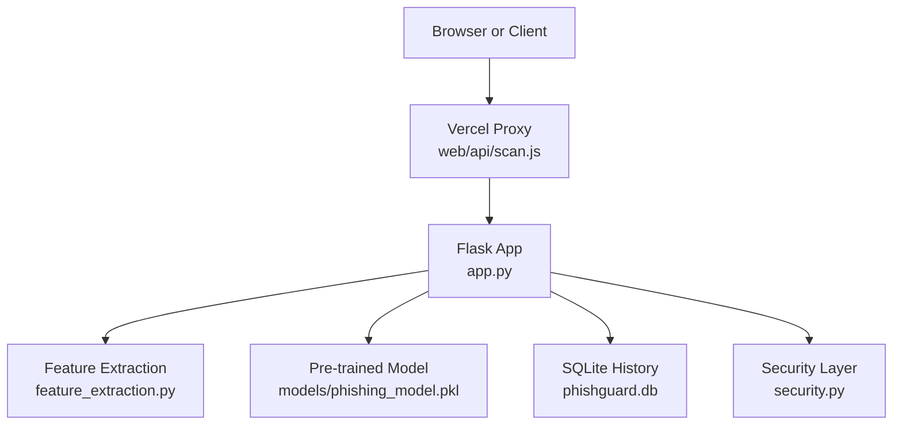
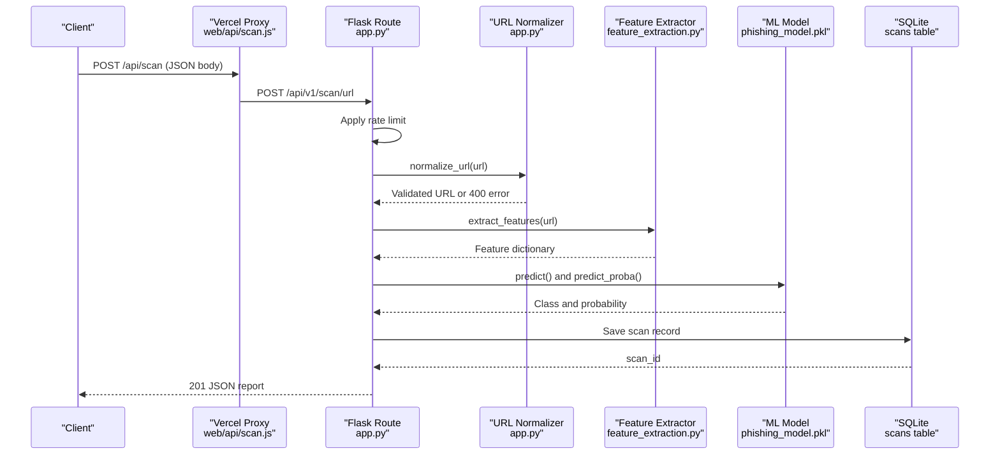
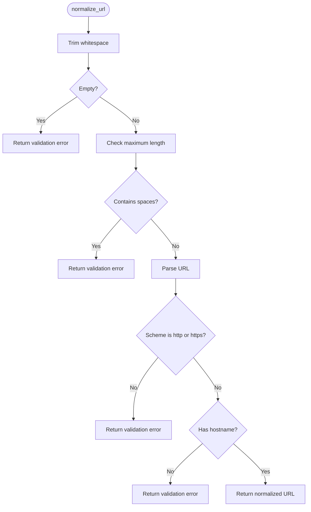
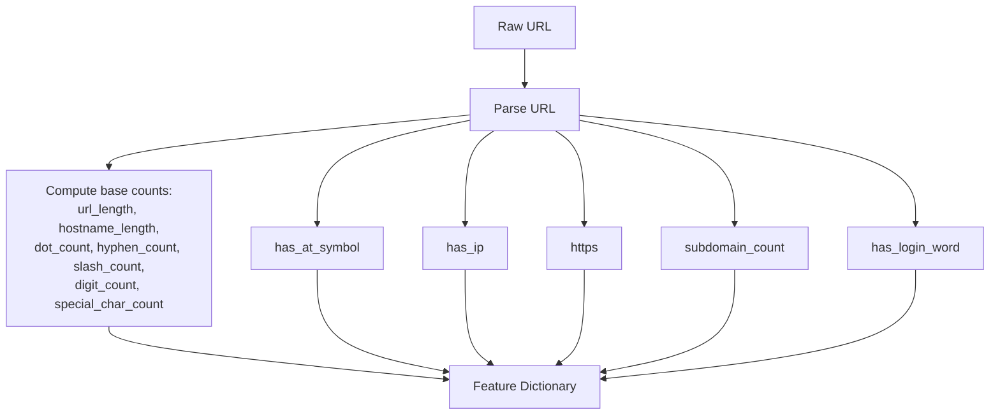
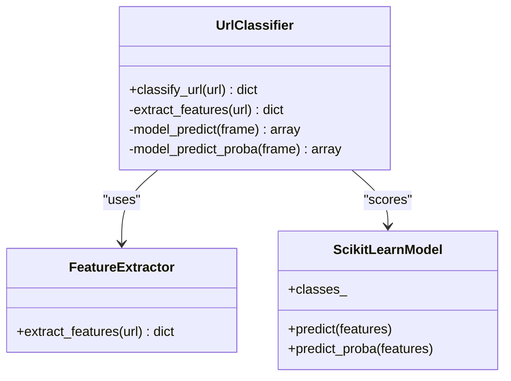
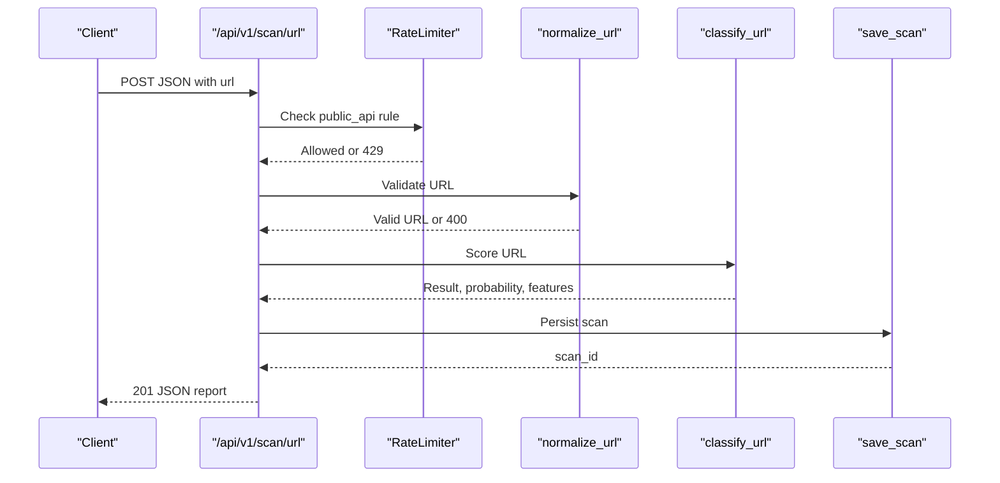
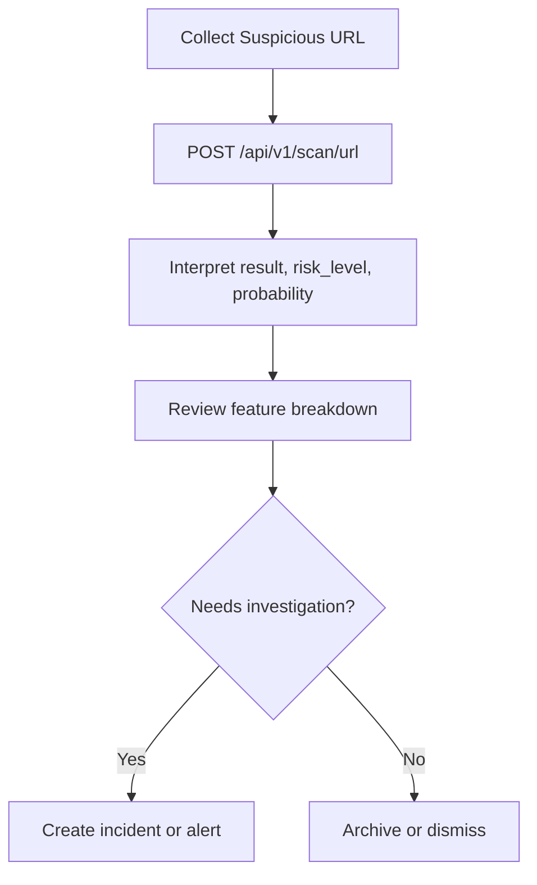
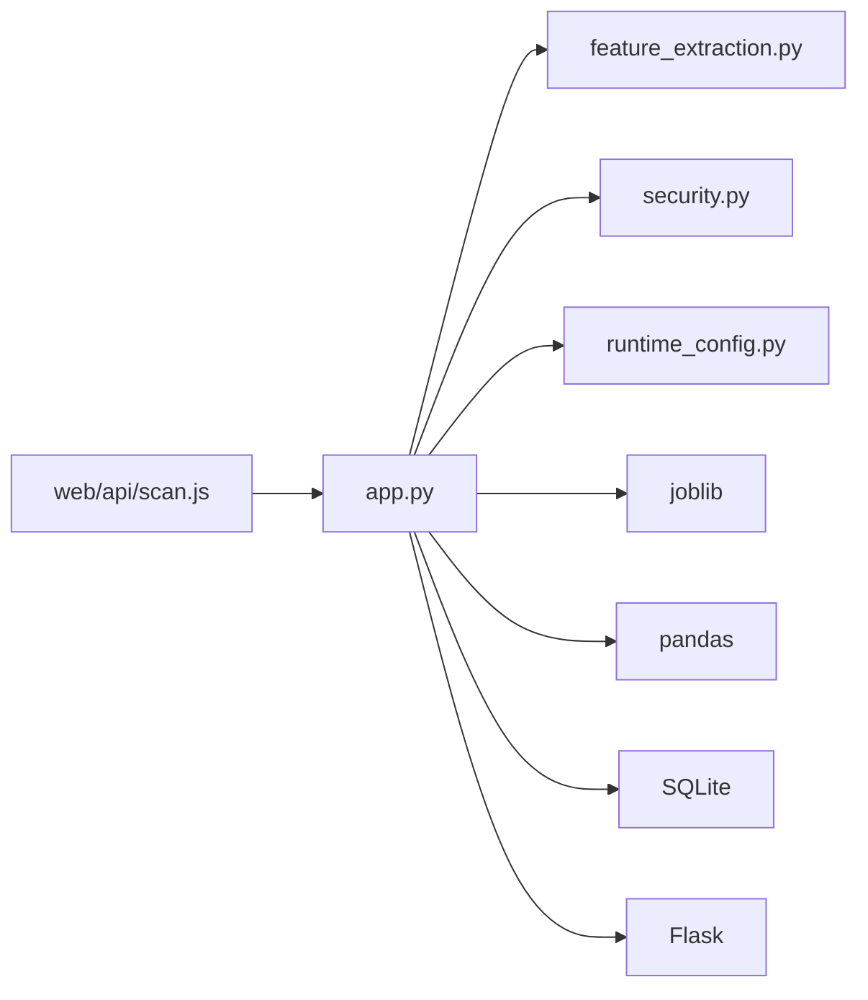

# URL Scanning Engine

<cite>
**Referenced Files in This Document**
- [README.md](file://README.md)
- [app.py](file://app.py)
- [feature_extraction.py](file://feature_extraction.py)
- [security.py](file://security.py)
- [runtime_config.py](file://runtime_config.py)
- [test_production_hardening.py](file://tests/test_production_hardening.py)
- [scan.js](file://web/api/scan.js)
</cite>

## Table of Contents
1. [Introduction](#introduction)
2. [Project Structure](#project-structure)
3. [Core Components](#core-components)
4. [Architecture Overview](#architecture-overview)
5. [Detailed Component Analysis](#detailed-component-analysis)
6. [Dependency Analysis](#dependency-analysis)
7. [Performance Considerations](#performance-considerations)
8. [Troubleshooting Guide](#troubleshooting-guide)
9. [Conclusion](#conclusion)

## Introduction
This document explains the URL scanning engine used by PhishGuard for machine learning-based phishing detection. It focuses on how URLs are parsed into structural features, how those features are scored by a pre-trained scikit-learn model, and how the public API endpoint `/api/v1/scan/url` exposes the result. It also documents authentication behavior, rate limiting, request/response schemas, practical workflows, feature interpretation, educational limitations, and troubleshooting guidance.

The project is explicitly educational: it does not open URLs, execute files, or query reputation services during URL scanning, and its output should be treated as heuristic rather than definitive security evidence.

**Section sources**
- [README.md:11-14](file://README.md#L11-L14)
- [README.md:34-48](file://README.md#L34-L48)

## Project Structure
The URL scanning engine lives primarily in three modules:

| File | Responsibility |
|---|---|
| `app.py` | Flask routes, URL normalization, classification, persistence, health endpoints, and model loading |
| `feature_extraction.py` | Structural feature extraction from a raw URL string |
| `security.py` | Security headers, CORS, passcode gate, and in-process sliding-window rate limiter |
| `runtime_config.py` | Environment-driven configuration such as database path, upload limits, host/port, and feature flags |
| `tests/test_production_hardening.py` | Contract tests for the public API, rate limiting, CORS, and validation |
| `web/api/scan.js` | Vercel proxy that forwards browser requests to the hosted Render backend |



**Diagram sources**
- [app.py:470-508](file://app.py#L470-L508)
- [feature_extraction.py:5-60](file://feature_extraction.py#L5-L60)
- [security.py:71-93](file://security.py#L71-L93)
- [scan.js:35-43](file://web/api/scan.js#L35-L43)

**Section sources**
- [README.md:202-219](file://README.md#L202-L219)
- [app.py:68-110](file://app.py#L68-L110)

## Core Components
The URL scanning pipeline has five main stages:

1. **Request intake**: The client sends a JSON payload with a `url` field to `/api/v1/scan/url`.
2. **Normalization and validation**: The URL is stripped, length-checked, whitespace-checked, and validated to require an `http` or `https` scheme with a hostname.
3. **Feature extraction**: Eleven structural features are computed from the URL string and parsed components.
4. **Model scoring**: A pre-loaded scikit-learn random forest model predicts class and probability.
5. **Response and persistence**: The scan is saved to SQLite and returned as a structured JSON response.

Key implementation points:

- URL normalization rejects empty strings, spaces, unsupported schemes, and missing hostnames.
- Feature extraction uses only static properties; no network access occurs.
- Classification maps model output to `PHISHING` or `LEGITIMATE`, plus a percentage probability.
- The public API returns a 201 status when a scan is created.
- Rate limiting applies per client address using a sliding window.

**Section sources**
- [app.py:291-337](file://app.py#L291-L337)
- [app.py:470-508](file://app.py#L470-L508)
- [feature_extraction.py:5-60](file://feature_extraction.py#L5-L60)

## Architecture Overview
The URL scanning engine integrates Flask routing, feature extraction, a persisted ML model, SQLite history, and shared security controls.



**Diagram sources**
- [scan.js:35-43](file://web/api/scan.js#L35-L43)
- [app.py:470-508](file://app.py#L470-L508)
- [app.py:295-337](file://app.py#L295-L337)
- [feature_extraction.py:5-60](file://feature_extraction.py#L5-L60)
- [app.py:1322](file://app.py#L1322)

## Detailed Component Analysis

### URL Validation and Normalization
The normalizer enforces safe input before any analysis:

- Rejects empty or whitespace-containing URLs.
- Enforces a maximum URL length.
- Requires `http` or `https` scheme.
- Requires a hostname after parsing.
- Raises a domain-specific validation error consumed by both HTML and JSON flows.

This prevents malformed or unsafe inputs from reaching the feature extractor or model.



**Diagram sources**
- [app.py:295-312](file://app.py#L295-L312)

**Section sources**
- [app.py:291-312](file://app.py#L291-L312)
- [tests/test_production_hardening.py:83-100](file://tests/test_production_hardening.py#L83-L100)

### Feature Extraction Process
The feature extractor computes eleven structural features from the raw URL:

| Feature | Meaning |
|---|---|
| `url_length` | Total character count of the full URL |
| `hostname_length` | Character count of the hostname |
| `dot_count` | Number of dots in the URL |
| `hyphen_count` | Number of hyphens in the URL |
| `slash_count` | Number of slashes in the URL |
| `digit_count` | Number of digit characters |
| `special_char_count` | Count of non-alphanumeric characters |
| `has_at_symbol` | Whether the URL contains `@` |
| `has_ip` | Whether the hostname looks like an IPv4 address |
| `https` | Whether the scheme is HTTPS |
| `subdomain_count` | Estimated subdomains based on dot-separated hostname parts |
| `has_login_word` | Whether suspicious login-related words appear in the URL |

These features capture common phishing signals such as long URLs, IP addresses, excessive punctuation, login keywords, and unusual hostname structure.



**Diagram sources**
- [feature_extraction.py:5-60](file://feature_extraction.py#L5-L60)

**Section sources**
- [feature_extraction.py:5-60](file://feature_extraction.py#L5-L60)
- [README.md:38](file://README.md#L38)

### ML Model Implementation and Scoring
The application loads a pre-trained scikit-learn model at startup using `joblib`. During classification:

1. The extracted feature dictionary is wrapped in a single-row DataFrame.
2. The model predicts the class label.
3. The model returns class probabilities.
4. The code selects the phishing class probability.
5. The result is mapped to `PHISHING` or `LEGITIMATE`.
6. The probability is converted to a percentage.

Important constraints:

- The model expects exactly the same feature set produced by `extract_features`.
- No live DNS, certificate inspection, or URL fetching occurs.
- The model is loaded once at process start.
- If the model file is missing, the health endpoint reports the model as unavailable.



**Diagram sources**
- [app.py:315-337](file://app.py#L315-L337)
- [feature_extraction.py:5-60](file://feature_extraction.py#L5-L60)
- [app.py:1322](file://app.py#L1322)

**Section sources**
- [app.py:315-337](file://app.py#L315-L337)
- [app.py:1165-1167](file://app.py#L1165-L1167)
- [app.py:1322](file://app.py#L1322)

### Public API Endpoint: `/api/v1/scan/url`
The endpoint accepts a POST request with a JSON object containing a `url` field. It performs validation, feature extraction, model scoring, persistence, and returns a structured report.

#### Request Schema
| Field | Type | Required | Description |
|---|---|---:|---|
| `url` | string | Yes | The URL to analyze. Must use `http` or `https`, contain no spaces, and have a hostname. |

Example request body:
```json
{
  "url": "http://secure-account-verify.example/login"
}
```

#### Response Schema
| Field | Type | Description |
|---|---|---|
| `scan_id` | integer | Database ID of the saved scan |
| `scanned_at` | string | Timestamp when the response was generated |
| `url` | string | The analyzed URL |
| `result` | string | Either `PHISHING` or `LEGITIMATE` |
| `risk_level` | string | Usually `High` for phishing, `Low` otherwise |
| `probability` | number | Phishing probability as a percentage |
| `features` | object | The 11 structural features used by the model |
| `engine` | string | Identifies the URL model |
| `disclaimer` | string | States that the URL was never opened and no reputation service was queried |

#### Status Codes
| Code | Meaning |
|---|---|
| `201` | Scan created successfully |
| `400` | Validation error, invalid payload, or unsupported URL |
| `429` | Rate limited; includes `Retry-After` header and `retry_after` in body |
| `500` | Unexpected server failure |

#### Authentication Requirements
The URL scanner itself is public. Authentication via a shared passcode protects read-only dashboard and history endpoints, not the scanning endpoints.

#### Rate Limiting
The default public API rule allows 60 requests per 300 seconds per client address. The exact values can be inspected through `/api/v1/health`.



**Diagram sources**
- [app.py:470-508](file://app.py#L470-L508)
- [security.py:71-93](file://security.py#L71-L93)
- [security.py:256-262](file://security.py#L256-L262)

**Section sources**
- [README.md:137-166](file://README.md#L137-L166)
- [app.py:470-508](file://app.py#L470-L508)
- [security.py:71-93](file://security.py#L71-L93)
- [tests/test_production_hardening.py:68-100](file://tests/test_production_hardening.py#L68-L100)

### Practical URL Analysis Workflow
A typical workflow involves:

1. Collecting a suspicious URL from logs, user reports, or email link extraction.
2. Sending it to `/api/v1/scan/url`.
3. Interpreting `result`, `risk_level`, and `probability`.
4. Reviewing `features` to understand why the model flagged or cleared the URL.
5. Recording the outcome in incident tracking if needed.

For example, a high `has_login_word` value indicates suspicious login-related terms, while `has_ip` indicates an IP-based hostname. High `url_length`, `special_char_count`, or `hyphen_count` can indicate obfuscation.



[No sources needed since this diagram shows conceptual workflow, not actual code structure]

### Feature Importance and Result Interpretation
Because the model is a black-box random forest loaded from a pickle file, the repository does not expose trained feature importance weights directly. However, the response includes the exact features used, which supports manual interpretation:

- **Strong phishing indicators**: `has_ip`, `has_login_word`, very long URLs, many special characters, or excessive subdomains.
- **Legitimate indicators**: HTTPS scheme, short hostname, few special characters, and absence of login-related keywords.
- **Ambiguous cases**: Legitimate sites may use login pages or long query strings, so probability should be combined with human review.

The disclaimer in the response reinforces that this is structural analysis only.

**Section sources**
- [feature_extraction.py:11-58](file://feature_extraction.py#L11-L58)
- [app.py:315-337](file://app.py#L315-L337)
- [README.md:152-158](file://README.md#L152-L158)

### Educational Nature and Limitations
PhishGuard is explicitly educational:

- It does not open URLs.
- It does not execute files during URL scanning.
- It does not query reputation services during URL scanning.
- Results are heuristic and can be wrong.
- A “legitimate” or “no detections” result is not proof of safety.
- Commercial solutions typically combine behavioral telemetry, threat intelligence feeds, sandboxing, certificate analysis, and continuous model updates.

**Section sources**
- [README.md:11-14](file://README.md#L11-L14)
- [README.md:45-48](file://README.md#L45-L48)
- [app.py:503-507](file://app.py#L503-L507)

## Dependency Analysis
The URL scanning engine depends on several modules and runtime settings:



**Diagram sources**
- [app.py:16-23](file://app.py#L16-L23)
- [app.py:1322](file://app.py#L1322)
- [scan.js:35-43](file://web/api/scan.js#L35-L43)

**Section sources**
- [app.py:16-23](file://app.py#L16-L23)
- [app.py:1322](file://app.py#L1322)
- [runtime_config.py:110-188](file://runtime_config.py#L110-L188)

## Performance Considerations
- **Model loading**: The model is loaded once at startup, avoiding repeated disk reads.
- **Feature extraction**: Uses lightweight string operations and regex checks.
- **Database writes**: Each successful scan inserts one row into the `scans` table.
- **Rate limiting**: In-process sliding-window limiter reduces abuse but is per-process; multiple workers multiply available budgets.
- **Concurrency**: File scanning uses a thread pool, but URL scanning is synchronous within the Flask request handler.
- **Health monitoring**: `/healthz` and `/api/v1/health` help detect missing models or database issues.

Recommendations:
- Use a production WSGI server such as Gunicorn behind a reverse proxy.
- Place a robust external rate limiter in front of the application when scaling horizontally.
- Monitor `/healthz` for model and database readiness.
- Keep the model file present and readable.

**Section sources**
- [app.py:107-110](file://app.py#L107-L110)
- [app.py:511-531](file://app.py#L511-L531)
- [security.py:71-93](file://security.py#L71-L93)
- [README.md:232-244](file://README.md#L232-L244)

## Troubleshooting Guide

### Common URL Parsing Issues
| Symptom | Likely Cause | Resolution |
|---|---|---|
| `400` with message about spaces | URL contains whitespace | Remove spaces before submitting |
| `400` with unsupported scheme | URL uses `ftp`, `file`, or another scheme | Use `http` or `https` |
| `400` with missing hostname | Malformed URL without a valid host | Provide a complete URL with hostname |
| `400` with invalid payload | Missing `url` field or non-object JSON | Send a JSON object with a `url` string |
| `429` with `Retry-After` | Too many requests from the same client address | Wait the suggested time and retry |

**Section sources**
- [app.py:295-312](file://app.py#L295-L312)
- [app.py:480-493](file://app.py#L480-L493)
- [tests/test_production_hardening.py:83-100](file://tests/test_production_hardening.py#L83-L100)

### Model Availability Issues
If the model file is missing or unreadable:

- `/healthz` reports the model state as unavailable.
- Dashboard system health marks the URL model service as unavailable.
- Scanning may fail because the model cannot be loaded.

Resolution steps:
- Ensure `models/phishing_model.pkl` exists.
- Verify file permissions.
- Restart the application after restoring the model file.

**Section sources**
- [app.py:511-531](file://app.py#L511-L531)
- [app.py:1165-1167](file://app.py#L1165-L1167)
- [app.py:1322](file://app.py#L1322)

### Rate Limiting Behavior
- The public API uses a sliding window keyed by client address.
- When blocked, responses include a `Retry-After` header and a `retry_after` field.
- Tests verify that exceeding the limit returns `429`.

Resolution steps:
- Implement exponential backoff on the client.
- Respect the `Retry-After` header.
- For multi-worker deployments, account for per-process rate limits.

**Section sources**
- [security.py:71-93](file://security.py#L71-L93)
- [security.py:256-262](file://security.py#L256-L262)
- [tests/test_production_hardening.py:149-167](file://tests/test_production_hardening.py#L149-L167)

### CORS and Frontend Proxy
- The backend enables CORS for `/api/v1/*` based on allowed origins.
- The Vercel proxy forwards requests to the backend without exposing the backend hostname to the browser.
- Preflight `OPTIONS` requests return `204`.

Resolution steps:
- Configure `PHISHGUARD_ALLOWED_ORIGINS` to restrict browser access.
- Use the provided proxy when deploying the static frontend separately.

**Section sources**
- [security.py:213-242](file://security.py#L213-L242)
- [scan.js:17-43](file://web/api/scan.js#L17-L43)
- [tests/test_production_hardening.py:102-111](file://tests/test_production_hardening.py#L102-L111)

## Conclusion
The PhishGuard URL scanning engine provides a transparent, educational phishing detector built around structural URL features and a pre-trained scikit-learn model. Its public API offers a clear contract for scoring URLs, returning interpretable features, probabilities, and explicit disclaimers. While useful for learning and triage, it should not replace commercial threat intelligence, dynamic analysis, or comprehensive security products. Operators should monitor health endpoints, respect rate limits, validate inputs carefully, and treat results as heuristic signals requiring human judgment.