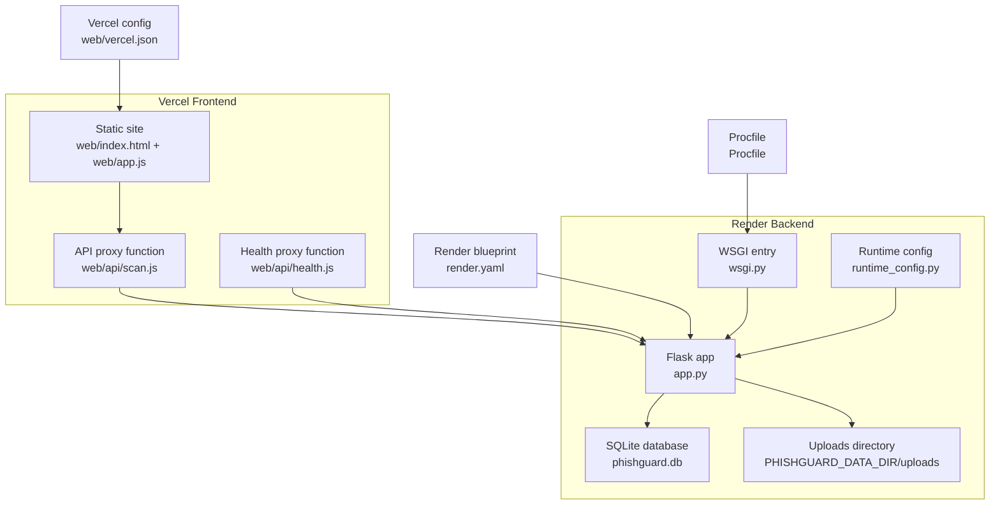
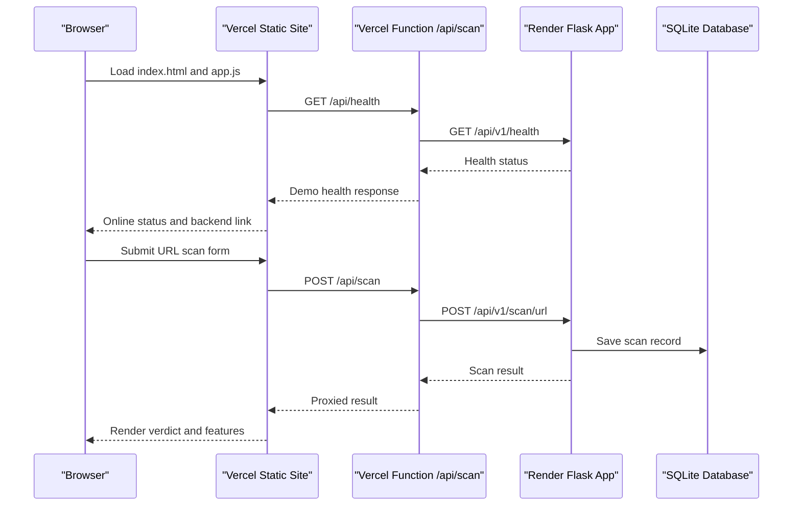
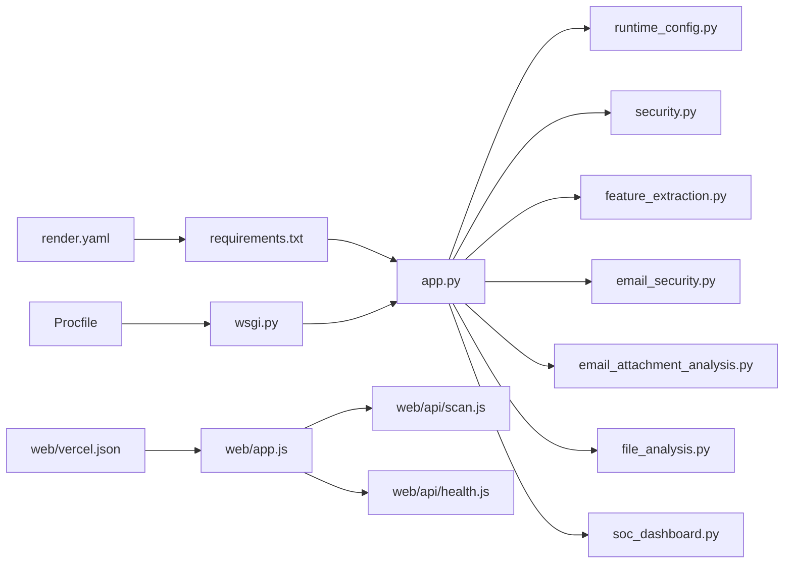
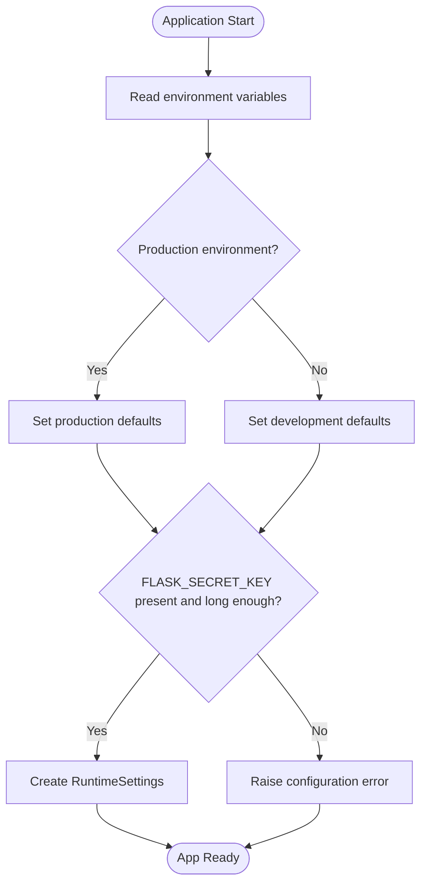

# Deployment Guide

<cite>
**Referenced Files in This Document**   
- [DEPLOYMENT.md](file://DEPLOYMENT.md)
- [render.yaml](file://render.yaml)
- [Procfile](file://Procfile)
- [wsgi.py](file://wsgi.py)
- [app.py](file://app.py)
- [runtime_config.py](file://runtime_config.py)
- [requirements.txt](file://requirements.txt)
- [web/app.js](file://web/app.js)
- [web/api/scan.js](file://web/api/scan.js)
- [web/api/health.js](file://web/api/health.js)
- [web/vercel.json](file://web/vercel.json)
</cite>

## Table of Contents
1. [Introduction](#introduction)
2. [Project Structure](#project-structure)
3. [Core Components](#core-components)
4. [Architecture Overview](#architecture-overview)
5. [Detailed Component Analysis](#detailed-component-analysis)
6. [Dependency Analysis](#dependency-analysis)
7. [Performance Considerations](#performance-considerations)
8. [Troubleshooting Guide](#troubleshooting-guide)
9. [Conclusion](#conclusion)
10. [Appendices](#appendices)

## Introduction
This guide explains how to deploy PhishGuard locally and in production using a dual-service architecture:
- Render hosts the heavy Flask application, including SQLite persistence, ML model loading, file scanning, email analysis, and the public API.
- Vercel serves the lightweight static frontend from `web/` and proxies scan requests through a server-side function so the backend domain never appears in browser traffic.

The recommended deployment order is GitHub → Render → Vercel because the Vercel functions depend on the Render URL, while Render depends only on the repository.

**Section sources**
- [DEPLOYMENT.md:3-12](file://DEPLOYMENT.md#L3-L12)

## Project Structure
PhishGuard separates backend logic, configuration, and deployment definitions from the static frontend:

| Area | Responsibility |
|---|---|
| Repository root | Flask application, security, scanning modules, WSGI entry point, Render blueprint, Procfile, Python dependencies, and environment-driven runtime configuration |
| `templates/` | Jinja HTML templates for the original Flask UI |
| `static/` | Static assets for the original Flask UI |
| `models/` | Machine learning model artifacts used by the URL classifier |
| `instance/uploads/` | Default upload directory when no external data directory is configured |
| `web/` | Vercel static site, client JavaScript, and Node-based API proxy functions |
| `tests/` | Unit and integration tests covering dashboard, email security, file scanning, and production hardening |

**Diagram sources**
- [app.py:68-96](file://app.py#L68-L96)
- [wsgi.py:1-13](file://wsgi.py#L1-L13)
- [runtime_config.py:140-188](file://runtime_config.py#L140-L188)
- [render.yaml:1-31](file://render.yaml#L1-L31)
- [Procfile:1-2](file://Procfile#L1-L2)
- [web/app.js:1-195](file://web/app.js#L1-L195)
- [web/api/scan.js:1-60](file://web/api/scan.js#L1-L60)
- [web/api/health.js:1-38](file://web/api/health.js#L1-L38)
- [web/vercel.json:1-46](file://web/vercel.json#L1-L46)

**Section sources**
- [DEPLOYMENT.md:3-12](file://DEPLOYMENT.md#L3-L12)
- [render.yaml:1-31](file://render.yaml#L1-L31)
- [web/vercel.json:1-46](file://web/vercel.json#L1-L46)

## Core Components
### Render Blueprint and Process Definition
Render deploys the Python service defined by `render.yaml`. The blueprint specifies:
- Web service type with Python runtime
- Build command installing Python dependencies
- Start command running Gunicorn against the stable WSGI target `wsgi:app`
- Health check path `/healthz`
- Environment variables including generated secret key, production flags, upload limits, rate limiting, and optional access controls

`Procfile` contains an equivalent process definition for platforms that read it directly. It binds Gunicorn to all interfaces and uses the same workers, threads, timeout, and WSGI target as the blueprint.

**Section sources**
- [render.yaml:1-31](file://render.yaml#L1-L31)
- [Procfile:1-2](file://Procfile#L1-L2)

### WSGI Entry Point
`wsgi.py` exists so the process manager imports one stable module instead of executing the Flask script directly. It imports the Flask application object from `app.py` and exposes it as the WSGI callable.

**Section sources**
- [wsgi.py:1-13](file://wsgi.py#L1-L13)

### Runtime Configuration
`runtime_config.py` centralizes environment-driven settings:
- Detects development versus production environments
- Loads `.env` for local development
- Requires a stable `FLASK_SECRET_KEY` in production
- Resolves `PHISHGUARD_DATA_DIR`, database path, upload directory, port, host, access code, allowed origins, and feature flags
- Enforces safe defaults for hosted deployments, such as smaller upload limits and stricter behavior

**Section sources**
- [runtime_config.py:1-8](file://runtime_config.py#L1-L8)
- [runtime_config.py:69-107](file://runtime_config.py#L69-L107)
- [runtime_config.py:140-188](file://runtime_config.py#L140-L188)

### Flask Application
`app.py` defines the Flask application, routes, rate limiting, CSRF protection, SQLite schema initialization, URL classification, file scanning, email analysis, health endpoints, and API documentation. It reads configuration from `runtime_config.py` and applies security headers, session cookie policies, and request size limits.

Key deployment-relevant behaviors include:
- Database initialization at import time
- Health endpoint reporting database and model status
- Public API endpoint for URL scanning
- File upload queueing and background processing
- Rate limiting per route category
- Optional access code gate for sensitive pages

**Section sources**
- [app.py:68-110](file://app.py#L68-L110)
- [app.py:133-251](file://app.py#L133-L251)
- [app.py:511-554](file://app.py#L511-L554)
- [app.py:636-720](file://app.py#L636-L720)

### Vercel Static Frontend
The frontend lives under `web/`:
- `index.html` and `styles.css` are served as static files
- `app.js` fetches `/api/health`, resolves the backend URL, renders results, and posts scans to `/api/scan`
- `vercel.json` disables framework detection, configures clean URLs, sets function timeouts, and adds security and caching headers

**Section sources**
- [web/app.js:1-60](file://web/app.js#L1-L60)
- [web/app.js:161-195](file://web/app.js#L161-L195)
- [web/vercel.json:1-46](file://web/vercel.json#L1-L46)

### Vercel API Proxy Functions
`web/api/scan.js` is a server-side proxy that forwards URL scans to the Render backend without exposing its domain to the browser. It:
- Validates HTTP method and JSON body
- Reads `PHISHGUARD_APP_URL` from environment variables
- Proxies to `/api/v1/scan/url`
- Returns 503 when the environment variable is missing
- Returns 504 when the backend times out or cannot be reached

`web/api/health.js` provides a resilient demo health response. It returns 200 even when the backend is unavailable, allowing the frontend to render links and error messages gracefully.

**Section sources**
- [web/api/scan.js:1-60](file://web/api/scan.js#L1-L60)
- [web/api/health.js:1-38](file://web/api/health.js#L1-L38)

## Architecture Overview
PhishGuard’s deployment architecture separates compute-heavy backend work from a lightweight frontend:

**Diagram sources**
- [web/app.js:161-195](file://web/app.js#L161-L195)
- [web/api/scan.js:17-58](file://web/api/scan.js#L17-L58)
- [app.py:470-508](file://app.py#L470-L508)
- [app.py:511-554](file://app.py#L511-L554)

## Detailed Component Analysis

### Render Deployment Using the Blueprint
Use the committed `render.yaml` blueprint to create the service automatically:
1. Connect your GitHub repository in the Render dashboard.
2. Select the PhishGuard repository and apply the blueprint.
3. Review the generated service and fill required values:
   - `PHISHGUARD_ACCESS_CODE` for protecting sensitive history
   - `PHISHGUARD_ALLOWED_ORIGINS` for restricting direct API access
4. Verify the health endpoint after deployment.

For manual creation, use the Python runtime, install requirements, start Gunicorn with the WSGI target, set `/healthz` as the health check, and configure the documented environment variables.

**Section sources**
- [DEPLOYMENT.md:51-115](file://DEPLOYMENT.md#L51-L115)
- [render.yaml:1-31](file://render.yaml#L1-L31)

### Vercel Static Site Deployment
Deploy the frontend from the same repository:
1. Import the repository into Vercel.
2. Set the root directory to `web`.
3. Leave build, output, and install commands empty because the frontend is static plus Node functions.
4. Add `PHISHGUARD_APP_URL` pointing to the Render backend URL without a trailing slash.
5. Redeploy after changing environment variables.

The frontend calls `/api/scan`, which proxies to the Render backend. This avoids CORS complexity and keeps the backend domain hidden from the browser.

**Section sources**
- [DEPLOYMENT.md:117-160](file://DEPLOYMENT.md#L117-L160)
- [web/vercel.json:1-46](file://web/vercel.json#L1-L46)
- [web/app.js:44-60](file://web/app.js#L44-L60)
- [web/app.js:161-195](file://web/app.js#L161-L195)
- [web/api/scan.js:17-58](file://web/api/scan.js#L17-L58)

### GitHub Repository Setup and Automated Triggers
Before pushing secrets:
- Ensure `.env` is ignored and `.env.example` contains no real keys.
- Generate a stable session key for production.
- Rotate any accidentally committed API keys.

Repository setup steps:
1. Initialize Git with the `main` branch.
2. Stage files, inspect status, commit, add the remote, and push.
3. Create the GitHub repository first if needed.

Automated deployment triggers:
- Render has `autoDeploy: true` in the blueprint, so pushes to `main` rebuild the service.
- Vercel also watches the connected repository and redeployments can be triggered by environment changes.

**Section sources**
- [DEPLOYMENT.md:16-49](file://DEPLOYMENT.md#L16-L49)
- [render.yaml:7-11](file://render.yaml#L7-L11)

### Environment Variable Configuration
#### Required Render Variables
| Variable | Purpose |
|---|---|
| `PYTHON_VERSION` | Controls the Python runtime version |
| `PHISHGUARD_ENV` | Sets production mode |
| `FLASK_SECRET_KEY` | Stable secret for sessions and CSRF; must not change between restarts |
| `PHISHGUARD_DATA_DIR` | Directory for SQLite and uploads; ephemeral on free instances unless attached |
| `PHISHGUARD_ACCESS_CODE` | Optional passcode for protected history |
| `PHISHGUARD_ALLOWED_ORIGINS` | Allowed origins for direct API access |
| `MAX_UPLOAD_BYTES` | Upload size limit |
| `FILE_SCAN_WORKERS` | Number of concurrent file scan threads |
| `PHISHGUARD_RATE_LIMIT` | Enables or disables rate limiting |

#### Required Vercel Variables
| Variable | Purpose |
|---|---|
| `PHISHGUARD_APP_URL` | Backend URL used by the proxy functions |

The runtime configuration enforces a minimum secret length and refuses to run in production without a stable key.

**Section sources**
- [DEPLOYMENT.md:81-94](file://DEPLOYMENT.md#L81-L94)
- [DEPLOYMENT.md:133-138](file://DEPLOYMENT.md#L133-L138)
- [runtime_config.py:89-107](file://runtime_config.py#L89-L107)
- [runtime_config.py:140-188](file://runtime_config.py#L140-L188)

### Production Security Considerations
#### Database Persistence
Free Render instances have an ephemeral filesystem. SQLite and uploaded files disappear on restart unless you:
- Accept per-session demo data
- Attach a Render disk and set `PHISHGUARD_DATA_DIR` to the mounted path
- Migrate to an external database (requires code changes)

The application creates the database and upload directories under `PHISHGUARD_DATA_DIR`.

**Section sources**
- [DEPLOYMENT.md:102-115](file://DEPLOYMENT.md#L102-L115)
- [runtime_config.py:82-86](file://runtime_config.py#L82-L86)
- [runtime_config.py:171-174](file://runtime_config.py#L171-L174)
- [app.py:133-135](file://app.py#L133-L135)

#### SSL/TLS Configuration
Both Render and Vercel provide HTTPS termination at the platform edge. The application itself does not manage TLS certificates. For additional security:
- Use HTTPS-only domains
- Restrict `PHISHGUARD_ALLOWED_ORIGINS` to trusted Vercel domains
- Keep `SESSION_COOKIE_SECURE` enabled in production via runtime configuration

**Section sources**
- [runtime_config.py:140-188](file://runtime_config.py#L140-L188)
- [web/vercel.json:11-26](file://web/vercel.json#L11-L26)

#### Monitoring and Health Checks
Render uses `/healthz` as the service health probe. The application reports:
- Overall status
- Environment
- Database state
- Model load state
- Uptime

The public API also exposes `/api/v1/health` with capability and limit metadata. Vercel’s `/api/health` function wraps this call and returns a friendly demo response.

**Section sources**
- [render.yaml:10](file://render.yaml#L10)
- [app.py:511-554](file://app.py#L511-L554)
- [web/api/health.js:18-36](file://web/api/health.js#L18-L36)

### Common Deployment Issues
| Symptom | Cause | Fix |
|---|---|---|
| Build fails with missing Python module | Dependency not listed | Add it to `requirements.txt`, commit, and push |
| Boot error about `FLASK_SECRET_KEY` | Production without a stable key | Set `FLASK_SECRET_KEY` on Render |
| `/healthz` returns degraded or unhealthy | Database or model could not load | Check logs and verify `PHISHGUARD_DATA_DIR` |
| Vercel shows missing backend URL | `PHISHGUARD_APP_URL` not set | Add it in Vercel environment variables and redeploy |
| Vercel shows timeout warning | Render instance is asleep | Retry after the backend wakes |
| Session or CSRF errors across workers | Secret key changed between restarts | Keep `FLASK_SECRET_KEY` fixed |
| Uploads rejected near platform limit | Platform request body cap | Lower `MAX_UPLOAD_BYTES` |
| History disappears after deploy | Ephemeral filesystem | Attach a disk and set `PHISHGUARD_DATA_DIR` |

**Section sources**
- [DEPLOYMENT.md:185-197](file://DEPLOYMENT.md#L185-L197)

### Scaling Considerations
- **Workers and threads**: Gunicorn runs two workers with four threads each by default. Adjust based on CPU capacity and concurrency needs.
- **File scan concurrency**: `FILE_SCAN_WORKERS` controls the thread pool for file analysis.
- **Rate limiting**: Route-specific rules protect URL scanning, file uploads, email analysis, dashboard access, public API usage, and unlock attempts.
- **Cold starts**: Free Render instances may sleep after inactivity. The Vercel proxy surfaces a readable timeout message when the backend is slow to wake.
- **Storage scaling**: SQLite is simple but not ideal for high-concurrency multi-instance setups. Attach persistent storage or migrate to a managed database if needed.

**Section sources**
- [render.yaml:9](file://render.yaml#L9)
- [app.py:98-110](file://app.py#L98-L110)
- [DEPLOYMENT.md:102-115](file://DEPLOYMENT.md#L102-L115)

### Maintenance Procedures
#### Rollback
- Render: Use the rollback option on the service page.
- Vercel: Promote a previous deployment from the Deployments view.
- Code rollback: Revert the last commit and push.

#### Post-Deployment Verification
Verify both services:
- Render health endpoint
- Root page status
- Public URL scan endpoint
- Vercel health endpoint
- Browser-based flows for URL scanning, security headers, access code gating, API docs, and file upload

**Section sources**
- [DEPLOYMENT.md:198-205](file://DEPLOYMENT.md#L198-L205)
- [DEPLOYMENT.md:162-184](file://DEPLOYMENT.md#L162-L184)

## Dependency Analysis
The backend depends on Python packages for Flask, Gunicorn, machine learning, data processing, PDF handling, image processing, DNS resolution, and HTTP requests. The frontend depends on Vercel’s static hosting and Node-based serverless functions.

**Diagram sources**
- [app.py:1-66](file://app.py#L1-L66)
- [runtime_config.py:1-21](file://runtime_config.py#L1-L21)
- [requirements.txt:1-35](file://requirements.txt#L1-L35)
- [wsgi.py:10-12](file://wsgi.py#L10-L12)
- [render.yaml:8-9](file://render.yaml#L8-L9)
- [Procfile:1](file://Procfile#L1)
- [web/app.js:1-60](file://web/app.js#L1-L60)
- [web/api/scan.js:1-60](file://web/api/scan.js#L1-L60)
- [web/api/health.js:1-38](file://web/api/health.js#L1-L38)
- [web/vercel.json:1-10](file://web/vercel.json#L1-L10)

**Section sources**
- [requirements.txt:1-35](file://requirements.txt#L1-L35)
- [app.py:1-66](file://app.py#L1-L66)
- [web/app.js:1-60](file://web/app.js#L1-L60)

## Performance Considerations
- Prefer keeping the backend behind a single Render instance during early production use to avoid shared-state issues with SQLite.
- Tune `FILE_SCAN_WORKERS` according to CPU availability and expected file-scan throughput.
- Monitor `/healthz` and `/api/v1/health` for database readiness and model availability.
- Use persistent storage for SQLite if history must survive restarts.
- Cache static frontend assets through Vercel’s CDN; keep API responses uncacheable.
- Avoid large uploads beyond platform limits; adjust `MAX_UPLOAD_BYTES` conservatively.

[No sources needed since this section provides general guidance]

## Troubleshooting Guide
Use the following checks before opening support issues:

1. Confirm the repository is pushed to GitHub.
2. Confirm Render built successfully and `/healthz` reports healthy status.
3. Confirm `FLASK_SECRET_KEY` is stable and present.
4. Confirm `PHISHGUARD_DATA_DIR` points to writable storage if persistence is required.
5. Confirm Vercel has `PHISHGUARD_APP_URL` set to the exact Render URL.
6. Test the Vercel `/api/health` endpoint to see whether the frontend can reach the backend.
7. Test the Vercel `/api/scan` endpoint to confirm proxy behavior.
8. Inspect Render logs for database, model, or upload errors.
9. Validate security headers on the Vercel frontend.
10. If rolling back, prefer platform rollbacks before reverting commits.

**Section sources**
- [DEPLOYMENT.md:162-205](file://DEPLOYMENT.md#L162-L205)
- [web/api/scan.js:17-58](file://web/api/scan.js#L17-L58)
- [web/api/health.js:8-36](file://web/api/health.js#L8-L36)
- [app.py:511-554](file://app.py#L511-L554)

## Conclusion
PhishGuard’s deployment strategy intentionally separates responsibilities:
- Render runs the Flask application, handles authentication, scanning, database persistence, and the public API.
- Vercel serves a fast, secure static frontend and proxies sensitive backend calls through server-side functions.

This separation reduces cross-origin complexity, improves frontend performance, and keeps backend credentials out of the browser. With proper environment variables, persistent storage, and health monitoring, the system can operate reliably in production.

[No sources needed since this section summarizes without analyzing specific files]

## Appendices

### Step-by-Step Local Development
1. Install Python dependencies from `requirements.txt`.
2. Run the Flask application directly for development.
3. Use `.env` for local overrides; do not commit secrets.
4. Access the original Flask UI at the local development port.

**Section sources**
- [requirements.txt:1-35](file://requirements.txt#L1-L35)
- [runtime_config.py:1-21](file://runtime_config.py#L1-L21)
- [wsgi.py:1-8](file://wsgi.py#L1-L8)

### Environment Decision Logic

**Diagram sources**
- [runtime_config.py:69-107](file://runtime_config.py#L69-L107)
- [runtime_config.py:140-188](file://runtime_config.py#L140-L188)