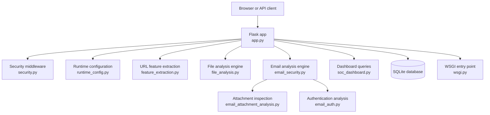
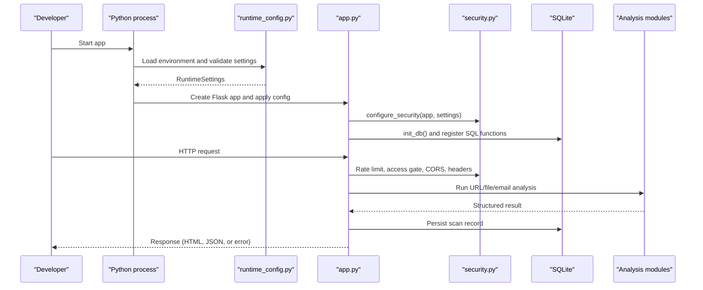
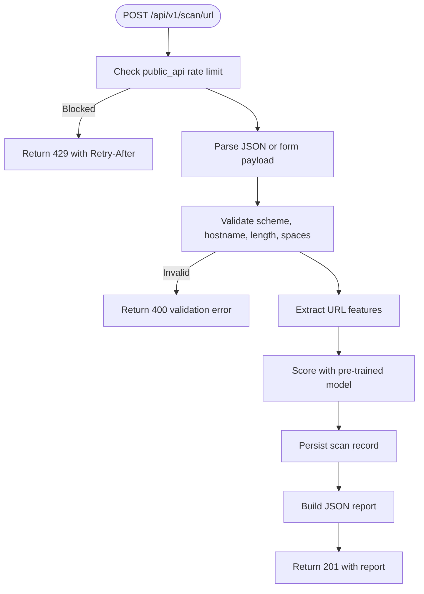
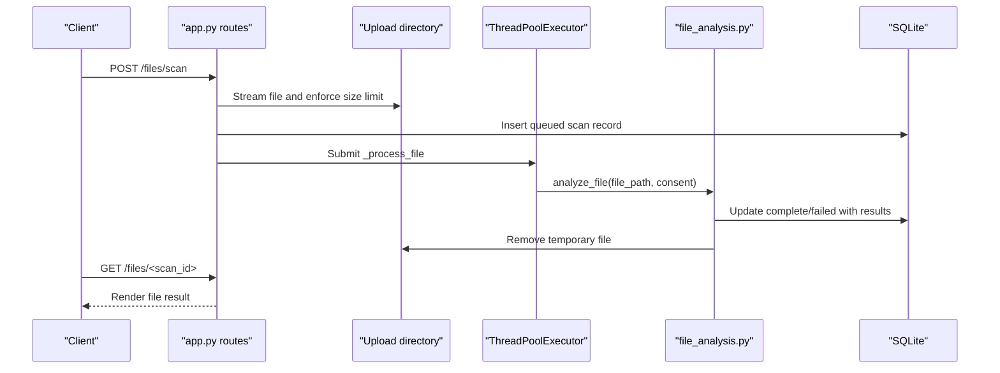
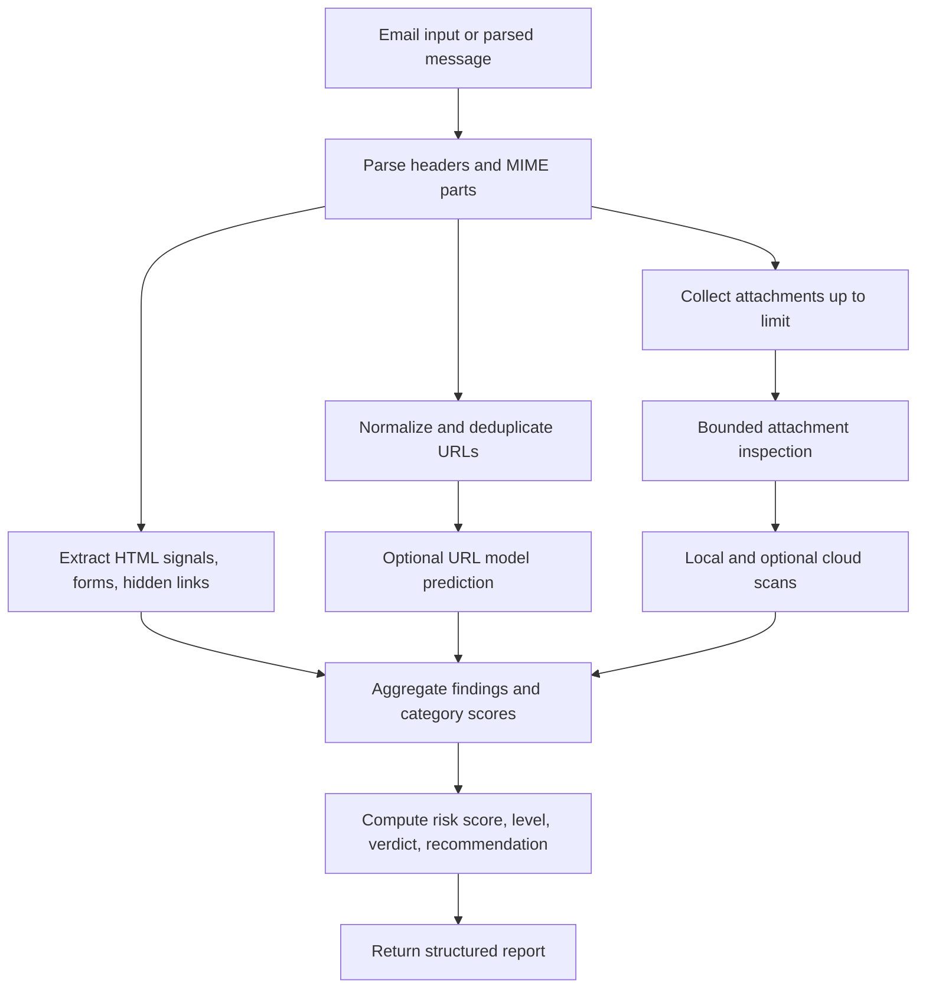
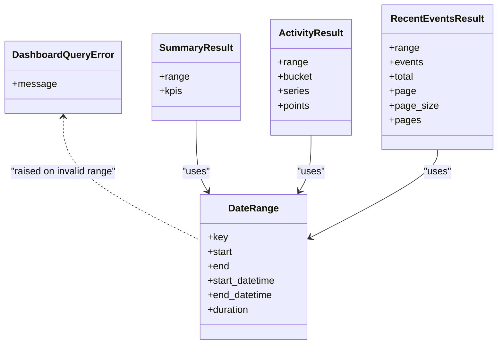
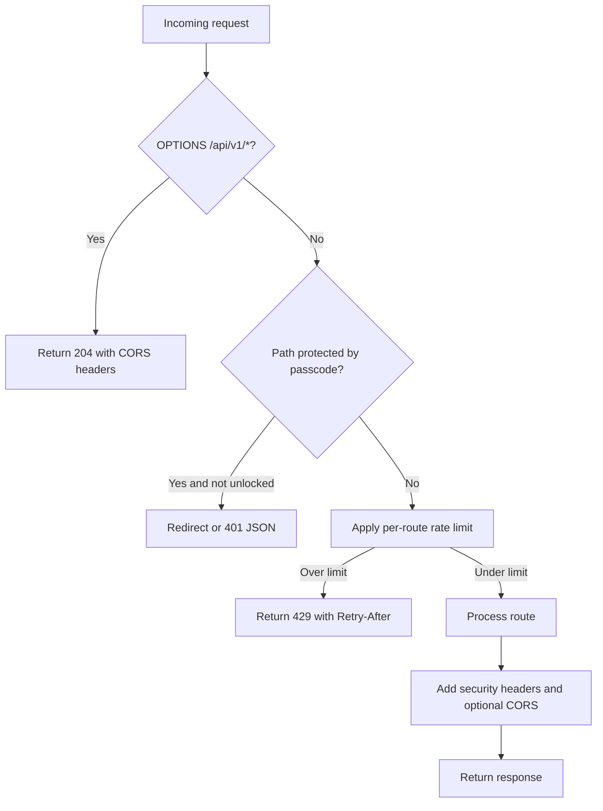
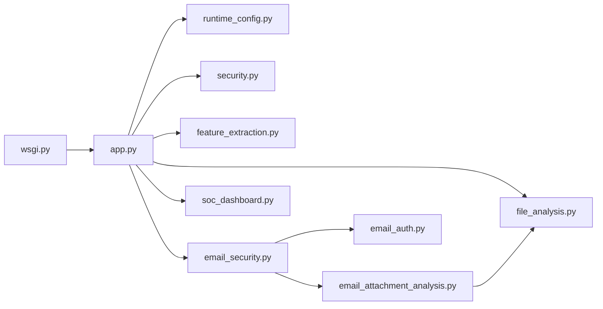

# Development Guide

<cite>
**Referenced Files in This Document**   
- [README.md](file://README.md)
- [app.py](file://app.py)
- [runtime_config.py](file://runtime_config.py)
- [security.py](file://security.py)
- [soc_dashboard.py](file://soc_dashboard.py)
- [feature_extraction.py](file://feature_extraction.py)
- [file_analysis.py](file://file_analysis.py)
- [email_security.py](file://email_security.py)
- [email_auth.py](file://email_auth.py)
- [email_attachment_analysis.py](file://email_attachment_analysis.py)
- [wsgi.py](file://wsgi.py)
- [requirements.txt](file://requirements.txt)
- [tests/test_dashboard.py](file://tests/test_dashboard.py)
- [tests/test_email_security.py](file://tests/test_email_security.py)
- [tests/test_file_scanning.py](file://tests/test_file_scanning.py)
- [tests/test_production_hardening.py](file://tests/test_production_hardening.py)
</cite>

## Table of Contents
1. [Introduction](#introduction)
2. [Project Structure](#project-structure)
3. [Core Components](#core-components)
4. [Architecture Overview](#architecture-overview)
5. [Detailed Component Analysis](#detailed-component-analysis)
6. [Dependency Analysis](#dependency-analysis)
7. [Performance Considerations](#performance-considerations)
8. [Troubleshooting Guide](#troubleshooting-guide)
9. [Conclusion](#conclusion)
10. [Appendices](#appendices)

## Introduction
PhishGuard is a self-hostable phishing triage console that combines URL classification, static file triage, and pasted-email security review into one Flask application with an SQLite-backed history and a SOC-style dashboard. It ships a pre-trained machine-learning model for URL scoring and provides a public JSON API for external consumption.

This development guide explains how to contribute, run the test suite, extend scanning engines, customize templates, add API endpoints, maintain backward compatibility, and profile or optimize the machine learning and analysis components.

## Project Structure
The repository follows a layered layout:

- Application layer: `app.py` defines routes, request handling, database initialization, and orchestration.
- Security layer: `security.py` centralizes headers, CORS, passcode gate, and rate limiting.
- Configuration layer: `runtime_config.py` resolves environment variables and enforces production guards.
- Analysis modules: `feature_extraction.py`, `file_analysis.py`, `email_security.py`, `email_auth.py`, and `email_attachment_analysis.py`.
- Dashboard layer: `soc_dashboard.py` exposes query functions and SQL helpers used by dashboard APIs.
- Front end assets: `templates/` and `static/`; optional Vercel front end under `web/`.
- Tests: `tests/` contains 60 tests covering scanners, dashboards, CSRF, headers, passcode gate, rate limits, public API contract, CORS preflight, and health probes.
- Deployment entry points: `wsgi.py` for gunicorn; `Procfile` and `render.yaml` for hosting.



**Diagram sources**
- [app.py:68-96](file://app.py#L68-L96)
- [security.py:245-253](file://security.py#L245-L253)
- [runtime_config.py:140-188](file://runtime_config.py#L140-L188)
- [feature_extraction.py:5-60](file://feature_extraction.py#L5-L60)
- [file_analysis.py:583-608](file://file_analysis.py#L583-L608)
- [email_security.py:284-647](file://email_security.py#L284-L647)
- [email_attachment_analysis.py:283-379](file://email_attachment_analysis.py#L283-L379)
- [email_auth.py:185-320](file://email_auth.py#L185-L320)
- [soc_dashboard.py:247-306](file://soc_dashboard.py#L247-L306)
- [wsgi.py:10-12](file://wsgi.py#L10-L12)

**Section sources**
- [README.md:202-219](file://README.md#L202-L219)

## Core Components
- URL scanner: validates input, extracts structural features, scores with a pre-trained model, persists results, and exposes both HTML and JSON endpoints.
- File scanner: streams uploads, computes SHA-256, queues background analysis, runs local ClamAV, and optionally submits to VirusTotal or OPSWAT when consent is given.
- Email scanner: parses headers, body, HTML signals, attachments, link extraction, authentication claims, optional DNS lookups, and attachment inspection.
- Dashboard APIs: summarize activity, recent events, threat distribution, email/file/url statistics, authentication statistics, incidents, top indicators, system health, and search.
- Security controls: CSP, framing, referrer policy, HSTS, private-page cache control, CORS on `/api/v1/*`, passcode-gated history, per-route sliding-window rate limits, and CSRF validation.
- Runtime configuration: environment-driven settings, safe defaults, secret key enforcement, data directory selection, upload ceilings, and proxy trust.

Key responsibilities are split so new features can be added without touching unrelated concerns. For example, adding a new dashboard endpoint should primarily touch `soc_dashboard.py` and `app.py`, while adding a new scanner should touch the relevant analysis module and route handler.

**Section sources**
- [app.py:98-110](file://app.py#L98-L110)
- [app.py:295-337](file://app.py#L295-L337)
- [app.py:470-508](file://app.py#L470-L508)
- [app.py:636-720](file://app.py#L636-L720)
- [email_security.py:284-647](file://email_security.py#L284-L647)
- [soc_dashboard.py:354-401](file://soc_dashboard.py#L354-L401)
- [security.py:33-55](file://security.py#L33-L55)
- [security.py:71-100](file://security.py#L71-L100)
- [runtime_config.py:110-188](file://runtime_config.py#L110-L188)

## Architecture Overview
The runtime flow starts with environment resolution, then Flask application setup, security middleware registration, database initialization, and finally request routing.



**Diagram sources**
- [runtime_config.py:140-188](file://runtime_config.py#L140-L188)
- [app.py:68-96](file://app.py#L68-L96)
- [app.py:133-251](file://app.py#L133-L251)
- [security.py:245-253](file://security.py#L245-L253)

## Detailed Component Analysis

### URL Scanning and Public API Contract
The URL path normalizes and validates input, extracts features, scores with the model, saves a scan record, and returns either an HTML result or a JSON report. The public API endpoint enforces its own rate rule, accepts JSON or form payloads, and returns a stable response shape including `scan_id`, `scanned_at`, `url`, `result`, `risk_level`, `probability`, `features`, `engine`, and `disclaimer`.



**Diagram sources**
- [app.py:470-508](file://app.py#L470-L508)
- [app.py:295-337](file://app.py#L295-L337)
- [feature_extraction.py:5-60](file://feature_extraction.py#L5-L60)

**Section sources**
- [app.py:470-508](file://app.py#L470-L508)
- [app.py:295-337](file://app.py#L295-L337)
- [feature_extraction.py:5-60](file://feature_extraction.py#L5-L60)
- [tests/test_production_hardening.py:68-100](file://tests/test_production_hardening.py#L68-L100)

### File Scanning Pipeline
File uploads stream directly to a private upload directory, compute SHA-256, create a queued database record, and submit analysis to a thread pool. Background processing runs local signature checks, optional cloud provider submissions, summarizes engine results, updates status, and removes temporary files.



**Diagram sources**
- [app.py:636-720](file://app.py#L636-L720)
- [file_analysis.py:583-608](file://file_analysis.py#L583-L608)

**Section sources**
- [app.py:636-720](file://app.py#L636-L720)
- [file_analysis.py:20-41](file://file_analysis.py#L20-L41)
- [file_analysis.py:146-203](file://file_analysis.py#L146-L203)
- [file_analysis.py:547-608](file://file_analysis.py#L547-L608)
- [tests/test_file_scanning.py:103-146](file://tests/test_file_scanning.py#L103-L146)
- [tests/test_file_scanning.py:180-234](file://tests/test_file_scanning.py#L180-L234)

### Email Analysis and Attachment Inspection
Email analysis parses headers, plain text, HTML, links, attachments, and authentication claims. It applies content rules, HTML signal detection, optional URL model scoring, and attachment inspection with bounded archive expansion, PDF page limits, image metadata extraction, and virus scanning.



**Diagram sources**
- [email_security.py:284-647](file://email_security.py#L284-L647)
- [email_attachment_analysis.py:283-379](file://email_attachment_analysis.py#L283-L379)
- [email_auth.py:185-320](file://email_auth.py#L185-L320)

**Section sources**
- [email_security.py:284-647](file://email_security.py#L284-L647)
- [email_attachment_analysis.py:283-379](file://email_attachment_analysis.py#L283-L379)
- [email_auth.py:185-320](file://email_auth.py#L185-L320)
- [tests/test_email_security.py:32-113](file://tests/test_email_security.py#L32-L113)
- [tests/test_email_security.py:251-355](file://tests/test_email_security.py#L251-L355)
- [tests/test_email_security.py:389-488](file://tests/test_email_security.py#L389-L488)

### Dashboard Queries and Data Models
The dashboard composes a unified event stream from URL scans, file scans, and email scans using a shared CTE. It supports date ranges, bucketing, pagination, filtering, search, CSV export, incident management, and statistics for each source type.



**Diagram sources**
- [soc_dashboard.py:9-26](file://soc_dashboard.py#L9-L26)
- [soc_dashboard.py:271-306](file://soc_dashboard.py#L271-L306)
- [soc_dashboard.py:354-401](file://soc_dashboard.py#L354-L401)
- [soc_dashboard.py:404-460](file://soc_dashboard.py#L404-L460)
- [soc_dashboard.py:463-534](file://soc_dashboard.py#L463-L534)

**Section sources**
- [soc_dashboard.py:40-244](file://soc_dashboard.py#L40-L244)
- [soc_dashboard.py:247-306](file://soc_dashboard.py#L247-L306)
- [soc_dashboard.py:354-534](file://soc_dashboard.py#L354-L534)
- [tests/test_dashboard.py:27-133](file://tests/test_dashboard.py#L27-L133)
- [tests/test_dashboard.py:135-247](file://tests/test_dashboard.py#L135-L247)

### Security Controls: Headers, CORS, Passcode Gate, and Rate Limits
Every response receives strict security headers. Private pages receive no-store cache behavior. The `/api/v1/*` prefix enables CORS with configurable allowed origins and preflight support. Protected paths require a shared passcode unless unlocked. Each expensive route uses a named rate rule with a sliding window.



**Diagram sources**
- [security.py:28-55](file://security.py#L28-L55)
- [security.py:71-100](file://security.py#L71-L100)
- [security.py:114-165](file://security.py#L114-L165)
- [security.py:178-243](file://security.py#L178-L243)
- [security.py:256-263](file://security.py#L256-L263)
- [app.py:267-288](file://app.py#L267-L288)

**Section sources**
- [security.py:33-55](file://security.py#L33-L55)
- [security.py:71-100](file://security.py#L71-L100)
- [security.py:114-165](file://security.py#L114-L165)
- [security.py:178-243](file://security.py#L178-L243)
- [security.py:256-263](file://security.py#L256-L263)
- [tests/test_production_hardening.py:46-111](file://tests/test_production_hardening.py#L46-L111)
- [tests/test_production_hardening.py:149-167](file://tests/test_production_hardening.py#L149-L167)

## Dependency Analysis
The main dependency relationships are:

- `app.py` depends on `runtime_config.py`, `security.py`, `feature_extraction.py`, `file_analysis.py`, `email_security.py`, `email_attachment_analysis.py`, `email_auth.py`, and `soc_dashboard.py`.
- `email_security.py` depends on `feature_extraction.py`, `email_attachment_analysis.py`, and `email_auth.py`.
- `email_attachment_analysis.py` reuses `file_analysis.py` for attachment scanning.
- `soc_dashboard.py` registers custom SQL functions and exposes query helpers consumed by dashboard routes.
- `wsgi.py` exposes the Flask app for production servers.



**Diagram sources**
- [app.py:22-65](file://app.py#L22-L65)
- [email_security.py:11-13](file://email_security.py#L11-L13)
- [email_attachment_analysis.py:17-17](file://email_attachment_analysis.py#L17-L17)
- [wsgi.py:10-12](file://wsgi.py#L10-L12)

**Section sources**
- [app.py:22-65](file://app.py#L22-L65)
- [email_security.py:11-13](file://email_security.py#L11-L13)
- [email_attachment_analysis.py:17-17](file://email_attachment_analysis.py#L17-L17)
- [wsgi.py:10-12](file://wsgi.py#L10-L12)

## Performance Considerations
- URL model inference: Uses pandas DataFrame construction per URL. Batch operations are not currently implemented; avoid submitting large batches through the browser UI.
- File scanning: Background threads reduce request latency, but CPU-bound antivirus calls still block worker threads. Tune `FILE_SCAN_WORKERS` based on available cores.
- Email parsing: BeautifulSoup and regex scanning operate over potentially large messages. Keep paste sizes reasonable and rely on configured limits.
- Database: SQLite is single-writer; heavy concurrent writes can cause contention. Use read replicas only if you move off SQLite, or throttle dashboard queries during peak load.
- Memory: Large attachments and emails are bounded by constants such as `MAX_ATTACHMENT_BYTES`, `MAX_EMAIL_CHARACTERS`, and `MAX_EMAIL_REQUEST_BYTES`. Avoid disabling these limits.
- Profiling ML components: Use Python profilers (`cProfile`, `py-spy`) around `classify_url` and `analyze_email`. Profile `extract_features`, `model.predict`, and `model.predict_proba` to identify hotspots. Consider caching repeated URL features if the same URLs are scanned frequently.

[No sources needed since this section provides general guidance]

## Troubleshooting Guide
Common issues and their likely causes:

- 429 Too Many Requests: A route exceeded its sliding-window limit. Check `Retry-After` and the corresponding rate rule name. During development, set `TESTING=True` to bypass rate limits unless a test explicitly opts in via `RATE_LIMIT_IN_TESTS`.
- 400 CSRF expired: State-changing requests must include a valid CSRF token. Reload the page to get a fresh token.
- 401 History gated: When `PHISHGUARD_ACCESS_CODE` is set, protected paths redirect to `/unlock` or return JSON with an unlock URL.
- 413 Payload too large: File or email inputs exceed configured limits. Adjust `MAX_UPLOAD_BYTES` or `MAX_EMAIL_REQUEST_BYTES` carefully.
- Health probe degraded: `/healthz` reports database or model state. If the model is unavailable, verify that the model object is loaded before serving traffic.
- External providers skipped: VirusTotal or OPSWAT may skip due to missing keys, upload limits, or consent not being granted.

Useful debugging steps:

- Inspect response headers for CSP, framing, and CORS values.
- Check the server log for file analysis failures or provider errors.
- Verify environment variables with `runtime_config.py` defaults and production guards.
- Temporarily disable rate limits in development by setting `TESTING=True`, but keep `RATE_LIMIT_IN_TESTS=False` when testing limiter behavior.

**Section sources**
- [app.py:267-288](file://app.py#L267-L288)
- [app.py:511-531](file://app.py#L511-L531)
- [security.py:178-243](file://security.py#L178-L243)
- [security.py:256-263](file://security.py#L256-L263)
- [tests/test_production_hardening.py:149-167](file://tests/test_production_hardening.py#L149-L167)

## Conclusion
PhishGuard’s modular design separates routing, security, configuration, and analysis logic, making it straightforward to extend scanners, add dashboard endpoints, and harden new routes. The test suite provides strong coverage for scanners, dashboard APIs, CSRF, headers, passcode gating, rate limiting, public API contracts, CORS preflight, and health probes. Follow the established patterns for URL, file, and email analysis, preserve backward-compatible response shapes, and use the provided configuration and security primitives when adding new features.

[No sources needed since this section summarizes without analyzing specific files]

## Appendices

### Testing and Test Execution
Run the full suite with:

```powershell
python -m unittest discover -s tests -v
```

The suite includes 60 tests covering:

- URL, file, and email scanners.
- Dashboard pages and all dashboard API endpoints.
- CSRF enforcement on forms and JSON endpoints.
- Security headers on every response.
- Passcode gate protecting dashboard, history, authentication, and dashboard APIs.
- Per-route rate limiting and 429 responses.
- Public API contract for `/api/v1/scan/url`.
- CORS preflight for `/api/v1/*`.
- Health probes at `/healthz` and `/api/v1/health`.

Development bypass:

- Set `TESTING=True` to bypass the in-process rate limiter during development.
- Tests that need deterministic rate-limit behavior set `RATE_LIMIT_IN_TESTS=True` and temporarily replace the relevant `RateRule`.

Test isolation:

- Tests create temporary databases and upload directories.
- They reset `LIMITER` state where necessary.
- They mock external DNS, network calls, and subprocesses to keep suites fast and deterministic.

**Section sources**
- [README.md:191-200](file://README.md#L191-L200)
- [tests/test_dashboard.py:10-25](file://tests/test_dashboard.py#L10-L25)
- [tests/test_email_security.py:15-27](file://tests/test_email_security.py#L15-L27)
- [tests/test_file_scanning.py:13-28](file://tests/test_file_scanning.py#L13-L28)
- [tests/test_production_hardening.py:10-39](file://tests/test_production_hardening.py#L10-L39)
- [security.py:71-100](file://security.py#L71-L100)

### Adding New Features
Guidelines for extending PhishGuard:

- New URL analysis feature:
  - Extend `feature_extraction.py` only if the model requires additional features.
  - Update `app.py` classification and API response only if the contract changes.
  - Add tests validating feature names, model compatibility, and API fields.

- New file scanning engine:
  - Add engine detection and invocation in `file_analysis.py`.
  - Update `get_scanner_configuration()` to expose readiness.
  - Ensure consent and external submission flags are respected.
  - Add tests for configuration, consent, and result aggregation.

- New email analysis rule:
  - Add a content rule or HTML signal in `email_security.py`.
  - Include severity, score, and finding title/detail.
  - Add tests asserting findings, risk levels, and persistence.

- New dashboard endpoint:
  - Implement a query function in `soc_dashboard.py`.
  - Add a route in `app.py` under `/api/dashboard/`.
  - Enforce passcode gate and date-range validation.
  - Add tests for empty data, historical data, pagination, and CSV export.

- New API endpoint:
  - Follow the existing pattern: validate input, apply rate limit, call analysis module, persist if needed, return stable JSON.
  - Add CORS and security header behavior automatically through middleware.
  - Add tests for success, validation errors, rate limiting, and CORS preflight.

Backward compatibility:

- Do not remove existing JSON fields without a deprecation plan.
- Preserve existing status codes and error shapes.
- Keep public API documentation accurate by updating `/api` and `/api/v1/health`.

**Section sources**
- [feature_extraction.py:5-60](file://feature_extraction.py#L5-L60)
- [app.py:295-337](file://app.py#L295-L337)
- [file_analysis.py:44-99](file://file_analysis.py#L44-L99)
- [email_security.py:23-66](file://email_security.py#L23-L66)
- [soc_dashboard.py:354-534](file://soc_dashboard.py#L354-L534)
- [tests/test_production_hardening.py:68-100](file://tests/test_production_hardening.py#L68-L100)

### Coding Standards
- Keep routes thin: delegate business logic to analysis modules.
- Validate all inputs early and return clear errors.
- Use CSRF tokens for state-changing requests.
- Apply rate limits to expensive endpoints.
- Never execute uploaded files or open submitted URLs.
- Store only structured results, not raw sensitive email bodies.
- Use environment variables for configuration; do not hardcode secrets.
- Prefer deterministic, offline behavior by default.

**Section sources**
- [app.py:254-264](file://app.py#L254-L264)
- [app.py:636-720](file://app.py#L636-L720)
- [email_security.py:284-301](file://email_security.py#L284-L301)
- [security.py:33-55](file://security.py#L33-L55)

### Debugging Techniques
- Enable verbose tests: `python -m unittest discover -s tests -v`.
- Inspect Flask session CSRF tokens by visiting the target page first.
- Use the health endpoints to confirm database and model state.
- Check `/robots.txt` and branded error pages to ensure framework defaults are replaced.
- Review server logs for file analysis failures, provider errors, and unexpected exceptions.
- Temporarily set `TESTING=True` to bypass rate limits during interactive debugging.

**Section sources**
- [tests/test_production_hardening.py:179-197](file://tests/test_production_hardening.py#L179-L197)
- [app.py:511-531](file://app.py#L511-L531)
- [app.py:569-584](file://app.py#L569-L584)

### Environment Variables and Configuration
Important variables for development and deployment:

- `FLASK_SECRET_KEY`: Required outside development; must be at least 16 characters.
- `PHISHGUARD_ENV`: Selects development or production defaults.
- `HOST` / `PORT`: Bind address and port.
- `PHISHGUARD_DATA_DIR`: SQLite database and uploads root.
- `MAX_UPLOAD_BYTES`: File upload ceiling.
- `MAX_EMAIL_REQUEST_BYTES`: Pasted email request ceiling.
- `PHISHGUARD_ACCESS_CODE`: Enables passcode gate for history and dashboard APIs.
- `PHISHGUARD_ALLOWED_ORIGINS`: Comma-separated CORS origins for `/api/v1/*`.
- `PHISHGUARD_RATE_LIMIT`: Disables in-process limiter when set to `0`.
- `PHISHGUARD_EXTERNAL_SUBMISSIONS`: Disables third-party file uploads even with consent.
- `PHISHGUARD_BEHIND_PROXY`: Trust proxy headers when enabled.

**Section sources**
- [README.md:100-118](file://README.md#L100-L118)
- [runtime_config.py:89-188](file://runtime_config.py#L89-L188)

### Dependencies and Toolchain
The project pins a modern Python toolchain and scientific stack:

- Flask, Werkzeug, Jinja2, and Gunicorn for web serving.
- NumPy, pandas, scikit-learn, scipy, and joblib for machine learning.
- BeautifulSoup, pypdf, Pillow, and tldextract for document and domain analysis.
- dnspython for optional SPF/DKIM/DMARC DNS lookups.
- python-dotenv for local `.env` loading.

Install dependencies with your virtual environment manager and install from `requirements.txt`.

**Section sources**
- [requirements.txt:1-35](file://requirements.txt#L1-L35)
- [README.md:73-83](file://README.md#L73-L83)