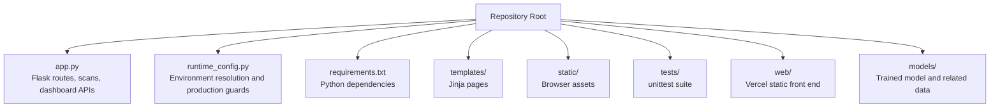
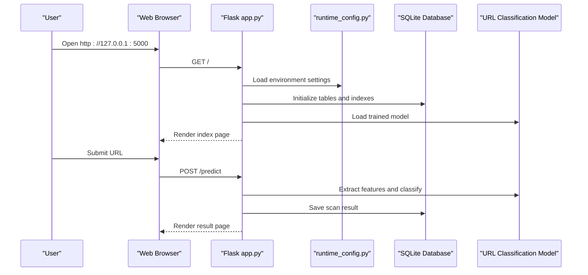
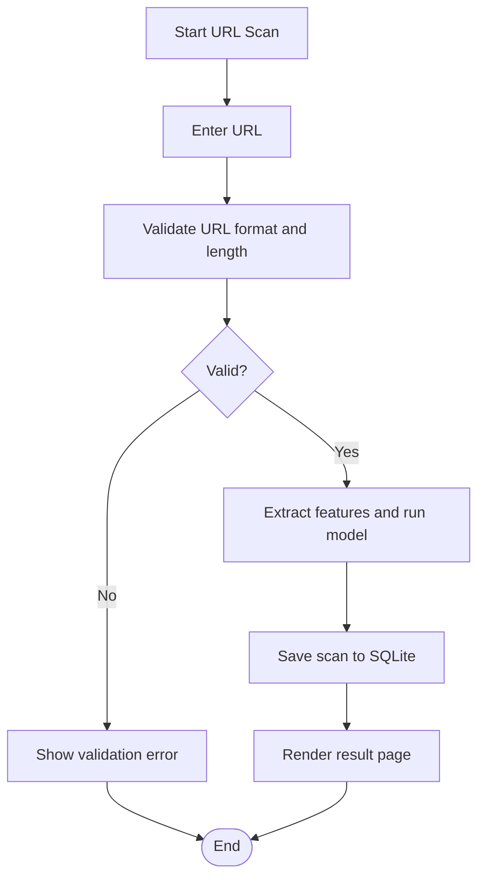
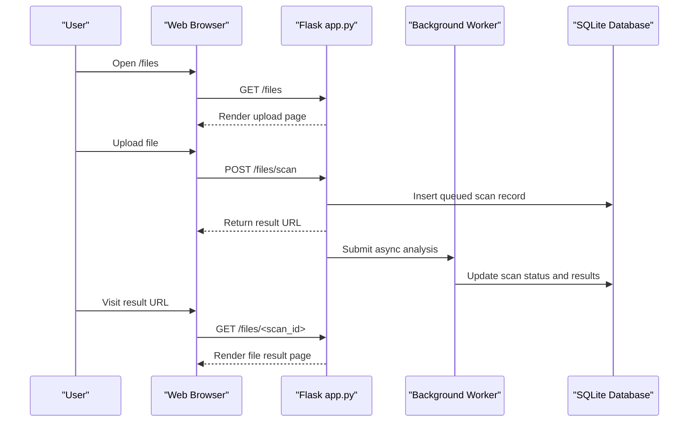
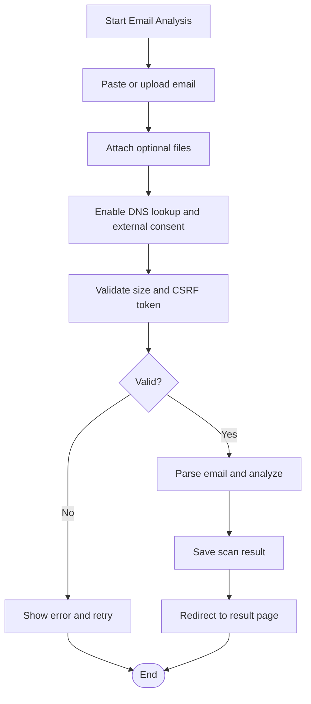
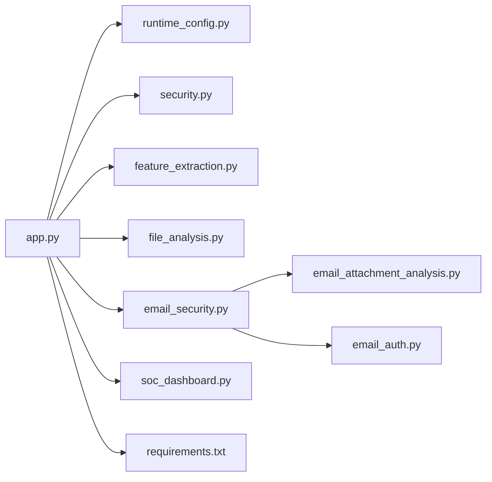

# Getting Started

<cite>
**Referenced Files in This Document**
- [README.md](file://README.md)
- [app.py](file://app.py)
- [requirements.txt](file://requirements.txt)
- [runtime_config.py](file://runtime_config.py)
</cite>

## Table of Contents
1. [Introduction](#introduction)
2. [Project Structure](#project-structure)
3. [Core Components](#core-components)
4. [Architecture Overview](#architecture-overview)
5. [Detailed Component Analysis](#detailed-component-analysis)
6. [Dependency Analysis](#dependency-analysis)
7. [Performance Considerations](#performance-considerations)
8. [Troubleshooting Guide](#troubleshooting-guide)
9. [Conclusion](#conclusion)
10. [Appendices](#appendices)

## Introduction
PhishGuard is a self-hostable phishing triage console that combines URL scanning, file triage, and email security analysis into one interface. It records every scan in SQLite and provides a SOC-style dashboard for reviewing results. The application runs locally as a Flask app or can be deployed to hosted platforms.

For first-time users, the most important points are:
- Use Python 3.11 or newer.
- Create a virtual environment and install dependencies from `requirements.txt`.
- Optionally create an `.env` file for integrations such as ClamAV, VirusTotal, or OPSWAT.
- Start the app with `python app.py`.
- Open `http://127.0.0.1:5000` in your browser.
- By default, the server binds to `127.0.0.1`, so it is only reachable on the local machine.

This guide focuses on quick setup, initial usage, and common development scenarios.

**Section sources**
- [README.md:1-15](file://README.md#L1-L15)
- [README.md:73-96](file://README.md#L73-L96)

## Project Structure
The repository is organized around a Flask application with separate modules for scanning logic, security configuration, templates, static assets, tests, and optional deployment files.



**Diagram sources**
- [README.md:202-219](file://README.md#L202-L219)

**Section sources**
- [README.md:202-219](file://README.md#L202-L219)

## Core Components
PhishGuard’s core user-facing components are:
- URL scanner at `/` and the public JSON endpoint `/api/v1/scan/url`.
- File scanner at `/files` with asynchronous analysis and status polling.
- Email scanner at `/email` supporting pasted content and file uploads.
- Dashboard at `/dashboard` for cross-source metrics and health.
- History at `/history` for a unified timeline.
- Authentication review at `/authentication`.

These components share:
- A SQLite database created at startup.
- CSRF protection for form submissions.
- Rate limiting per feature area.
- Environment-driven configuration through `runtime_config.py`.

**Section sources**
- [README.md:34-48](file://README.md#L34-L48)
- [README.md:120-135](file://README.md#L120-L135)
- [app.py:68-96](file://app.py#L68-L96)
- [app.py:418-508](file://app.py#L418-L508)
- [app.py:625-728](file://app.py#L625-L728)
- [app.py:752-892](file://app.py#L752-L892)

## Architecture Overview
At runtime, PhishGuard loads environment variables, initializes the database, loads the URL classification model, and starts the Flask development server bound to a configured host and port.



**Diagram sources**
- [app.py:133-251](file://app.py#L133-L251)
- [app.py:315-337](file://app.py#L315-L337)
- [app.py:418-445](file://app.py#L418-L445)
- [runtime_config.py:140-188](file://runtime_config.py#L140-L188)

## Detailed Component Analysis

### Quick Setup on Windows PowerShell
Use these steps to set up PhishGuard locally:

1. Navigate to the project directory.
2. Create a virtual environment.
3. Install dependencies from `requirements.txt`.
4. Optionally copy `.env.example` to `.env` if you plan to use optional integrations.
5. Start the Flask application.
6. Open `http://127.0.0.1:5000`.

Example commands:
```powershell
cd "C:\Users\VasuDev\OneDrive\Desktop\PhishGuard"
python -m venv .venv
.\.venv\Scripts\python.exe -m pip install -r requirements.txt
Copy-Item .env.example .env
.\.venv\Scripts\python.exe app.py
```

If you do not have `.env.example`, you can skip the `.env` step for basic usage and add it later when configuring optional integrations.

**Section sources**
- [README.md:73-96](file://README.md#L73-L96)

### Changing the Default Port
You can change the port without editing code by setting the `PORT` environment variable before starting the app.

PowerShell example:
```powershell
$env:PORT = "5056"
.\.venv\Scripts\python.exe app.py
Remove-Item Env:PORT
```

Under the hood, `runtime_config.py` reads `PORT` and validates that it is between 1 and 65535. If unset, the default is `5000`.

**Section sources**
- [README.md:88-93](file://README.md#L88-L93)
- [runtime_config.py:157-159](file://runtime_config.py#L157-L159)

### Development vs Production Differences
PhishGuard uses `PHISHGUARD_ENV` and platform detection to choose safe defaults:

| Aspect | Development | Production |
|---|---|---|
| Bind address | `127.0.0.1` | `0.0.0.0` unless overridden |
| Default port | `5000` | `$PORT` |
| Secret key | Ephemeral random key allowed | Stable `FLASK_SECRET_KEY` required |
| Upload limit | Larger local default | Smaller hosted default |
| Session cookie security | Normal development behavior | `Secure` cookies enabled |
| Proxy trust | Disabled by default | Enabled when trusted behind a proxy |

Important: the development server is not suitable for hosting. In production, use a proper WSGI server such as gunicorn.

**Section sources**
- [runtime_config.py:23-30](file://runtime_config.py#L23-L30)
- [runtime_config.py:69-79](file://runtime_config.py#L69-L79)
- [runtime_config.py:89-107](file://runtime_config.py#L89-L107)
- [runtime_config.py:140-188](file://runtime_config.py#L140-L188)
- [app.py:1333-1344](file://app.py#L1333-L1344)

### Basic Workflow

#### Opening the Application
Open `http://127.0.0.1:5000` after starting the app. The homepage contains the URL scanner.

**Section sources**
- [README.md:73-86](file://README.md#L73-L86)
- [app.py:418-420](file://app.py#L418-L420)

#### Performing an Initial URL Scan
1. Go to the homepage.
2. Enter a URL.
3. Submit the form.
4. Review the result page showing the verdict, probability, risk level, and structural features used by the model.

The same URL classification logic is also available through the public JSON API at `/api/v1/scan/url`.



**Diagram sources**
- [app.py:295-312](file://app.py#L295-L312)
- [app.py:315-337](file://app.py#L315-L337)
- [app.py:423-445](file://app.py#L423-L445)

**Section sources**
- [app.py:295-337](file://app.py#L295-L337)
- [app.py:418-445](file://app.py#L418-L445)

#### Uploading a File for Analysis
1. Open `/files`.
2. Choose a file.
3. Optionally enable external cloud submission if consent is appropriate.
4. Submit the upload.
5. Wait for the asynchronous analysis to complete.
6. View the result page or poll the file status endpoint.

File uploads are queued and processed in background threads. The response returns a URL where you can check the analysis result.



**Diagram sources**
- [app.py:625-728](file://app.py#L625-L728)

**Section sources**
- [app.py:625-728](file://app.py#L625-L728)

#### Analyzing an Email
1. Open `/email`.
2. Paste email content or upload an email file.
3. Optionally attach additional files and enable DNS lookups.
4. Submit the analysis.
5. Review the result page with headers, links, attachments, and risk indicators.

Email analysis supports pasted text, `.eml`, `.txt`, `.html`, and `.htm` inputs. It also supports separate attachment uploads with size limits.



**Diagram sources**
- [app.py:752-892](file://app.py#L752-L892)

**Section sources**
- [app.py:752-892](file://app.py#L752-L892)

### Optional `.env` Configuration
An `.env` file is loaded automatically by `runtime_config.py`. You normally need it only for optional integrations or advanced configuration.

Common optional variables include:
- `VT_API_KEY`
- `OPSWAT_API_KEY`
- `CLAMSCAN_PATH`
- `CLAMAV_DATABASE_DIR`

For local development, you can start without `.env`. For production, you must set `FLASK_SECRET_KEY` and may configure bind address, data directory, rate limits, and other runtime settings.

**Section sources**
- [README.md:98-118](file://README.md#L98-L118)
- [README.md:174-189](file://README.md#L174-L189)
- [runtime_config.py:17-21](file://runtime_config.py#L17-L21)
- [runtime_config.py:140-188](file://runtime_config.py#L140-L188)

## Dependency Analysis
PhishGuard depends on Flask, data science libraries for URL feature extraction and classification, email parsing utilities, and optional integration libraries.



**Diagram sources**
- [app.py:22-65](file://app.py#L22-L65)
- [README.md:202-219](file://README.md#L202-L219)

**Section sources**
- [app.py:22-65](file://app.py#L22-L65)
- [requirements.txt:1-35](file://requirements.txt#L1-L35)

## Performance Considerations
- File analysis runs asynchronously using a thread pool. The number of workers can be influenced by the `FILE_SCAN_WORKERS` environment variable.
- Rate limiting protects scanners, dashboard endpoints, and the public API.
- Large uploads are rejected early to avoid memory pressure.
- The development server is single-process and not optimized for production traffic.

Recommendations:
- Keep uploads reasonable for local testing.
- Use the dashboard health endpoints to monitor pending and failed scans.
- Run behind a reverse proxy and gunicorn in production.

**Section sources**
- [app.py:107-110](file://app.py#L107-L110)
- [app.py:267-288](file://app.py#L267-L288)
- [app.py:636-720](file://app.py#L636-L720)
- [app.py:1160-1234](file://app.py#L1160-L1234)
- [app.py:1339-1343](file://app.py#L1339-L1343)

## Troubleshooting Guide

### Python Version Issues
If installation fails because of incompatible binary wheels or package versions, ensure you are using Python 3.11 or newer. The README states Python 3.11+ is required and the pinned toolchain is 3.13.

**Section sources**
- [README.md:75](file://README.md#L75)

### Virtual Environment Not Found
If `.\.venv\Scripts\python.exe` is not found, confirm that the virtual environment was created successfully and that you are running commands from the correct directory.

**Section sources**
- [README.md:77-83](file://README.md#L77-L83)

### Port Already in Use
If port `5000` is already taken, set `PORT` to another value before starting the app.

**Section sources**
- [README.md:88-93](file://README.md#L88-L93)
- [runtime_config.py:157-159](file://runtime_config.py#L157-L159)

### Missing Secret Key in Production
Outside development, `FLASK_SECRET_KEY` must be set and at least 16 characters long. Without it, startup raises a configuration error.

**Section sources**
- [runtime_config.py:89-107](file://runtime_config.py#L89-L107)

### Server Only Accessible Locally
By default, the development server binds to `127.0.0.1`. Other machines cannot reach it. To expose it externally, set `HOST` appropriately, but prefer a production WSGI server and reverse proxy.

**Section sources**
- [README.md:85-86](file://README.md#L85-L86)
- [runtime_config.py:162-164](file://runtime_config.py#L162-L164)
- [app.py:1333-1344](file://app.py#L1333-L1344)

### Upload Too Large
If you receive an upload limit error, reduce the file size or adjust `MAX_UPLOAD_BYTES` carefully. Local development allows larger uploads than production by default.

**Section sources**
- [app.py:665-683](file://app.py#L665-L683)
- [app.py:1260-1288](file://app.py#L1260-L1288)
- [runtime_config.py:146-149](file://runtime_config.py#L146-L149)

### Email Request Too Large
Email paste or upload requests have a separate size limit. If the request exceeds the limit, the server returns a clear error message.

**Section sources**
- [app.py:764-796](file://app.py#L764-L796)
- [app.py:1260-1288](file://app.py#L1260-L1288)

### CSRF Errors
If forms report that the form expired, reload the page and try again. CSRF tokens are session-based and protect state-changing requests.

**Section sources**
- [app.py:254-264](file://app.py#L254-L264)
- [app.py:432-436](file://app.py#L432-L436)
- [app.py:787-796](file://app.py#L787-L796)

## Conclusion
You now have everything needed to install PhishGuard locally, start the Flask application, and perform your first URL, file, and email scans. Remember that the server binds to localhost by default, development mode uses safer defaults, and production requires explicit configuration for secrets, binding, and deployment.

Next steps:
- Explore the dashboard at `/dashboard`.
- Review scan history at `/history`.
- Try the authentication review page at `/authentication`.
- Configure optional integrations like ClamAV or VirusTotal through `.env`.
- Move to production deployment using gunicorn and a reverse proxy when ready.

[No sources needed since this section summarizes without analyzing specific files]

## Appendices

### First-Time Checklist
- [ ] Python 3.11+ installed.
- [ ] Virtual environment created.
- [ ] Dependencies installed from `requirements.txt`.
- [ ] `.env` created only if needed.
- [ ] App started with `python app.py`.
- [ ] `http://127.0.0.1:5000` opened.
- [ ] URL scanned successfully.
- [ ] File uploaded and analyzed.
- [ ] Email analyzed.
- [ ] Dashboard and history reviewed.

**Section sources**
- [README.md:73-96](file://README.md#L73-L96)
- [README.md:120-135](file://README.md#L120-L135)