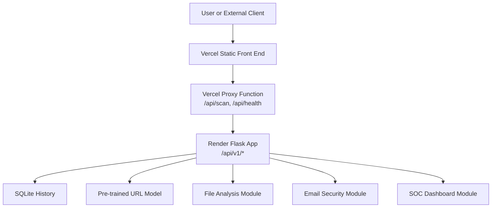
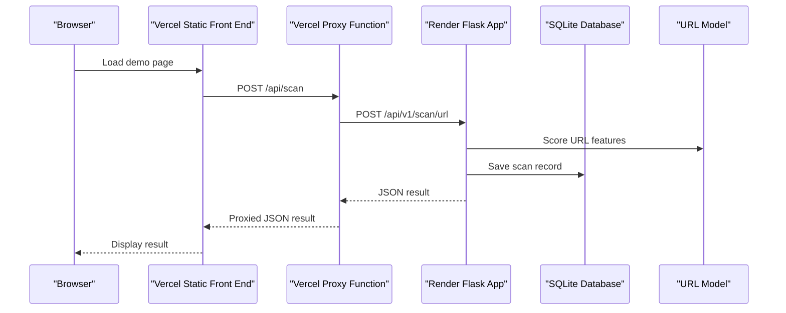
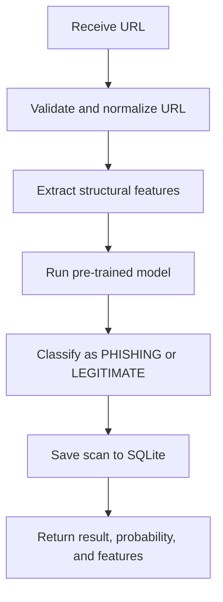
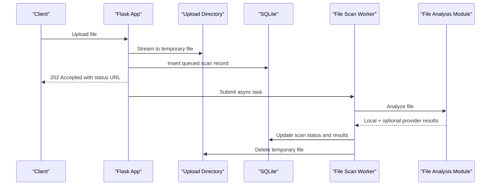
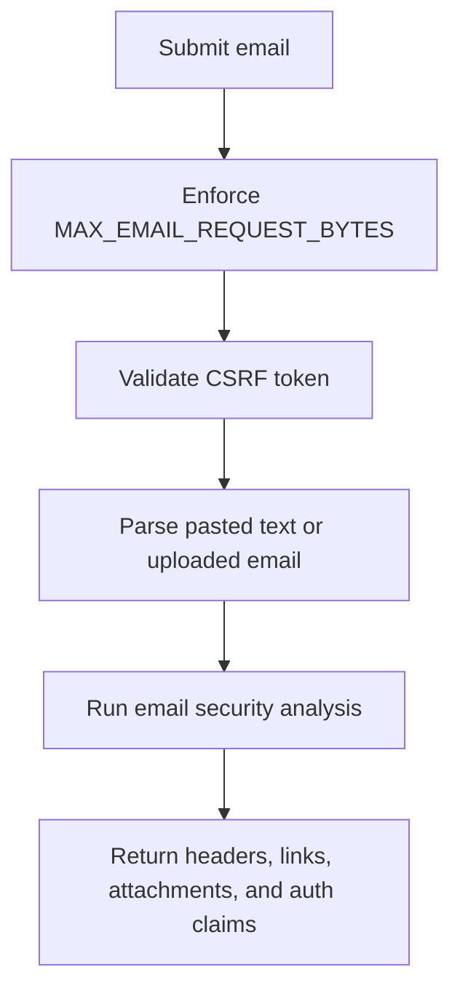
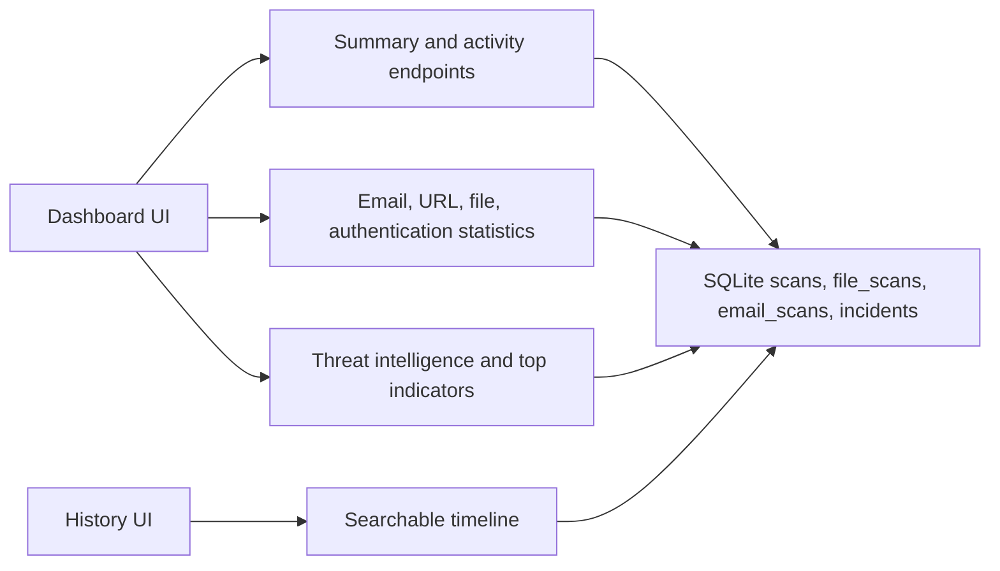
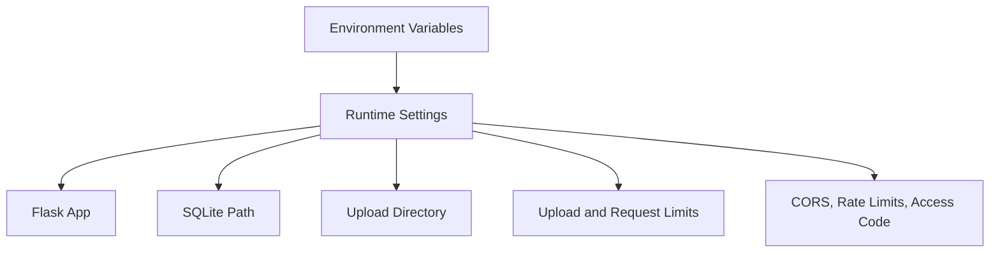

# Project Overview

<cite>
**Referenced Files in This Document**
- [README.md](file://README.md)
- [app.py](file://app.py)
- [runtime_config.py](file://runtime_config.py)
- [render.yaml](file://render.yaml)
- [web/vercel.json](file://web/vercel.json)
- [SECURITY.md](file://SECURITY.md)
</cite>

## Table of Contents
1. [Introduction](#introduction)
2. [Project Structure](#project-structure)
3. [Core Components](#core-components)
4. [Architecture Overview](#architecture-overview)
5. [Detailed Component Analysis](#detailed-component-analysis)
6. [Dependency Analysis](#dependency-analysis)
7. [Performance Considerations](#performance-considerations)
8. [Troubleshooting Guide](#troubleshooting-guide)
9. [Conclusion](#conclusion)

## Introduction
PhishGuard is a self-hostable phishing triage console designed for learning, demonstration, and hands-on security analysis. It brings three complementary analyses into one interface:

- Machine-learning URL checks based on structural features.
- Static file triage using hashing, signature/magic detection, optional local ClamAV scanning, and consented cloud submissions.
- Pasted-email security reviews that extract headers, links, attachments, and SPF/DKIM/DMARC claims.

Every scan is recorded in a searchable SQLite history, and the SOC-style dashboard aggregates counts, trends, top indicators, recent events, and system health. The public JSON API exposes URL scanning so external front ends can call it without exposing the full application.

This project is explicitly an educational detector, not a production security product. Model output and scanner results can be wrong. URLs are never opened, files are never executed, and email checks are heuristics. A result indicating legitimacy or no detections is not proof of safety.

**Section sources**
- [README.md:1-14](file://README.md#L1-L14)
- [README.md:34-48](file://README.md#L34-L48)

## Project Structure
At a high level, PhishGuard consists of:

- A Flask application providing routes, scanners, dashboard APIs, and the public JSON API.
- Environment-driven runtime configuration that selects safe defaults for development versus production.
- Separate analysis modules for emails, files, and URL feature extraction.
- A SOC dashboard module backed by SQLite.
- A small static front end under `web/` intended for Vercel, which proxies a single endpoint to the Render-hosted backend.
- Deployment blueprints for Render and Vercel.

**Diagram sources**
- [README.md:50-71](file://README.md#L50-L71)
- [app.py:68-96](file://app.py#L68-L96)
- [render.yaml:1-31](file://render.yaml#L1-L31)
- [web/vercel.json:1-46](file://web/vercel.json#L1-L46)

**Section sources**
- [README.md:202-219](file://README.md#L202-L219)
- [app.py:68-96](file://app.py#L68-L96)
- [runtime_config.py:1-8](file://runtime_config.py#L1-L8)

## Core Components
PhishGuard’s core capabilities map directly to its entry points:

| Capability | Primary Entry Point | What It Does |
|---|---|---|
| URL scanning | `/` and `POST /api/v1/scan/url` | Extracts structural features from the URL, scores them with a pre-trained model, returns a phishing probability, risk level, and feature breakdown. |
| File analysis | `/files` and `/files/scan` | Computes SHA-256, identifies file type, runs signature/magic checks, optionally invokes ClamAV, and may submit to VirusTotal or OPSWAT only when consented and enabled. |
| Email security assessment | `/email` and `/email/analyze` | Parses pasted text or uploaded email files, extracts headers, intent signals, links, attachment metadata, and SPF/DKIM/DMARC claims. |
| Authentication review | `/authentication` | Shows reported authentication-header findings and per-source history tabs. |
| SOC dashboard | `/dashboard` | Displays cross-source counts, time-range trends, top indicators, live health, and incident-related statistics. |
| Searchable history | `/history` | Provides a unified timeline with filters and CSV export. |

The URL scanner does not open or resolve the submitted URL; it analyzes structure only. File scanning does not execute content. Email scanning parses input locally and reports heuristic findings.

**Section sources**
- [README.md:34-48](file://README.md#L34-L48)
- [README.md:120-132](file://README.md#L120-L132)
- [app.py:315-337](file://app.py#L315-L337)
- [app.py:418-508](file://app.py#L418-L508)
- [app.py:625-728](file://app.py#L625-L728)
- [app.py:752-800](file://app.py#L752-L800)

## Architecture Overview
PhishGuard uses a deliberate deployment split between Render and Vercel:

- **Render** hosts the real Flask application, SQLite database, uploads directory, and pre-trained URL model. It exposes the public JSON API and health endpoints.
- **Vercel** serves a lightweight static front end and proxy functions. This avoids bundling heavy Python dependencies such as NumPy, SciPy, pandas, and scikit-learn into a serverless function bundle.
- The browser communicates with the Vercel front end, which proxies a single scan endpoint to Render over HTTPS. This keeps CORS simple and hides the Render hostname from client-side code.

**Diagram sources**
- [README.md:50-71](file://README.md#L50-L71)
- [README.md:137-172](file://README.md#L137-L172)
- [render.yaml:1-31](file://render.yaml#L1-L31)
- [web/vercel.json:1-46](file://web/vercel.json#L1-L46)

### Deterministic Offline-by-Default Design
By default, PhishGuard performs deterministic local analysis:

- No URL fetches.
- No telemetry.
- No automatic network calls.
- No phoning home.

Only two categories of external behavior exist, and both are opt-in:

1. **DNS lookups**: Used for SPF, DMARC, and MX checks during email authentication analysis.
2. **Cloud submissions**: Optional submission of scanned attachments to VirusTotal or OPSWAT when API keys are configured, the operator allows external submissions, and the user consents for that specific scan.

Local ClamAV remains offline and platform-specific.

**Section sources**
- [README.md:45-48](file://README.md#L45-L48)
- [README.md:174-189](file://README.md#L174-L189)
- [SECURITY.md:41-44](file://SECURITY.md#L41-L44)

### Two Opt-In External Integrations
| Integration | Trigger | Configuration | Safety Notes |
|---|---|---|---|
| DNS lookups | Email authentication analysis | Built-in; used for SPF/DKIM/DMARC/MX claims | Only DNS queries are made; no email body is sent. |
| Cloud submissions | File analysis | Requires vendor API keys and `PHISHGUARD_EXTERNAL_SUBMISSIONS=1`; requires per-scan consent checkbox | Never submit confidential or regulated samples; “no detections” is not proof of safety. |

**Section sources**
- [README.md:174-189](file://README.md#L174-L189)
- [SECURITY.md:41-44](file://SECURITY.md#L41-L44)

## Detailed Component Analysis

### URL Scanning
The URL scanner validates the input without resolving or fetching the URL. It extracts structural features, loads a pre-trained model, computes a phishing probability, and records the result in SQLite.

**Diagram sources**
- [app.py:291-337](file://app.py#L291-L337)
- [app.py:418-508](file://app.py#L418-L508)

Common use cases:
- Paste a suspicious login link to see whether its structure resembles phishing patterns.
- Use the public JSON API to integrate URL scoring into another tool or workflow.
- Compare the model confidence score and feature breakdown to understand why a URL was flagged.

**Section sources**
- [app.py:291-337](file://app.py#L291-L337)
- [app.py:418-508](file://app.py#L418-L508)
- [README.md:137-167](file://README.md#L137-L167)

### File Analysis
File analysis is asynchronous and thread-pooled. When a file is uploaded, the app streams it into a temporary upload directory, computes SHA-256, records a queued scan, and then processes it in a worker thread.

**Diagram sources**
- [app.py:374-415](file://app.py#L374-L415)
- [app.py:636-728](file://app.py#L636-L728)

Key behaviors:
- Streaming upload prevents loading large files entirely into memory.
- Size limits are enforced before completion.
- Asynchronous processing avoids blocking the web request.
- Consent controls cloud submissions.
- Temporary files are cleaned up after analysis.

**Section sources**
- [app.py:374-415](file://app.py#L374-L415)
- [app.py:636-728](file://app.py#L636-L728)
- [README.md:174-189](file://README.md#L174-L189)

### Email Security Assessment
The email scanner accepts pasted text or uploaded email files. It enforces request size limits, CSRF validation, rate limiting, and then delegates parsing and reporting to the email security module.

**Diagram sources**
- [app.py:752-800](file://app.py#L752-L800)

Practical examples:
- Paste a suspicious email body to inspect sender, subject, extracted links, and authentication claims.
- Upload an `.eml`, `.txt`, or `.html` email file for structured inspection.
- Use the authentication review page to compare SPF/DKIM/DMARC findings across different sources.

**Section sources**
- [README.md:120-132](file://README.md#L120-L132)
- [app.py:752-800](file://app.py#L752-L800)

### SOC Dashboard and Searchable History
The dashboard provides SOC-style visibility:

- Cross-source counts for URL, file, and email scans.
- Time-range selection from short windows up to 30 days or custom ranges.
- Top indicators and threat distribution.
- Recent events and system health.
- Authentication statistics and incident-related data.

The history page offers a unified timeline with filtering and CSV export. Both rely on SQLite tables created at startup and indexed for efficient querying.

**Diagram sources**
- [app.py:133-251](file://app.py#L133-L251)
- [README.md:168-172](file://README.md#L168-L172)

**Section sources**
- [README.md:120-132](file://README.md#L120-L132)
- [README.md:168-172](file://README.md#L168-L172)
- [app.py:133-251](file://app.py#L133-L251)

## Dependency Analysis
PhishGuard’s runtime depends on environment variables rather than editable source files for deployment behavior. The configuration layer centralizes decisions about environment, secret keys, data directories, upload ceilings, host binding, access codes, CORS origins, rate limiting, and external submissions.

**Diagram sources**
- [runtime_config.py:140-188](file://runtime_config.py#L140-L188)
- [app.py:68-96](file://app.py#L68-L96)

Important relationships:
- Production environments require a stable `FLASK_SECRET_KEY`.
- Hosted deployments use stricter upload limits and bind to all interfaces by default.
- The access code gates sensitive pages but does not protect public scanners.
- External submissions are disabled globally by setting the appropriate flag, even if vendor keys are present.

**Section sources**
- [runtime_config.py:1-8](file://runtime_config.py#L1-L8)
- [runtime_config.py:89-107](file://runtime_config.py#L89-L107)
- [runtime_config.py:140-188](file://runtime_config.py#L140-L188)
- [app.py:68-96](file://app.py#L68-L96)

## Performance Considerations
- URL scanning is synchronous and model-based; keep payloads small and avoid excessive burst traffic because rate limits apply.
- File scanning is asynchronous and uses a thread pool sized by `FILE_SCAN_WORKERS`. Long-running operations do not block the HTTP response.
- SQLite is convenient for local and small hosted deployments but is not a substitute for a dedicated database service. On free Render instances, the database may be ephemeral unless a disk is attached.
- Large uploads consume disk space in the configured upload directory; adjust `MAX_UPLOAD_BYTES` according to your hosting constraints.
- The in-process rate limiter resets on restart and scales per process, so multiple workers have independent budgets.

[No sources needed since this section provides general guidance]

## Troubleshooting Guide
Common operational issues and their context:

- **Missing or unstable secret key**: Outside development, startup fails if `FLASK_SECRET_KEY` is missing or too short. Generate a stable value and store it in the platform’s environment variables.
- **History is empty after restart**: Free Render instances may discard the SQLite file unless a mounted disk is attached.
- **External submissions blocked**: Ensure vendor keys are set, `PHISHGUARD_EXTERNAL_SUBMISSIONS` is enabled, and the user checked consent for the scan.
- **Rate-limited responses**: Public API and scanners return `429` with retry guidance. Adjust usage or add edge-level rate limiting behind a CDN.
- **Access code gate active**: If `PHISHGUARD_ACCESS_CODE` is set, dashboard, history, authentication, and dashboard API endpoints require unlocking.
- **Health check degraded**: `/healthz` reports database and model state; a degraded status means either the database cannot be read or the model is unavailable.

**Section sources**
- [README.md:98-118](file://README.md#L98-L118)
- [README.md:221-244](file://README.md#L221-L244)
- [SECURITY.md:46-75](file://SECURITY.md#L46-L75)
- [app.py:511-554](file://app.py#L511-L554)

## Conclusion
PhishGuard is a focused, educational phishing triage console. It combines machine-learning URL checks, static file triage, and email security assessments in one interface while keeping the default behavior deterministic and offline. Its SOC-style dashboard and searchable SQLite history make it useful for learning how phishing artifacts appear across URLs, files, and email metadata.

Use it to practice triage workflows, explore model confidence and feature explanations, and understand the difference between heuristic results and definitive security guarantees. Do not treat any result as production-grade assurance, and avoid submitting sensitive or regulated data to third-party services.

[No sources needed since this section summarizes without analyzing specific files]