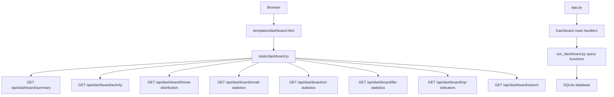
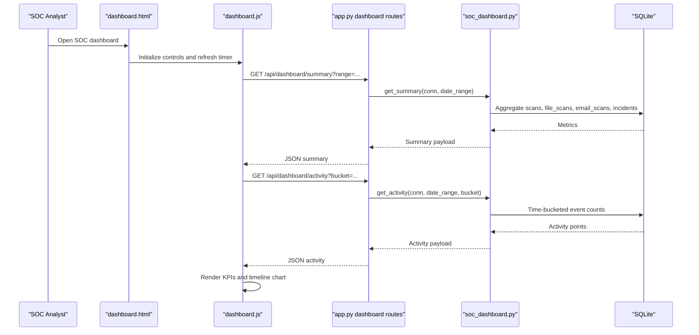
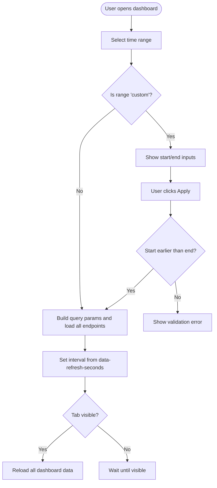
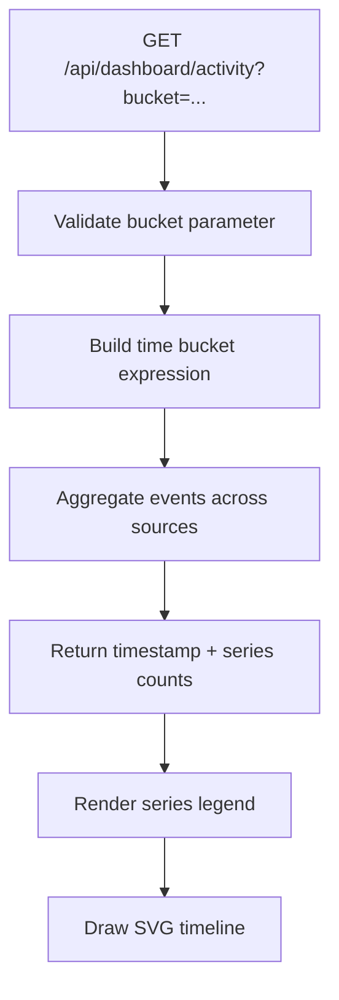
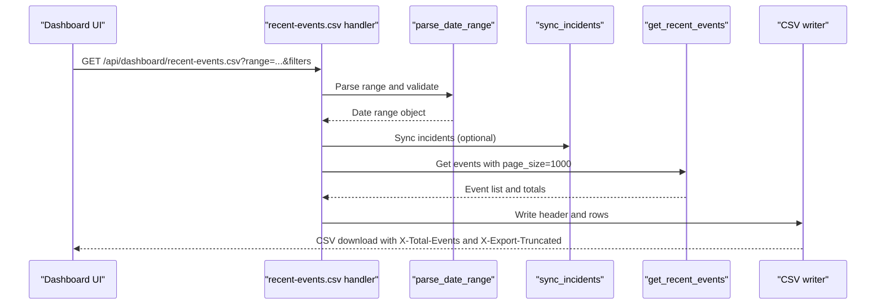
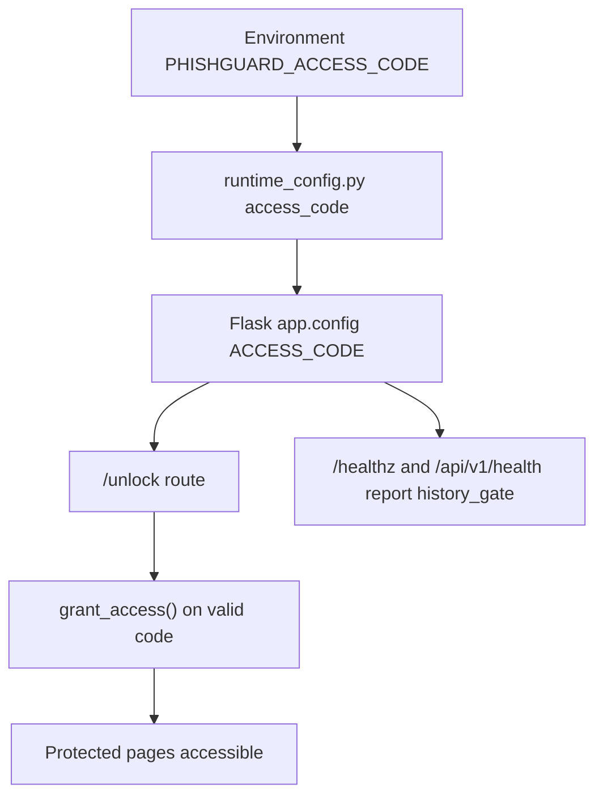
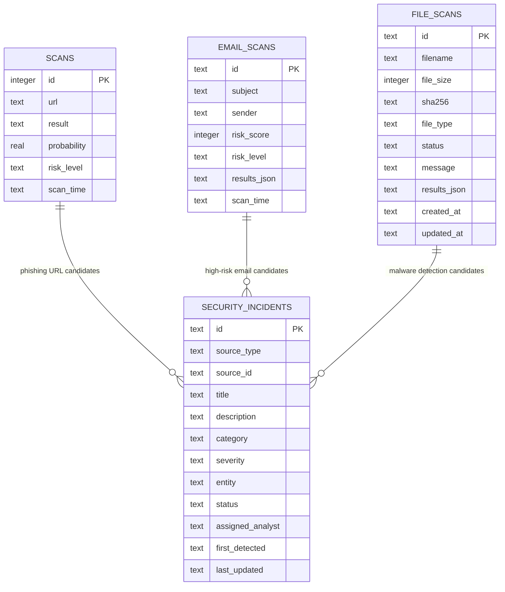
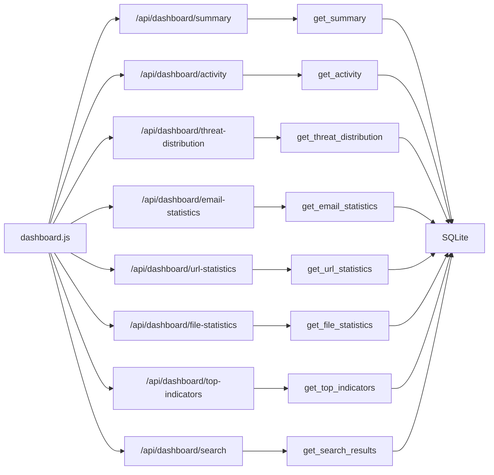

# SOC Dashboard

<cite>
**Referenced Files in This Document**   
- [app.py](file://app.py)
- [soc_dashboard.py](file://soc_dashboard.py)
- [dashboard.html](file://templates/dashboard.html)
- [dashboard.js](file://static/dashboard.js)
- [runtime_config.py](file://runtime_config.py)
- [security.py](file://security.py)
- [test_dashboard.py](file://tests/test_dashboard.py)
</cite>

## Table of Contents
1. [Introduction](#introduction)
2. [Project Structure](#project-structure)
3. [Core Components](#core-components)
4. [Architecture Overview](#architecture-overview)
5. [Detailed Component Analysis](#detailed-component-analysis)
6. [Dependency Analysis](#dependency-analysis)
7. [Performance Considerations](#performance-considerations)
8. [Troubleshooting Guide](#troubleshooting-guide)
9. [Conclusion](#conclusion)

## Introduction
The SOC dashboard provides a unified, read-only operational view of PhishGuard’s local scan history. It consolidates URL model results, file scanner outcomes, email heuristic analysis, and security incidents into one interface for real-time monitoring, incident tracking, and historical analysis. The page loads data from a set of JSON endpoints under `/api/dashboard/`, applies a time range selector, renders cross-source metrics, and supports global search across scans and incidents.

Key capabilities:
- Real-time overview with KPI cards comparing the current period to the previous period.
- Unified timeline chart aggregating email, file, and URL events.
- Threat distribution by severity, category, file classification, and URL classification.
- Recent event list with filtering and CSV export.
- Email, URL, and file statistics with paginated records.
- Authentication statistics for SPF, DKIM, and DMARC.
- Threat intelligence summary for configured external providers.
- Security incident listing and status updates.
- Top indicators such as suspicious sender domains, phishing URL hosts, detected file hashes, and high-risk subjects.
- Global search across URLs, files, emails, and incidents.

## Project Structure
The dashboard is implemented as a Flask web application with a dedicated template and client-side JavaScript module.

**Diagram sources**
- [dashboard.html:10-54](file://templates/dashboard.html#L10-L54)
- [dashboard.js:103-143](file://static/dashboard.js#L103-L143)
- [app.py:923-1109](file://app.py#L923-L1109)
- [soc_dashboard.py:40-244](file://soc_dashboard.py#L40-L244)

**Section sources**
- [dashboard.html:10-54](file://templates/dashboard.html#L10-L54)
- [dashboard.js:103-143](file://static/dashboard.js#L103-L143)
- [app.py:923-1109](file://app.py#L923-L1109)

## Core Components
- **Flask dashboard routes**: Centralized under `/api/dashboard/`. They parse date ranges, enforce rate limits, optionally sync incidents, and delegate to `soc_dashboard.py` functions.
- **Query layer**: `soc_dashboard.py` defines reusable SQL CTEs, date-range parsing, validation, and per-endpoint logic for summary, activity, threat distribution, recent events, email/URL/file statistics, authentication statistics, threat intelligence, incidents, top indicators, and search.
- **Template**: Renders the SOC overview UI, including time range controls, refresh button, custom range inputs, global search box, KPI grid, activity chart container, distribution panels, and record tables.
- **Client script**: Builds query parameters, fetches multiple endpoints concurrently, renders charts and tables, handles errors, and auto-refreshes based on a configurable interval.

**Section sources**
- [app.py:935-1109](file://app.py#L935-L1109)
- [soc_dashboard.py:271-306](file://soc_dashboard.py#L271-L306)
- [dashboard.html:10-177](file://templates/dashboard.html#L10-L177)
- [dashboard.js:1-143](file://static/dashboard.js#L1-L143)

## Architecture Overview
The dashboard follows a clear request-to-render flow:

**Diagram sources**
- [dashboard.js:103-143](file://static/dashboard.js#L103-L143)
- [app.py:956-967](file://app.py#L956-L967)
- [soc_dashboard.py:354-460](file://soc_dashboard.py#L354-L460)

## Detailed Component Analysis

### Range Selector and Auto-Refresh
- **Range selector options**: 15 minutes, 1 hour, 24 hours, 7 days, 30 days, or custom start/end.
- **Custom range behavior**: When “custom” is selected, the UI shows datetime-local inputs. On apply, it validates that the start is earlier than the end before reloading data.
- **Auto-refresh**: The template sets `data-refresh-seconds="60"`. The client script reads this value and calls `loadAll()` at that interval when the tab is visible.
- **Parameter construction**: The client always sends `range`; if `custom`, it also sends `start` and `end`. Other endpoint-specific parameters are appended as needed.

**Diagram sources**
- [dashboard.html:20-42](file://templates/dashboard.html#L20-L42)
- [dashboard.js:555-593](file://static/dashboard.js#L555-L593)

**Section sources**
- [dashboard.html:20-42](file://templates/dashboard.html#L20-L42)
- [dashboard.js:74-101](file://static/dashboard.js#L74-L101)
- [dashboard.js:555-593](file://static/dashboard.js#L555-L593)

### Unified Timeline and Cross-Source Counts
- **Unified timeline**: The activity endpoint aggregates events from URL scans, file scans, and email scans into a single time series.
- **Cross-source series**: Emails, phishing-risk emails, files, malicious files, URLs, and phishing URLs are plotted together. Users can toggle series via checkboxes generated from the response.
- **Bucketing**: Supports 5-minute, 15-minute, 1-hour, and 1-day buckets. The server computes time buckets using SQLite formatting functions.
- **Visualization**: The client draws an SVG line chart with hover tooltips showing timestamp and series values.

**Diagram sources**
- [soc_dashboard.py:404-460](file://soc_dashboard.py#L404-L460)
- [dashboard.js:185-292](file://static/dashboard.js#L185-L292)

**Section sources**
- [soc_dashboard.py:404-460](file://soc_dashboard.py#L404-L460)
- [dashboard.js:185-292](file://static/dashboard.js#L185-L292)

### Recent Events and CSV Export
- **Recent events endpoint**: Returns paginated, filtered events across URL, file, and email scans. Filters include severity, event type, source type, and free-text search. Sorting supports ascending or descending order.
- **CSV export**: The `/api/dashboard/recent-events.csv` endpoint exports up to 1,000 rows. It forces `page_size=1000`, writes headers, and returns CSV with metadata headers indicating total events and whether the export was truncated.
- **Validation**: Page size must be between 1 and 1,000; search text is limited to 200 characters; severity and source filters are validated.

**Diagram sources**
- [app.py:993-1044](file://app.py#L993-L1044)
- [soc_dashboard.py:463-534](file://soc_dashboard.py#L463-L534)

**Section sources**
- [app.py:993-1044](file://app.py#L993-L1044)
- [soc_dashboard.py:463-534](file://soc_dashboard.py#L463-L534)

### Read-Only Dashboard Endpoints
All dashboard endpoints share common behavior:
- Rate-limited under the `dashboard` scope.
- Parse `range` and optional custom `start`/`end`.
- Return JSON with a `range` object containing `start` and `end`.
- Raise `DashboardQueryError` for invalid parameters, returning HTTP 400.
- Catch SQLite errors and return HTTP 503.

| Endpoint | Purpose | Key Parameters | Notes |
|---|---|---|---|
| `GET /api/dashboard/summary` | KPI cards with current vs previous period | `range`, optional `start`/`end` | Syncs incidents before computing open critical incidents. |
| `GET /api/dashboard/activity` | Unified timeline series | `range`, optional `start`/`end`, `bucket` | Bucket values: `5m`, `15m`, `1h`, `1d`. Default `1h`. |
| `GET /api/dashboard/threat-distribution` | Severity, categories, file and URL classifications | `range`, optional `start`/`end` | Includes authentication distribution. |
| `GET /api/dashboard/recent-events` | Paginated event list | `range`, optional `start`/`end`, `q`, `severity`, `event_type`, `source`, `page`, `page_size`, `sort` | Page size 1–1,000. Search length ≤ 200. |
| `GET /api/dashboard/recent-events.csv` | CSV export of recent events | Same as recent-events plus pagination defaults | Forces page size 1,000. |
| `GET /api/dashboard/email-statistics` | Email risk overview and records | `range`, optional `start`/`end`, `page`, `page_size`, `q` | Page size 1–100. |
| `GET /api/dashboard/url-statistics` | URL model classifications and records | `range`, optional `start`/`end`, `page`, `page_size` | Page size 1–100. |
| `GET /api/dashboard/file-statistics` | File scanner outcomes and records | `range`, optional `start`/`end`, `page`, `page_size` | Page size 1–100. |
| `GET /api/dashboard/authentication-statistics` | SPF/DKIM/DMARC pass/fail/none/unknown | `range`, optional `start`/`end` | Includes alignment failures and DNS lookup counts. |
| `GET /api/dashboard/threat-intelligence` | External provider scan summaries | `range`, optional `start`/`end` | Reports configuration state but does not test connectivity. |
| `GET /api/dashboard/incidents` | Security incidents list | `range`, optional `start`/`end`, `status`, `page`, `page_size` | Syncs incidents before listing. |
| `PATCH /api/dashboard/incidents/<incident_id>` | Update incident status or analyst | CSRF token required, JSON body with `status` and/or `assigned_analyst` | Status must be valid; analyst name ≤ 80 characters. |
| `GET /api/dashboard/system-health` | System health probe | None | Health check endpoint used by the platform. |
| `GET /api/dashboard/search` | Global search across scans and incidents | `range`, optional `start`/`end`, `q`, optional `limit` | Minimum 2 characters; maximum 200 characters; limit 1–100. |

**Section sources**
- [app.py:935-1109](file://app.py#L935-L1109)
- [soc_dashboard.py:354-460](file://soc_dashboard.py#L354-L460)
- [soc_dashboard.py:614-667](file://soc_dashboard.py#L614-L667)
- [soc_dashboard.py:670-946](file://soc_dashboard.py#L670-L946)
- [soc_dashboard.py:949-1012](file://soc_dashboard.py#L949-L1012)
- [soc_dashboard.py:1015-1093](file://soc_dashboard.py#L1015-L1093)
- [soc_dashboard.py:1196-1319](file://soc_dashboard.py#L1196-L1319)

### Parameter Specifications for Range Queries
The supported `range` values are:
- `all`: Includes all available history.
- `15m`: Last 15 minutes.
- `1h`: Last 1 hour.
- `24h`: Last 24 hours.
- `7d`: Last 7 days.
- `30d`: Last 30 days.
- `custom`: Requires both `start` and `end` as local datetime strings without timezone offsets. The start must be earlier than the end.

Additional common parameters:
- `page`: Integer ≥ 1.
- `page_size`: Integer within endpoint-specific limits. For recent events, 1–1,000; for other statistics, typically 1–100.
- `sort`: `asc` or `desc` where applicable.
- `q`: Free-text search string, usually limited to 200 characters.
- `bucket`: Activity timeline bucket: `5m`, `15m`, `1h`, `1d`.
- `status`: Incident filter: `all` or one of the defined statuses.

**Section sources**
- [soc_dashboard.py:13-19](file://soc_dashboard.py#L13-L19)
- [soc_dashboard.py:271-306](file://soc_dashboard.py#L271-L306)
- [soc_dashboard.py:404-408](file://soc_dashboard.py#L404-L408)
- [soc_dashboard.py:463-534](file://soc_dashboard.py#L463-L534)
- [soc_dashboard.py:1196-1247](file://soc_dashboard.py#L1196-L1247)

### Passcode Gate Protection
When `PHISHGUARD_ACCESS_CODE` is configured:
- The access code is loaded from the environment and stored in runtime settings.
- The Flask app config includes `ACCESS_CODE`.
- The `/unlock` route requires a valid access code to grant temporary access to protected areas.
- The unlock route is rate-limited and validates CSRF tokens.
- The system health endpoint reports whether a history gate is active.
- The dashboard itself is rendered through `/dashboard`, which uses the same app configuration.

Important clarification:
- The provided code does not show explicit per-request passcode checks inside `_dashboard_api`. Therefore, the passcode gate primarily protects sensitive pages through the unlock workflow and broader security configuration rather than being enforced directly on every dashboard JSON endpoint in the referenced implementation.

**Diagram sources**
- [runtime_config.py:179](file://runtime_config.py#L179)
- [app.py:83](file://app.py#L83)
- [app.py:587-615](file://app.py#L587-L615)
- [app.py:534-554](file://app.py#L534-L554)

**Section sources**
- [runtime_config.py:179](file://runtime_config.py#L179)
- [app.py:83](file://app.py#L83)
- [app.py:587-615](file://app.py#L587-L615)
- [app.py:534-554](file://app.py#L534-L554)

### Relationship Between Dashboard Data and Scan History Storage
The dashboard reads from four primary storage areas:
- `scans`: URL model results, including result, probability, risk level, and scan time.
- `file_scans`: File analysis records, including filename, size, SHA-256, status, engine results JSON, and timestamps.
- `email_scans`: Email analysis records, including subject, sender, risk score, risk level, results JSON, and scan time.
- `security_incidents`: Operational incident records derived from scan detections.

The unified event CTE normalizes these sources into a consistent schema with fields like event ID, source type, source ID, event type, source identifier, category, risk score, severity, detection engine, status, timestamp, investigation URL, searchable text, and per-source classification.

**Diagram sources**
- [app.py:137-229](file://app.py#L137-L229)
- [soc_dashboard.py:40-244](file://soc_dashboard.py#L40-L244)
- [soc_dashboard.py:1096-1193](file://soc_dashboard.py#L1096-L1193)

**Section sources**
- [app.py:137-229](file://app.py#L137-L229)
- [soc_dashboard.py:40-244](file://soc_dashboard.py#L40-L244)
- [soc_dashboard.py:1096-1193](file://soc_dashboard.py#L1096-L1193)

## Dependency Analysis
The dashboard depends on:
- **Flask routing and request handling**: Parses arguments, enforces rate limits, and delegates to query functions.
- **Query functions**: Implement SQL aggregation, validation, and response shaping.
- **SQLite database**: Stores scan history and incidents.
- **Template and client script**: Provide user interaction, parameter building, concurrent fetching, rendering, and auto-refresh.

**Diagram sources**
- [dashboard.js:103-143](file://static/dashboard.js#L103-L143)
- [app.py:956-1109](file://app.py#L956-L1109)
- [soc_dashboard.py:354-1319](file://soc_dashboard.py#L354-L1319)

**Section sources**
- [dashboard.js:103-143](file://static/dashboard.js#L103-L143)
- [app.py:956-1109](file://app.py#L956-L1109)
- [soc_dashboard.py:354-1319](file://soc_dashboard.py#L354-L1319)

## Performance Considerations
- **Concurrent frontend requests**: The client loads summary, activity, distribution, email, URL, file, and indicators in parallel to reduce perceived latency.
- **Rate limiting**: Dashboard endpoints use a shared rate rule to prevent excessive polling.
- **Pagination**: Most endpoints support pagination to avoid large payloads.
- **CSV export cap**: Recent events CSV is capped at 1,000 rows to balance usability and performance.
- **Time-based queries**: All dashboards filter by time ranges, leveraging indexed columns such as `scan_time`, `created_at`, and `first_detected`.
- **Activity bucketing**: Server-side bucketing reduces client-side processing and keeps chart data compact.

[No sources needed since this section provides general guidance]

## Troubleshooting Guide
Common issues and resolutions:
- **Invalid range**: If `range` is unknown or custom dates are invalid, the server returns HTTP 400 with an error message. Ensure one of the supported values or provide valid local `start` and `end` where `start < end`.
- **Invalid activity bucket**: Only `5m`, `15m`, `1h`, and `1d` are accepted.
- **Invalid page or page size**: Each endpoint validates its own limits. Recent events allow up to 1,000; other statistics typically allow up to 100.
- **Search too short or too long**: Global search and recent-event search require at least 2 characters and at most 200 characters.
- **Unknown filters**: Severity, source type, event type, and incident status must match allowed values.
- **CSRF protection for incident updates**: PATCH requests to update incidents require a valid CSRF token.
- **Passcode gate**: If `PHISHGUARD_ACCESS_CODE` is configured, ensure you have successfully unlocked access through `/unlock` before accessing protected pages.

**Section sources**
- [soc_dashboard.py:271-306](file://soc_dashboard.py#L271-L306)
- [soc_dashboard.py:404-408](file://soc_dashboard.py#L404-L408)
- [soc_dashboard.py:463-534](file://soc_dashboard.py#L463-L534)
- [soc_dashboard.py:1196-1247](file://soc_dashboard.py#L1196-L1247)
- [app.py:1112-1150](file://app.py#L1112-L1150)
- [app.py:587-615](file://app.py#L587-L615)

## Conclusion
The SOC dashboard centralizes PhishGuard’s local scan evidence into a practical operational interface. It supports flexible time ranges, automatic refresh, cross-source visualization, detailed statistics, incident tracking, and global search. Its endpoints are designed for safe, rate-limited consumption, with strict parameter validation and clear error responses. Understanding the relationship between the dashboard and the underlying scan history tables helps analysts interpret metrics accurately and investigate findings efficiently.

[No sources needed since this section summarizes without analyzing specific files]