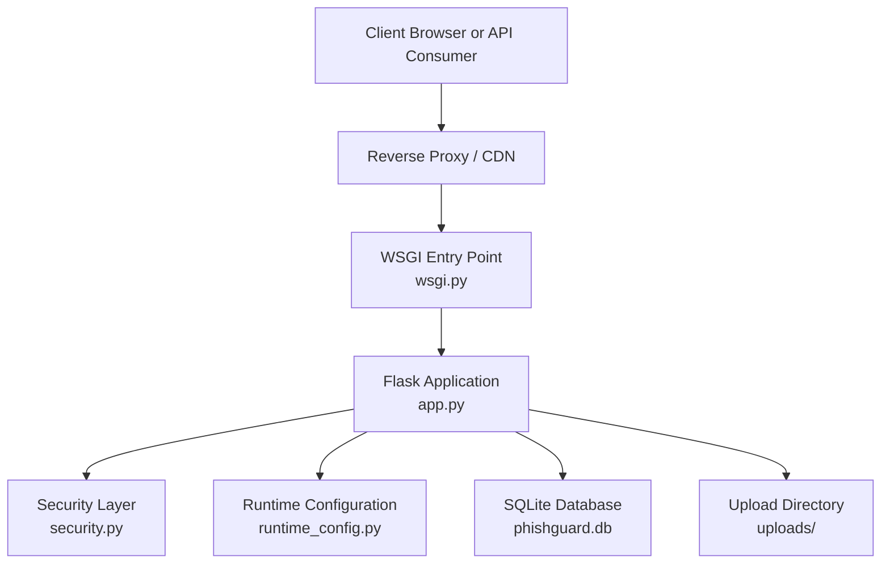
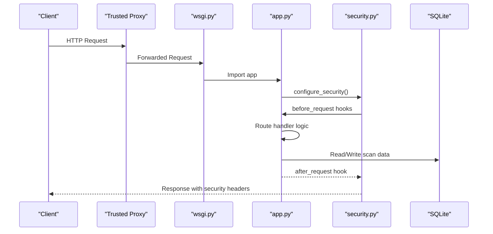
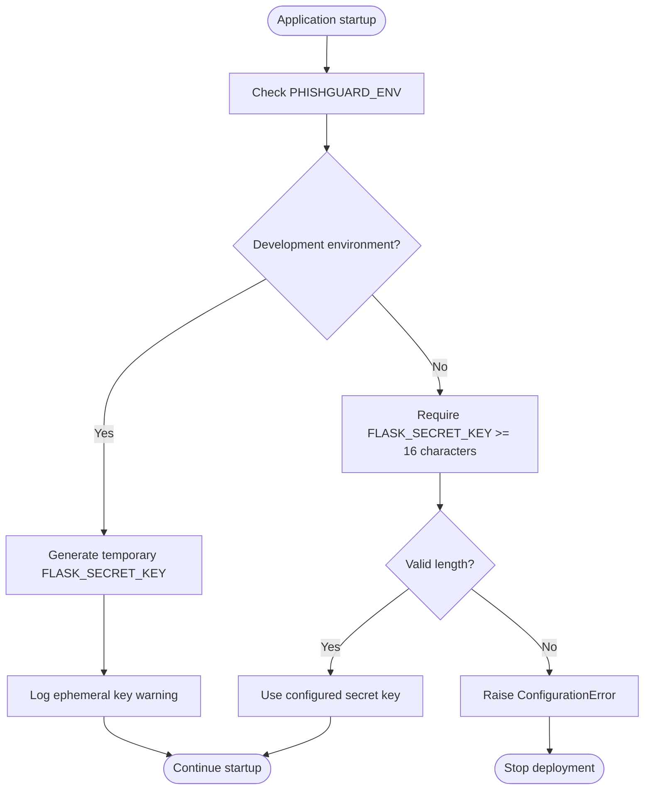
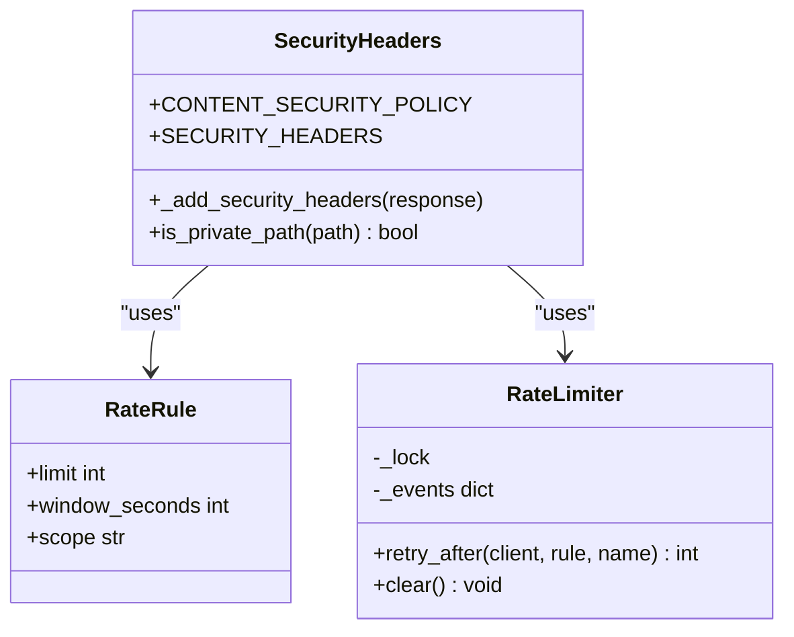
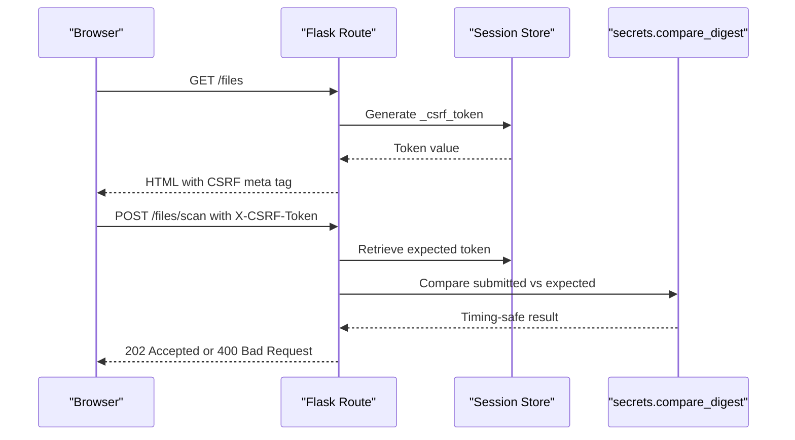
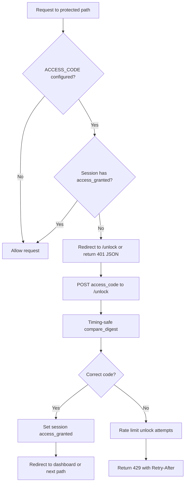
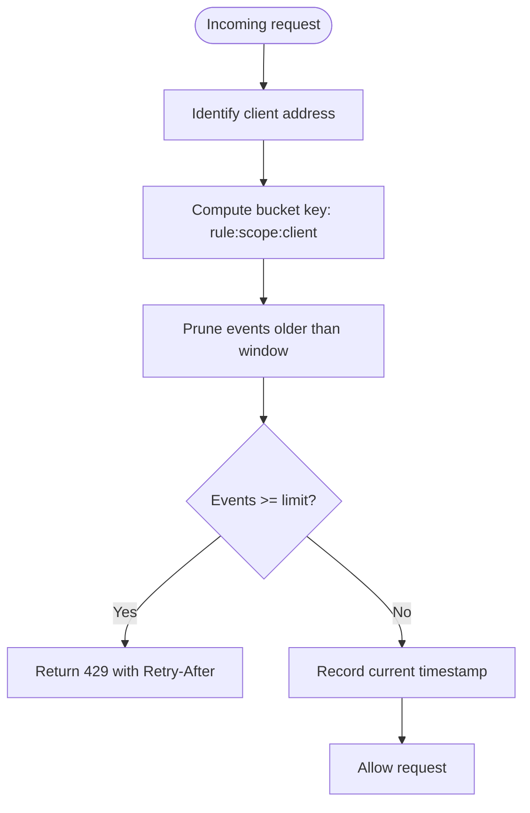
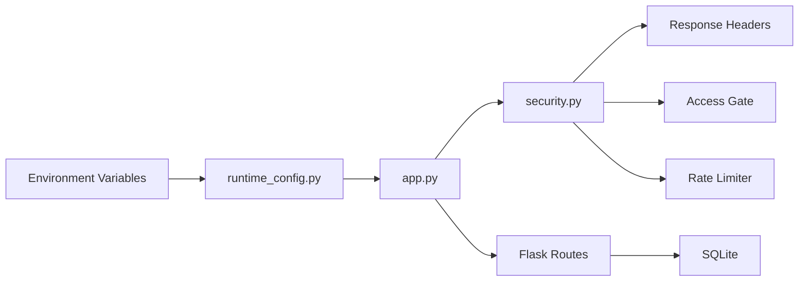

# Security Model

<cite>
**Referenced Files in This Document**
- [app.py](file://app.py)
- [security.py](file://security.py)
- [runtime_config.py](file://runtime_config.py)
- [SECURITY.md](file://SECURITY.md)
- [DEPLOYMENT.md](file://DEPLOYMENT.md)
- [wsgi.py](file://wsgi.py)
</cite>

## Table of Contents
1. [Introduction](#introduction)
2. [Project Structure](#project-structure)
3. [Core Components](#core-components)
4. [Architecture Overview](#architecture-overview)
5. [Detailed Component Analysis](#detailed-component-analysis)
6. [Dependency Analysis](#dependency-analysis)
7. [Performance Considerations](#performance-considerations)
8. [Troubleshooting Guide](#troubleshooting-guide)
9. [Conclusion](#conclusion)
10. [Appendices](#appendices)

## Introduction
This document describes the security model for PhishGuard, focusing on implemented controls and the operational threat model. It explains how secrets are managed, how response headers protect browsers, how session cookies and CSRF tokens work, how rate limiting is implemented, how trusted proxies are configured, how robots.txt is sanitized, and how sensitive endpoints are gated by a shared access code. It also documents known limitations and provides secure deployment guidance for extending the application safely.

PhishGuard is an educational URL, file, and email triage tool. Its security model balances usability with defense against opportunistic abuse: scraping history, API hammering, oversized uploads, framing, content sniffing, cross-site request forgery, and accidental secret leakage.

## Project Structure
The security-relevant parts of the repository are concentrated in a small set of modules:

- `app.py` defines Flask routes, session-based CSRF handling, upload limits, scan persistence, and error surfaces.
- `security.py` centralizes response headers, CORS, proxy trust, access gating, and the in-process sliding-window rate limiter.
- `runtime_config.py` loads environment-driven configuration, including the mandatory stable secret key and production defaults.
- `SECURITY.md` documents the threat model, controls, recommendations, and limitations.
- `DEPLOYMENT.md` provides deployment steps and post-deploy verification.
- `wsgi.py` exposes the WSGI entry point for production servers such as gunicorn.

**Diagram sources**
- [wsgi.py:1-13](file://wsgi.py#L1-L13)
- [app.py:74-96](file://app.py#L74-L96)
- [security.py:245-253](file://security.py#L245-L253)
- [runtime_config.py:140-188](file://runtime_config.py#L140-L188)

**Section sources**
- [app.py:74-96](file://app.py#L74-L96)
- [security.py:245-253](file://security.py#L245-L253)
- [runtime_config.py:140-188](file://runtime_config.py#L140-L188)
- [wsgi.py:1-13](file://wsgi.py#L1-L13)

## Core Components
The security model is built around these core components:

| Component | Responsibility | Key Implementation Location |
|---|---|---|
| Secret key management | Enforces a stable, minimum-length `FLASK_SECRET_KEY` outside development; marks ephemeral keys for local use. | [runtime_config.py:89-107](file://runtime_config.py#L89-L107), [runtime_config.py:140-188](file://runtime_config.py#L140-L188) |
| Session cookies | HttpOnly, SameSite=Lax, Secure in production. | [app.py:92-94](file://app.py#L92-L94) |
| CSRF protection | Session-bound token compared with timing-safe comparison on state-changing forms. | [app.py:254-264](file://app.py#L254-L264) |
| Response headers | Strict CSP, nosniff, DENY framing, no-referrer, HSTS, restrictive permissions policy. | [security.py:33-55](file://security.py#L33-L55), [security.py:201-222](file://security.py#L201-L222) |
| Access control gate | Shared passcode protects `/dashboard`, `/history`, `/authentication`, `/api/dashboard/*`. | [security.py:28-31](file://security.py#L28-L31), [security.py:138-155](file://security.py#L138-L155), [security.py:178-198](file://security.py#L178-L198) |
| Rate limiting | Sliding-window limiter per client address and rule. | [security.py:58-100](file://security.py#L58-L100), [app.py:98-105](file://app.py#L98-L105) |
| Trusted proxy configuration | Applies `ProxyFix` only when behind a trusted proxy. | [security.py:245-249](file://security.py#L245-L249) |
| Robots.txt sanitization | Disallows private prefixes from indexing. | [app.py:569-584](file://app.py#L569-L584) |
| Error surfaces | Branded 404/429/500 responses without stack traces. | [app.py:1260-1319](file://app.py#L1260-L1319) |

**Section sources**
- [runtime_config.py:89-107](file://runtime_config.py#L89-L107)
- [runtime_config.py:140-188](file://runtime_config.py#L140-L188)
- [app.py:92-94](file://app.py#L92-L94)
- [app.py:254-264](file://app.py#L254-L264)
- [security.py:33-55](file://security.py#L33-L55)
- [security.py:138-155](file://security.py#L138-L155)
- [security.py:178-198](file://security.py#L178-L198)
- [security.py:58-100](file://security.py#L58-L100)
- [app.py:98-105](file://app.py#L98-L105)
- [security.py:245-249](file://security.py#L245-L249)
- [app.py:569-584](file://app.py#L569-L584)
- [app.py:1260-1319](file://app.py#L1260-L1319)

## Architecture Overview
At runtime, every request passes through the WSGI entry point, then the Flask application, which applies security middleware before reaching route handlers. The security layer adds response headers, enforces the optional access gate, handles CORS preflight, and enables proxy trust. Routes enforce CSRF validation, input normalization, size limits, and rate limiting where appropriate. Scan results and metadata are persisted to SQLite.

**Diagram sources**
- [wsgi.py:10-12](file://wsgi.py#L10-L12)
- [app.py:74-96](file://app.py#L74-L96)
- [security.py:245-253](file://security.py#L245-L253)

## Detailed Component Analysis

### Mandatory Stable Secret Key
The application requires a stable `FLASK_SECRET_KEY` outside development. In development environments, an ephemeral key may be generated automatically, but this breaks sessions across process restarts and multiple workers. Production deployments must set a secret key with at least 16 characters.

Key behaviors:
- Rejects short secret keys with a clear configuration error.
- Allows ephemeral keys only in development environments.
- Raises a configuration error if no stable key is provided in production.
- Logs a warning when an ephemeral key is used locally.

**Diagram sources**
- [runtime_config.py:89-107](file://runtime_config.py#L89-L107)
- [runtime_config.py:140-188](file://runtime_config.py#L140-L188)
- [app.py:1324-1328](file://app.py#L1324-L1328)

**Section sources**
- [runtime_config.py:89-107](file://runtime_config.py#L89-L107)
- [runtime_config.py:140-188](file://runtime_config.py#L140-L188)
- [app.py:1324-1328](file://app.py#L1324-L1328)
- [DEPLOYMENT.md:16-28](file://DEPLOYMENT.md#L16-L28)

### Strict Content Security Policy and Response Headers
Every response receives a strict Content Security Policy that restricts default resources to the same origin, disallows object embedding, allows scripts and styles only from the same origin, permits inline styles for compatibility, allows images from the same origin and data URIs, restricts fonts and connections to the same origin, constrains form actions, and forbids framing. Additional headers include `X-Content-Type-Options: nosniff`, `X-Frame-Options: DENY`, `Referrer-Policy: no-referrer`, `Cross-Origin-Opener-Policy: same-origin`, and a restrictive `Permissions-Policy`. HTTPS responses receive `Strict-Transport-Security`. Private paths receive `Cache-Control: no-store` and `X-Robots-Tag: noindex, nofollow`.

**Diagram sources**
- [security.py:33-55](file://security.py#L33-L55)
- [security.py:58-100](file://security.py#L58-L100)
- [security.py:201-222](file://security.py#L201-L222)

**Section sources**
- [security.py:33-55](file://security.py#L33-L55)
- [security.py:201-222](file://security.py#L201-L222)
- [SECURITY.md:28-44](file://SECURITY.md#L28-L44)

### Session Cookies and CSRF Protection
Session cookies are configured with HttpOnly and SameSite=Lax. The Secure flag is enabled in production based on the runtime environment. CSRF protection uses a session-bound token generated per page load and validated using timing-safe comparison. State-changing endpoints validate either a form field or an `X-CSRF-Token` header depending on the endpoint.

Affected endpoints include:
- `/predict`: validates form CSRF token.
- `/files/scan`: validates `X-CSRF-Token` header.
- `/email/analyze`: validates form CSRF token.
- `/unlock`: validates form CSRF token.
- `/lock`: validates form CSRF token.
- `/api/dashboard/incidents/<id>` PATCH: validates `X-CSRF-Token` header.

**Diagram sources**
- [app.py:92-94](file://app.py#L92-L94)
- [app.py:254-264](file://app.py#L254-L264)
- [app.py:423-445](file://app.py#L423-L445)
- [app.py:636-647](file://app.py#L636-L647)
- [app.py:764-796](file://app.py#L764-L796)
- [app.py:1112-1115](file://app.py#L1112-L1115)

**Section sources**
- [app.py:92-94](file://app.py#L92-L94)
- [app.py:254-264](file://app.py#L254-L264)
- [app.py:423-445](file://app.py#L423-L445)
- [app.py:636-647](file://app.py#L636-L647)
- [app.py:764-796](file://app.py#L764-L796)
- [app.py:1112-1115](file://app.py#L1112-L1115)

### Access Control Mechanism Using PHISHGUARD_ACCESS_CODE
Sensitive endpoints are protected by an optional shared passcode stored in `PHISHGUARD_ACCESS_CODE`. Protected prefixes include `/dashboard`, `/history`, `/authentication`, and `/api/dashboard/*`. When the access code is configured, requests to these paths are redirected to `/unlock` unless the session already contains the access grant. JSON API callers receive a `401` response with an unlock URL instead of an HTML redirect. The passcode comparison uses timing-safe comparison to mitigate timing attacks.

**Diagram sources**
- [security.py:28-31](file://security.py#L28-L31)
- [security.py:138-155](file://security.py#L138-L155)
- [security.py:178-198](file://security.py#L178-L198)
- [app.py:587-615](file://app.py#L587-L615)

**Section sources**
- [security.py:28-31](file://security.py#L28-L31)
- [security.py:138-155](file://security.py#L138-L155)
- [security.py:178-198](file://security.py#L178-L198)
- [app.py:587-615](file://app.py#L587-L615)
- [SECURITY.md:36-39](file://SECURITY.md#L36-L39)

### Sliding-Window Rate Limiting
The rate limiter is an in-process sliding-window implementation keyed by client address and rule name. Rules include URL scanning, file uploads, email analysis, dashboard reads, public API usage, and unlock attempts. Each rule defines a limit and window duration. Requests exceeding the limit receive a `429` response with `Retry-After` and a JSON `retry_after` field.

Important characteristics:
- Uses `client_address()` to derive identity from `X-Forwarded-For` when available, otherwise `remote_addr`.
- Stores timestamps in a deque per bucket and prunes events older than the window.
- Is intentionally single-process; multi-worker deployments need edge or distributed rate limiting.
- Can be disabled via `PHISHGUARD_RATE_LIMIT=0`, though this is not recommended for hosted instances.

**Diagram sources**
- [security.py:58-100](file://security.py#L58-L100)
- [security.py:103-111](file://security.py#L103-L111)
- [app.py:98-105](file://app.py#L98-L105)
- [app.py:267-288](file://app.py#L267-L288)

**Section sources**
- [security.py:58-100](file://security.py#L58-L100)
- [security.py:103-111](file://security.py#L103-L111)
- [app.py:98-105](file://app.py#L98-L105)
- [app.py:267-288](file://app.py#L267-L288)
- [SECURITY.md:37-39](file://SECURITY.md#L37-L39)

### ProxyFix Configuration for Trusted Proxies
`ProxyFix` is applied only when `PHISHGUARD_BEHIND_PROXY` is enabled, which defaults to true in production environments. This ensures that `X-Forwarded-For`, `X-Proto`, and `X-Host` headers are trusted only when the application is behind a controlled reverse proxy. Local development does not enable proxy trust by default.

Operational implications:
- Enables correct client IP detection for rate limiting and logging behind trusted proxies.
- Prevents spoofing of forwarded headers when running directly.
- Should only be enabled behind proxies you control.

**Section sources**
- [security.py:245-249](file://security.py#L245-L249)
- [runtime_config.py:161-164](file://runtime_config.py#L161-L164)
- [SECURITY.md:39-40](file://SECURITY.md#L39-L40)

### Sanitized robots.txt
The robots.txt endpoint explicitly disallows crawling of sensitive paths, including `/dashboard`, `/history`, `/authentication`, `/api/`, `/email/`, `/files/`, `/urls/`, and `/unlock`. This complements the private response headers that mark sensitive pages as `noindex, nofollow`.

**Section sources**
- [app.py:569-584](file://app.py#L569-L584)
- [security.py:209-211](file://security.py#L209-L211)
- [SECURITY.md:43-44](file://SECURITY.md#L43-L44)

### Known Security Limitations
The application explicitly acknowledges several limitations:

| Limitation | Impact | Mitigation or Guidance |
|---|---|---|
| Per-process rate limiter | Multiple workers have independent budgets; restarts reset counters. | Add edge rate limiting behind a CDN or reverse proxy. |
| Shared secret passcode system | No per-user authentication, lockout, or audit trail. | Treat it as a coarse access gate, not a full authentication system. |
| Ephemeral SQLite storage | Free platform instances discard the database on restart. | Attach persistent storage or migrate to an external database. |
| Heuristic scan results | URL model sees structure only; vendor “no detections” is not proof of safety. | Do not treat scanner output as definitive malware verdicts. |
| Trusted `X-Forwarded-For` | Spoofable if proxy trust is misconfigured. | Enable only behind a trusted proxy. |
| Public scanners | Scanners remain unauthenticated by design. | Rely on rate limits, upload ceilings, and network controls. |

**Section sources**
- [SECURITY.md:63-76](file://SECURITY.md#L63-L76)
- [security.py:6-12](file://security.py#L6-L12)
- [DEPLOYMENT.md:102-115](file://DEPLOYMENT.md#L102-L115)

## Dependency Analysis
The security dependencies flow from configuration into the application and security layer:

**Diagram sources**
- [runtime_config.py:140-188](file://runtime_config.py#L140-L188)
- [app.py:74-96](file://app.py#L74-L96)
- [security.py:245-253](file://security.py#L245-L253)

**Section sources**
- [runtime_config.py:140-188](file://runtime_config.py#L140-L188)
- [app.py:74-96](file://app.py#L74-L96)
- [security.py:245-253](file://security.py#L245-L253)

## Performance Considerations
Security controls introduce measurable but intentional overhead:

- CSRF validation adds minimal per-request cost but prevents cross-site request forgery.
- Sliding-window rate limiting uses memory proportional to the number of active buckets and timestamps; it is efficient for moderate traffic but should not replace distributed rate limiting.
- Strict CSP and response headers add negligible CPU cost while significantly reducing attack surface.
- SQLite writes are synchronous within request contexts; heavy dashboard queries can block workers if not carefully bounded.
- File and email uploads stream data and compute hashes incrementally to avoid loading entire payloads into memory.

Recommendations:
- Keep rate limits conservative for public instances.
- Avoid disabling rate limiting in production.
- Monitor worker utilization and database latency under load.
- Use persistent storage only when necessary and implement retention policies externally.

[No sources needed since this section provides general guidance]

## Troubleshooting Guide
Common security-related issues and their resolutions:

| Symptom | Likely Cause | Resolution |
|---|---|---|
| Sessions reset across restarts | Ephemeral `FLASK_SECRET_KEY` generated in development. | Set a stable `FLASK_SECRET_KEY` in production environment variables. |
| CSRF errors across workers | Secret key changed between processes. | Ensure one consistent secret key across all workers. |
| Dashboard returns 401 JSON | Access code is configured but session is not unlocked. | Visit `/unlock` with the correct `PHISHGUARD_ACCESS_CODE`. |
| Rate-limited responses | Too many requests from the same client address. | Respect `Retry-After`; add edge rate limiting if needed. |
| Wrong client IP in logs | Proxy trust misconfiguration. | Enable `PHISHGUARD_BEHIND_PROXY` only behind a trusted proxy. |
| History disappears after deploy | Ephemeral filesystem on free platform instances. | Attach persistent disk and set `PHISHGUARD_DATA_DIR`. |
| CSP blocking assets | Custom asset domains not allowed. | Review CSP directives and adjust only if necessary; prefer same-origin assets. |

**Section sources**
- [runtime_config.py:89-107](file://runtime_config.py#L89-L107)
- [app.py:1324-1328](file://app.py#L1324-L1328)
- [security.py:138-155](file://security.py#L138-L155)
- [security.py:245-249](file://security.py#L245-L249)
- [DEPLOYMENT.md:185-197](file://DEPLOYMENT.md#L185-L197)

## Conclusion
PhishGuard implements a focused security model suitable for an educational triage tool. It enforces a mandatory stable secret key outside development, applies strict response headers, protects state-changing operations with CSRF tokens, gates sensitive dashboards with a shared access code, and applies in-process rate limiting per client address and rule. Deployment guidance emphasizes persistent storage, CORS tightening, secret hygiene, and awareness of known limitations such as per-process rate limiting and heuristic scanner outputs. Operators extending the application should follow the same patterns: validate inputs, enforce CSRF on mutations, apply security headers consistently, keep secrets out of source control, and treat scanner results as advisory rather than authoritative.

[No sources needed since this section summarizes without analyzing specific files]

## Appendices

### Secure Deployment Checklist
- Generate and store a stable `FLASK_SECRET_KEY` in platform environment variables.
- Set `PHISHGUARD_ACCESS_CODE` on any public instance.
- Pin `PHISHGUARD_ALLOWED_ORIGINS` to your frontend domain.
- Keep `MAX_UPLOAD_BYTES` and `MAX_EMAIL_REQUEST_BYTES` aligned with platform limits.
- Enable `PHISHGUARD_BEHIND_PROXY` only behind a trusted reverse proxy.
- Attach persistent storage for SQLite if history must survive restarts.
- Rotate any vendor keys previously committed or shared.
- Verify health endpoints and security headers after deployment.

**Section sources**
- [DEPLOYMENT.md:16-28](file://DEPLOYMENT.md#L16-L28)
- [DEPLOYMENT.md:51-94](file://DEPLOYMENT.md#L51-L94)
- [DEPLOYMENT.md:162-184](file://DEPLOYMENT.md#L162-L184)
- [SECURITY.md:46-61](file://SECURITY.md#L46-L61)